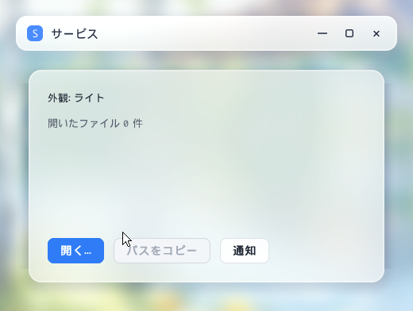
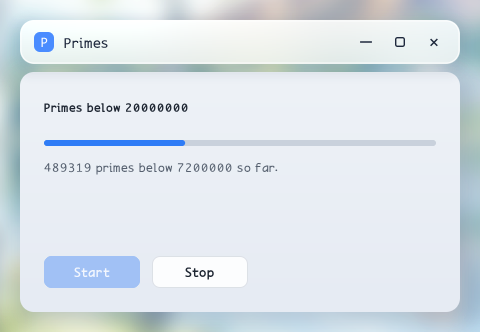
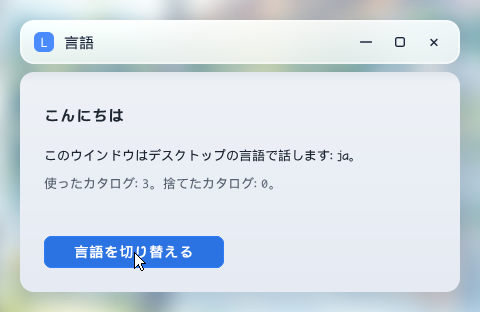
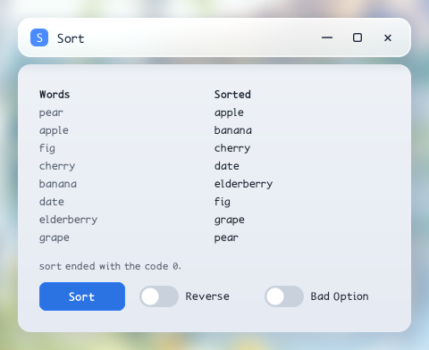
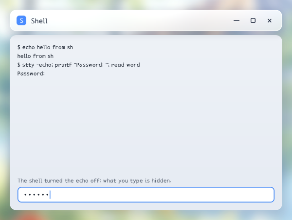
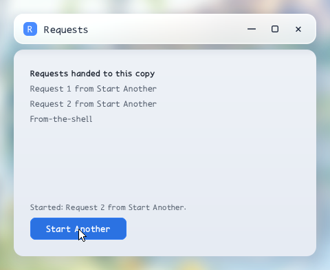

Programming a Keiland application
==================================

Status: how-to guide

This guide shows how to write a desktop application with libkeiland, the library that every Keiland program uses to draw, to read its input and to talk to the desktop. It teaches by programs. Each chapter is built on one complete program that compiles, links and runs. You read the program first, then a walk through it line by line, then the rules that the program showed.

The chapters go in the order a program is built; chapters 8 to 10 are what a program adds as it grows:

1. [The application](#1-the-application): the connection to the desktop and the event queue.
2. [The window](#2-the-window): a window, the pixels you draw into, and the input.
3. [The titlebar](#3-the-titlebar): controls that the desktop draws for you.
4. [The user interface and the main loop](#4-the-user-interface-and-the-main-loop): widgets, `kl_ui`, and how a program decides when to draw.
5. [The widgets](#5-the-widgets): fields, lists, switches, sliders, and widgets you make yourself.
6. [Menus](#6-menus): the window's menu and context menus.
7. [Other services](#7-other-services): glass, appearance, translations, files, the clipboard and notifications.
8. [Work on other threads](#8-work-on-other-threads): a worker thread that hands its results to the window, and a language whose catalogs are read on a thread.
9. [Other programs](#9-other-programs): a program the window talks to, and a shell in a terminal of its own.
10. [Running once and starting programs](#10-running-once-and-starting-programs): one copy of a program per user, and starting a program apart from the application.

## The programs

The programs are in [keiland-examples/](keiland-examples/). Each one grows out of an earlier one, so you can follow the changes from chapter to chapter.

| File | Chapter | What it shows | Grows out of |
| --- | --- | --- | --- |
| [01-app.c](keiland-examples/01-app.c) | 1 | Connect, post a notification, read the event queue for two seconds | - |
| [02-window.c](keiland-examples/02-window.c) | 2 | A window, a frame of pixels, a dot that follows the pointer | 01 |
| [03-titlebar.c](keiland-examples/03-titlebar.c) | 3 | Titlebar controls: Back, Forward and a search field | 02 |
| [04-counter.c](keiland-examples/04-counter.c) | 4 | `kl_ui` and three buttons: a counter | 02 |
| [04-counter-parts.c](keiland-examples/04-counter-parts.c) | 4 | The counter at the display's pace, drawing only what changed | 04 |
| [05-widgets.c](keiland-examples/05-widgets.c) | 5 | A field, a list, a switch, a slider and a widget of your own | 04 |
| [06-menu.c](keiland-examples/06-menu.c) | 6 | The counter with a window menu and a context menu | 04 |
| [07-services.c](keiland-examples/07-services.c) | 7 | Glass, appearance, translations, a file chooser, the clipboard, a notification | 04 |
| [08-worker.c](keiland-examples/08-worker.c) | 8 | Primes counted on a worker thread; its progress and its result posted to the window | 04 |
| [08-language.c](keiland-examples/08-language.c) | 8 | The desktop's language followed, its catalogs read on a thread; the latest change wins | 07 |
| [09-sort.c](keiland-examples/09-sort.c) | 9 | `sort` as a process: its input written, its output read by the line, its errors and exit code | 04 |
| [09-shell.c](keiland-examples/09-shell.c) | 9 | `sh` in a terminal of its own: its output as bytes, the terminal's size and modes | 05 (the field) |
| [10-instance.c](keiland-examples/10-instance.c) | 10 | One copy per user: later starts hand their requests over; Start Another launches it again | 04 |

The Japanese catalogs of `07-services.c` and `08-language.c` are in [keiland-examples/locale/ja/](keiland-examples/locale/ja/). Installed as `KEILAND_DATADIR/keiland/locale/ja/NAME.tr` (`/usr/share/keiland/locale/ja/` on zedBSD), they make those programs speak Japanese when the desktop does.

## How to read this guide

Run the chapter's program first, then read it with the guide. Every chapter has the same parts:

- A short description of what the program does, with a picture of it.
- The program, whole.
- **Reading the program**: a walk through the program in the order it runs. The line numbers are links to the lines in the program file, and the lines being discussed are quoted under the sentence.
- **The rules**: what the program showed, stated in general, with links back to the lines where you can see each rule at work. You can read this part alone and come back to the program when you need an example.
- **Pitfalls**, and a sentence that leads to the next chapter.

A chapter explains only what is new in it. For what an earlier chapter explained, it says "as in chapter N" and moves on.

The interface is the C headers under [userland/desktop/include/keiland/](../../userland/desktop/include/keiland/). `<keiland/keiland.h>` includes all of them. Each `keiland_*.h` holds one component (`kl_app`, `kl_window`, `kl_ui`, the widgets, and so on) and can be included alone. The header of a call is the authority for its exact behaviour. This guide explains how the parts fit together, and each chapter links the headers it uses.

## Prerequisites

- A C compiler and libkeiland: the zedBSD sysroot, or the Keiland build for Linux or FreeBSD (`userland/desktop/keiland-linux.mk`, `userland/desktop/keiland-freebsd.mk`).
- A running Keiland compositor to show the windows. The programs run inside a Keiland session, where `WAYLAND_DISPLAY` names the compositor's socket.
- A TrueType font for the text (chapters 4 to 7). Keiland installs its own as `keiland.ttf` and `keiland-fallback.ttf` in the desktop's font directory: `/usr/share/fonts` on zedBSD.

## Building and running a program

A program links with `-lkeiland`:

```sh
cc -o app 01-app.c -lkeiland
./app
```

The programs of chapters 4 to 7 open fonts. They look for them in `FONT_DIR`, which is `/usr/share/fonts` unless you define it. For a Linux build installed under `/opt/keiland`, define it when you compile:

```sh
cc -DFONT_DIR='"/opt/keiland/share/fonts"' -o counter 04-counter.c -lkeiland
```

Every libkeiland call of an application is made from the one thread that opened it. Two things are for the program's other threads: the posts, `kl_app_post` and `kl_window_post`, which hand work back to the application's thread (chapter 8), and `kl_tr_read`, which reads a language's catalogs (chapter 8).


The programs of chapter 8 use C11 threads (`<threads.h>`). zedBSD's C library holds them, and so does glibc from 2.34 (an older glibc needs `-lpthread`). FreeBSD keeps them in libstdthreads: add `-lstdthreads`. `10-instance.c` needs `XDG_RUNTIME_DIR` to be the user's own directory (mode 0700), as a Keiland session sets it.

## 1. The application

The first program connects to the desktop, posts a notification under the name `org.example.Hello`, listens to the desktop for two seconds, and ends. It opens no window. It exists to show the two things every Keiland program does first: it connects, and it reads the events the desktop sends.


*The notification the program posts.*

Build and run it as shown above. You see the notification; the program prints `hello: done` after two seconds.

<!-- example: keiland-examples/01-app.c -->
```c
/*
 * zedBSD
 * Copyright (C) 2026 Awe Morris
 *
 * SPDX-License-Identifier: Zlib
 */

/*
 * The smallest Keiland application: it connects to the desktop, posts a
 * notification, listens to the desktop for two seconds and disconnects.
 */

#include <keiland/keiland.h>
#include <errno.h>
#include <stdio.h>
#include <string.h>

/* How long the program listens to the desktop, in microseconds. */
#define LISTEN_US	2000000U

int
main(void)
{
	struct kl_app_options options;
	struct kl_app_event event;
	struct kl_app *app;
	uint64_t deadline;
	uint64_t now;
	int status;
	int taken;
	int wait;

	/* Connects to the desktop (the compositor WAYLAND_DISPLAY names) as org.example.Hello. */
	memset(&options, 0, sizeof(options));
	options.application = "org.example.Hello";
	app = kl_app_open(&options);
	if (app == NULL) {
		fprintf(stderr, "hello: no desktop (%s)\n", strerror(errno));
		return 1;
	}

	/* Shows that the program is there, under its application ID. */
	status = kl_app_notify(app, "Hello", "A Keiland application is running.");
	if (status != 0)
		fprintf(stderr, "hello: no notification (%s)\n", strerror(status));

	/* Listens until the deadline: waits for the desktop, then takes what it queued. */
	deadline = kl_clock_us() + LISTEN_US;
	for (;;) {
		/* Ends at the deadline. */
		now = kl_clock_us();
		if (now >= deadline)
			break;

		/* Waits for the desktop, at most until the deadline. */
		wait = (int)((deadline - now) / 1000U);
		status = kl_app_dispatch(app, wait);
		if (status != 0) {
			fprintf(stderr, "hello: the desktop went away\n");
			break;
		}

		/* Takes every event queued, oldest first. */
		for (;;) {
			taken = kl_app_take(app, &event);
			if (!taken)
				break;

			/* The desktop's appearance changed: light or dark, or the accent. */
			if (event.kind == KL_APP_THEME)
				printf("hello: the appearance changed\n");
		}
	}

	/* Disconnects. */
	kl_app_close(app);

	/* Succeeded: the program connected and listened. */
	printf("hello: done\n");
	return 0;
}
```

### Reading the program

**Connecting ([lines 33-40](keiland-examples/01-app.c#L33-L40)).** A program starts by connecting to the desktop. The options say which desktop and who you are.

```c
memset(&options, 0, sizeof(options));
options.application = "org.example.Hello";
app = kl_app_open(&options);
```

Fill in a zeroed `struct kl_app_options` and call `kl_app_open`. `display` names the **compositor** to connect to. The compositor is the desktop's program: it draws the windows on the screen and sends them the input. A `NULL` display, as here, means the one `WAYLAND_DISPLAY` names. `application` is the **application ID**: the name the desktop shows for the program and groups its windows by. Here it is `org.example.Hello`.

What you get back is a `struct kl_app`, an **application**: one connection to the compositor. A program has one. Everything else the program makes (windows, menus, titlebar controls, glass) goes through it.

[Lines 37-40](keiland-examples/01-app.c#L37-L40) handle failure. `kl_app_open` returns `NULL` and sets `errno`. `EOPNOTSUPP` means the program found no Keiland compositor. Other values mean the connection failed (`EPROTO` is a protocol error, `ENOMEM` is memory).

**The first visible effect ([lines 42-45](keiland-examples/01-app.c#L42-L45)).** `kl_app_notify` asks the desktop to show a notification under the program's application ID.

```c
status = kl_app_notify(app, "Hello", "A Keiland application is running.");
if (status != 0)
	fprintf(stderr, "hello: no notification (%s)\n", strerror(status));
```

It returns 0, or an `errno` value (`ENOTSUP` if the compositor shows no notifications). Chapter 7 covers notifications in full.

**Listening ([lines 47-73](keiland-examples/01-app.c#L47-L73)).** The rest of the program is the shape that every later main loop has: wait for the desktop, then take what it sent.

```c
/* Waits for the desktop, at most until the deadline. */
wait = (int)((deadline - now) / 1000U);
status = kl_app_dispatch(app, wait);
```

`kl_app_dispatch` is **dispatch**. It waits for the compositor for at most `timeout_ms` milliseconds, reads whatever arrived, and queues it. A timeout of `-1` waits for ever, and `0` does not wait at all. Dispatch does not wait while events are already queued, so a loop that does not take the queued events spins. Dispatch returns 0, or `-1` when the connection is lost ([lines 58-61](keiland-examples/01-app.c#L58-L61)). Here the timeout is the time that is left until the two seconds are over ([lines 48-56](keiland-examples/01-app.c#L48-L56)).

Dispatch only fills a queue. Reading the queue is **take**:

```c
/* Takes every event queued, oldest first. */
for (;;) {
	taken = kl_app_take(app, &event);
	if (!taken)
		break;
```

`kl_app_take` removes the oldest **event** from the **event queue** and returns 1 with it in the structure you pass. It returns 0 when the queue is empty. An event is a `struct kl_app_event`: a `kind`, and for some kinds more. The loop takes events until the queue is empty, then goes back to dispatch.

**The kinds of event ([lines 69-71](keiland-examples/01-app.c#L69-L71)).** This program knows one kind:

```c
/* The desktop's appearance changed: light or dark, or the accent. */
if (event.kind == KL_APP_THEME)
	printf("hello: the appearance changed\n");
```

`KL_APP_THEME` says that the desktop's appearance changed: light or dark, or the accent colour. The other kind, `KL_APP_WINDOW`, carries the input of one of the application's windows. It comes in chapter 2, when there is a window. A program without windows gets almost nothing, which is why this one only listens for a moment.

**Disconnecting ([lines 75-76](keiland-examples/01-app.c#L75-L76)).** `kl_app_close` closes the windows that are still open and the connection.

### The rules

- A program has one `struct kl_app`. Open it first, close it last. `kl_app_close` closes the windows that are still open, so the order of closing is forgiving, but the application must outlive everything made from it ([lines 34-36](keiland-examples/01-app.c#L34-L36), [75-76](keiland-examples/01-app.c#L75-L76)).
- Every libkeiland call of the application is made from the one thread that opened it, but `kl_app_post` and `kl_window_post`, which other threads call to hand the application an event of their own (chapter 8).
- Everything that happens to the program arrives through one queue, in the order it happened. A window's typed text and a menu's Ctrl+S therefore keep their order ([lines 63-72](keiland-examples/01-app.c#L63-L72)).
- The program reads the queue in two steps: `kl_app_dispatch` waits and queues, `kl_app_take` hands the events over one at a time. Take every queued event before you dispatch again ([lines 55-72](keiland-examples/01-app.c#L55-L72)).
- A held key repeats by itself inside `kl_app_dispatch`. The repeats are queued as key inputs with `repeated` set.
- An event's `kind` is one of:

  | Kind | Meaning |
  | --- | --- |
  | `KL_APP_WINDOW` | An input of one of the application's windows: `event.window` and `event.input` (chapter 2). |
  | `KL_APP_THEME` | The desktop's appearance changed (light or dark, the accent): draw every window again ([line 70](keiland-examples/01-app.c#L70)). |
| `KL_APP_LANGUAGE` | The desktop's language changed; `event.language` names the language it changed to (chapter 7). |
| `KL_APP_POST` | An event of the program's own: `event.code` and `event.data`, posted from any thread (chapter 8). |
| `KL_APP_PROCESS` | News of a process the program started: `event.process`, and `event.ready` says what (chapter 9). |
| `KL_APP_INSTANCE` | Later starts of the program handed it requests: `event.instance` (chapter 10). |

A program looks at `kind` first and ignores the kinds it does not use; `01-app.c` uses only `KL_APP_THEME`.

The component's header is [keiland_app.h](../../userland/desktop/include/keiland/keiland_app.h).

### Pitfalls

- Calling libkeiland from a second thread. The application belongs to the thread that opened it. Another thread hands the application its results with `kl_app_post` or `kl_window_post` (chapter 8).
- Dispatching again while the queue is not empty. Dispatch returns at once in that case, so a loop that forgets to take everything runs hot.
- Ignoring `kl_app_open`'s failure. A program started outside a Keiland session has no compositor to talk to.

This program has no window, so nothing fills the queue except the desktop's own news. Next: a window, whose input is what fills the queue.

## 2. The window

The second program opens a 480x320 window, paints the theme's ground colour in it, and draws a dot under the pointer. The close button ends it. It is chapter 1's program with a window, a frame and a real main loop.


*The window with the dot under the pointer.*

<!-- example: keiland-examples/02-window.c -->
```c
/*
 * zedBSD
 * Copyright (C) 2026 Awe Morris
 *
 * SPDX-License-Identifier: Zlib
 */

/*
 * A window that the program draws itself: the theme's ground, and a dot
 * that follows the pointer.  It ends when its window is closed.
 */

#include <keiland/keiland.h>
#include <errno.h>
#include <stdio.h>
#include <stdlib.h>
#include <string.h>

/* The dot's radius, in pixels. */
#define DOT_RADIUS	12.0f

/*
 * Everything the program keeps: its connection and window, the frame it
 * draws into, where the pointer is, and what the main loop has to do next.
 */
struct hello {
	struct kl_app *app;
	struct kl_window *window;
	struct kl_canvas canvas;
	uint32_t *pixels;
	uint32_t width;
	uint32_t height;
	double pointer_x;
	double pointer_y;
	int pointer_in;
	int dirty;
	int resized;
	int closed;
};

static int hello_resize(struct hello *hello);
static void hello_draw(struct hello *hello);
static int hello_frame(struct hello *hello);
static void hello_input(struct hello *hello, const struct kl_window_event *input);

int
main(void)
{
	static struct hello hello;
	struct kl_window_options window_options;
	struct kl_app_options app_options;
	struct kl_app_event event;
	int timeout;
	int status;
	int taken;

	/* Connects to the desktop. */
	memset(&app_options, 0, sizeof(app_options));
	app_options.application = "org.example.Window";
	hello.app = kl_app_open(&app_options);
	if (hello.app == NULL) {
		fprintf(stderr, "window: no desktop (%s)\n", strerror(errno));
		return 1;
	}

	/* Opens the window; it is configured when the call returns. */
	memset(&window_options, 0, sizeof(window_options));
	window_options.title = "Window";
	window_options.width = 480;
	window_options.height = 320;
	window_options.present = KL_PRESENT_VULKAN;
	hello.window = kl_app_window_create(hello.app, &window_options);
	if (hello.window == NULL) {
		fprintf(stderr, "window: no window (%s)\n", strerror(errno));
		return 1;
	}

	/* Makes the first frame at the size the compositor gave. */
	status = hello_resize(&hello);
	if (status != 0)
		return 1;

	/* Runs until the window is closed: waits, takes the events, draws when something changed. */
	while (!hello.closed) {
		/* Waits for the desktop; not at all while a frame is due. */
		timeout = -1;
		if (hello.dirty || hello.resized)
			timeout = 0;
		status = kl_app_dispatch(hello.app, timeout);
		if (status != 0)
			break;

		/* Takes every event queued, in order. */
		for (;;) {
			taken = kl_app_take(hello.app, &event);
			if (!taken)
				break;

			/* The appearance changed: the theme's colours are new. */
			if (event.kind == KL_APP_THEME)
				hello.dirty = 1;

			/* An input of the window. */
			if (event.kind == KL_APP_WINDOW && event.window == hello.window)
				hello_input(&hello, &event.input);
		}

		/* A new size: a new frame of that size. */
		if (hello.resized) {
			hello.resized = 0;
			status = hello_resize(&hello);
			if (status != 0)
				break;
		}

		/* Something changed: draws and shows a frame. */
		if (hello.dirty) {
			status = hello_frame(&hello);
			if (status != 0)
				break;
		}
	}

	/* Closes the window and the connection, and frees the frame. */
	kl_canvas_release(&hello.canvas);
	free(hello.pixels);
	kl_app_close(hello.app);

	/* Succeeded: the window was closed. */
	return 0;
}

/*
 * Makes the frame at the window's size; nonzero when it cannot.
 */
static int
hello_resize(
	struct hello *hello)
{
	uint32_t *pixels;
	int status;

	/* Sets the presenter to the window's size, which it reports. */
	status = kl_window_present_resize(hello->window, &hello->width, &hello->height);
	if (status != 0)
		return -1;

	/* Allocates the frame: one premultiplied 0xAARRGGBB word per pixel. */
	pixels = malloc((size_t)hello->width * hello->height * sizeof(pixels[0]));
	if (pixels == NULL)
		return -1;

	/* Puts the canvas on the new pixels in place of the old ones. */
	if (hello->pixels != NULL)
		kl_canvas_release(&hello->canvas);
	free(hello->pixels);
	hello->pixels = pixels;
	status = kl_canvas_init(&hello->canvas, hello->pixels, hello->width, (int)hello->width, (int)hello->height);
	if (status != 0)
		return -1;

	/* Succeeded: the new frame is drawn next. */
	hello->dirty = 1;
	return 0;
}

/*
 * Draws one frame: the ground, and the dot where the pointer is.
 */
static void
hello_draw(
	struct hello *hello)
{
	const struct kl_theme *theme;
	struct kl_rect whole;

	/* Paints the theme's ground over the whole frame. */
	theme = kl_theme_default();
	whole.x = 0;
	whole.y = 0;
	whole.width = (int)hello->width;
	whole.height = (int)hello->height;
	kl_canvas_gradient(&hello->canvas, &whole, theme->ground_top, theme->ground_bottom);

	/* Puts the dot under the pointer while the pointer is over the window. */
	if (hello->pointer_in)
		kl_canvas_circle(&hello->canvas, (float)hello->pointer_x, (float)hello->pointer_y, DOT_RADIUS, theme->accent);
}

/*
 * Draws and shows a frame; nonzero when it cannot be shown.
 */
static int
hello_frame(
	struct hello *hello)
{
	int status;

	/* Draws the frame and hands it to the compositor. */
	hello->dirty = 0;
	hello_draw(hello);
	status = kl_window_present(hello->window, hello->pixels, hello->width);

	/* The window's size changed under the frame: a new frame of the new size. */
	if (status == EAGAIN) {
		hello->resized = 1;
		return 0;
	}

	/* Refuses to go on when the frame could not be shown. */
	if (status != 0)
		return -1;

	/* Succeeded: the frame is shown. */
	return 0;
}

/*
 * Acts on one input of the window.
 */
static void
hello_input(
	struct hello *hello,
	const struct kl_window_event *input)
{
	/* Sorts the input by its kind. */
	switch (input->kind) {
	case KL_WINDOW_MOTION:
		/* The pointer moved: the dot follows it. */
		hello->pointer_x = input->x;
		hello->pointer_y = input->y;
		hello->pointer_in = 1;
		hello->dirty = 1;
		break;
	case KL_WINDOW_LEAVE:
		/* The pointer left the window: the dot goes. */
		hello->pointer_in = 0;
		hello->dirty = 1;
		break;
	case KL_WINDOW_RESIZE:
		/* The compositor gave a new size. */
		hello->resized = 1;
		break;
	case KL_WINDOW_CLOSE:
		/* The close button: the program ends. */
		hello->closed = 1;
		break;
	default:
		/* The keys, the fingers and the rest: not used here. */
		break;
	}
}
```

### Reading the program

**What the program keeps ([lines 22-39](keiland-examples/02-window.c#L22-L39)).** Everything lives in one structure. It has four kinds of member, and every later program keeps the same shape.

```c
struct hello {
	struct kl_app *app;
	struct kl_window *window;
	struct kl_canvas canvas;
	uint32_t *pixels;
	uint32_t width;
	uint32_t height;
	double pointer_x;
	double pointer_y;
	int pointer_in;
	int dirty;
	int resized;
	int closed;
};
```

- The desktop's objects: `app` and `window`.
- The **frame**: `pixels`, `width`, `height` and the `canvas` that draws into them. A frame is the picture of the whole window that the program makes and shows. More on it below.
- The state the picture shows: `pointer_x`, `pointer_y` and `pointer_in`. The picture is drawn from this state, never the other way round.
- What the main loop has to do next: `dirty` (a frame must be drawn), `resized` (the frame must be made again at a new size) and `closed` (the program must end).

**Opening the window ([lines 66-76](keiland-examples/02-window.c#L66-L76)).** Fill in a `struct kl_window_options` and call `kl_app_window_create`.

```c
memset(&window_options, 0, sizeof(window_options));
window_options.title = "Window";
window_options.width = 480;
window_options.height = 320;
window_options.present = KL_PRESENT_VULKAN;
hello.window = kl_app_window_create(hello.app, &window_options);
```

`title` is the window's title. `width` and `height` are the size you ask for, until the compositor gives the window a size of its own. The window is **configured** when the call returns: the compositor has already told it its size. `present` chooses how the frames reach the screen, the **presenter**:

- `KL_PRESENT_VULKAN` shows the frames you draw on the CPU through a Vulkan swapchain. It is see-through for the desktop's glass (chapter 7) when the swapchain is premultiplied.
- `KL_PRESENT_SHM` shows them through shared memory, which is always blended by its alpha, so it is see-through too. Use it for a small window, or where there is no Vulkan.
- `KL_PRESENT_NONE` leaves the surface to the program's own Vulkan.

**Making a frame ([lines 133-165](keiland-examples/02-window.c#L133-L165), `hello_resize`).** A **frame** is ordinary memory that the program owns: one 32-bit word per pixel, in the form premultiplied `0xAARRGGBB`, row after row. A **canvas** (`struct kl_canvas`) is the object you draw with: it knows the pixels, their width and the stride, and has calls that fill rectangles, circles and so on.

```c
status = kl_window_present_resize(hello->window, &hello->width, &hello->height);
/* ... */
pixels = malloc((size_t)hello->width * hello->height * sizeof(pixels[0]));
/* ... */
status = kl_canvas_init(&hello->canvas, hello->pixels, hello->width, (int)hello->width, (int)hello->height);
```

`kl_window_present_resize` makes the presenter match the window's size and reports that size. The program allocates that many words, then puts a canvas on them with `kl_canvas_init`. The stride, the distance between two rows, is counted in words, not bytes. Here it equals the width.

When the window changes size, the program makes a new frame. It releases the old canvas before it makes the new one ([lines 153-160](keiland-examples/02-window.c#L153-L160)): `kl_canvas_release` frees what the canvas allocated for itself, and the pixels stay the program's.

**Drawing ([lines 167-188](keiland-examples/02-window.c#L167-L188), `hello_draw`).** The function draws the whole picture from the state, every time.

```c
kl_canvas_gradient(&hello->canvas, &whole, theme->ground_top, theme->ground_bottom);
/* ... */
if (hello->pointer_in)
	kl_canvas_circle(&hello->canvas, (float)hello->pointer_x, (float)hello->pointer_y, DOT_RADIUS, theme->accent);
```

`kl_theme_default` gives the **theme**: the desktop's colours and sizes. They follow the light or dark appearance and the user's accent. `ground_top` and `ground_bottom` are the colours of the window's ground; `accent` is the accent colour. The function paints the ground, then draws the dot where the pointer is.

**Showing the frame ([lines 190-216](keiland-examples/02-window.c#L190-L216), `hello_frame`).** `kl_window_present` hands the frame to the compositor.

```c
status = kl_window_present(hello->window, hello->pixels, hello->width);
/* ... */
if (status == EAGAIN) {
	hello->resized = 1;
	return 0;
}
```

`EAGAIN` is not an error. It says that the window's size changed under the frame, so the presenter no longer matches. The program sets `resized`, and the main loop makes a new frame and draws again.

**The input ([lines 218-252](keiland-examples/02-window.c#L218-L252), `hello_input`).** The window's inputs arrive as events of kind `KL_APP_WINDOW`. The program's handler looks at `input->kind`.

```c
case KL_WINDOW_MOTION:
	/* The pointer moved: the dot follows it. */
	hello->pointer_x = input->x;
	hello->pointer_y = input->y;
	hello->pointer_in = 1;
	hello->dirty = 1;
	break;
```

A pointer motion stores the place in the state and sets `dirty`. `KL_WINDOW_LEAVE` says that the pointer left the window. `KL_WINDOW_RESIZE` says that the compositor gave a new size ([lines 240-243](keiland-examples/02-window.c#L240-L243)). `KL_WINDOW_CLOSE` says that the user pressed the close button ([lines 244-247](keiland-examples/02-window.c#L244-L247)). The handler never draws. It changes the state and sets a flag.

**The main loop ([lines 83-122](keiland-examples/02-window.c#L83-L122)).** The loop is chapter 1's loop with the window's work added.

```c
timeout = -1;
if (hello.dirty || hello.resized)
	timeout = 0;
status = kl_app_dispatch(hello.app, timeout);
```

The program waits for the desktop. It does not wait at all while a frame is due (`dirty`) or a new frame must be made (`resized`). Otherwise it waits for ever, since nothing needs doing until the desktop says so.

```c
if (event.kind == KL_APP_THEME)
	hello.dirty = 1;
/* ... */
if (event.kind == KL_APP_WINDOW && event.window == hello.window)
	hello_input(&hello, &event.input);
```

It takes every queued event. `KL_APP_THEME` marks the frame dirty, since the theme's colours are new. A `KL_APP_WINDOW` event for this window goes to `hello_input`.

```c
if (hello.resized) {
	hello.resized = 0;
	status = hello_resize(&hello);
	if (status != 0)
		break;
}
/* ... */
if (hello.dirty) {
	status = hello_frame(&hello);
```

Then it acts on the flags: first the new size, then one frame. Many inputs make one frame. A pointer that moves fifty times between two dispatches sets `dirty` fifty times and draws once. That is why drawing is not done in the input handler.

### The rules

- A frame is memory the program owns: premultiplied `0xAARRGGBB` words, with the stride counted in words ([lines 148-151](keiland-examples/02-window.c#L148-L151), [158](keiland-examples/02-window.c#L158)). Premultiplied means each colour channel is already multiplied by the alpha. An opaque pixel is unchanged by this.
- `kl_window_present` copies or shows the frame. It returns `EAGAIN` when the window's size has changed. Respond by making a new frame of the new size and drawing again ([lines 204-208](keiland-examples/02-window.c#L204-L208)).
- `KL_WINDOW_RESIZE` means: call `kl_window_present_resize` and make a new frame ([lines 240-243](keiland-examples/02-window.c#L240-L243), [108-114](keiland-examples/02-window.c#L108-L114)).
- `KL_WINDOW_CLOSE` is a request. The program decides what to do. This one ends; another might ask "Save changes?" ([lines 244-247](keiland-examples/02-window.c#L244-L247)).
- Coordinates in an input are in the surface's pixels. Times are `CLOCK_MONOTONIC` microseconds; `kl_clock_us()` reads that clock.
- The **main loop** is: wait, take every event, change the state, then draw once if something changed. The flags `dirty`, `resized` and `closed` are the pattern that every later program keeps ([lines 83-122](keiland-examples/02-window.c#L83-L122)).
- A window's input has these kinds. Each one has a chapter that uses it:

  | Kind | Meaning | Chapter |
  | --- | --- | --- |
  | `KL_WINDOW_MOTION`, `_LEAVE`, `_BUTTON`, `_AXIS` | The pointer, its buttons and the wheel | 2, 4, 6 |
  | `KL_WINDOW_KEY`, `_FOCUS` | The keys and the keyboard focus | 4, 5 |
  | `KL_WINDOW_TOUCH_*` | Fingers | 4 |
  | `KL_WINDOW_TEXT_*` | Text from an input method | 5 |
  | `KL_WINDOW_RESIZE`, `_CLOSE` | A new size, the close request | 2 |
  | `KL_WINDOW_ACTION` | An action chosen in the titlebar or a menu | 3, 6 |

The headers are [keiland_window.h](../../userland/desktop/include/keiland/keiland_window.h) and [keiland_canvas.h](../../userland/desktop/include/keiland/keiland_canvas.h).

### Pitfalls

- Drawing inside the input handler. Many inputs can arrive between two frames; draw once, after the queue is empty.
- Forgetting to release the old canvas when the frame is remade.
- Counting the stride in bytes. It is in words.
- Treating `EAGAIN` from `kl_window_present` as an error.

The window's titlebar is not drawn by the program at all. Next: how to describe it to the desktop.

## 3. The titlebar

The third program shows one colour at a time. Back and Forward in the titlebar step through five colours, the search field finds a colour by its name as you type, and the window's title is the colour's name. It is chapter 2's program with titlebar controls, and without the dot.


*After Forward was clicked twice: Sun is shown, its name is the title, and Back is enabled. At the first colour Back is disabled.*

<!-- example: keiland-examples/03-titlebar.c -->
```c
/*
 * zedBSD
 * Copyright (C) 2026 Awe Morris
 *
 * SPDX-License-Identifier: Zlib
 */

/*
 * A window with titlebar controls: it shows one colour at a time; Back and
 * Forward in the titlebar step through the colours, and the search field
 * finds one by its name.  The window's title is the colour's name.
 */

#include <keiland/keiland.h>
#include <ctype.h>
#include <errno.h>
#include <stdio.h>
#include <stdlib.h>
#include <string.h>

/* The titlebar's controls, by ID. */
#define ID_BACK		1U
#define ID_FORWARD	2U
#define ID_SEARCH	3U

/* The actions the controls queue when chosen. */
#define ACTION_BACK	1U
#define ACTION_FORWARD	2U
#define ACTION_SEARCH	3U

/* The radius of the dots that tell which colour is shown, and the room between them. */
#define DOT_RADIUS	6.0f
#define DOT_SPACING	24

/*
 * One colour the program shows: its name and its value.
 */
struct colour {
	const char *name;
	kl_color value;
};

/*
 * Everything the program keeps: its connection and window, the frame,
 * which colour is shown, and what the main loop has to do next.
 */
struct colours {
	struct kl_app *app;
	struct kl_window *window;
	struct kl_canvas canvas;
	uint32_t *pixels;
	uint32_t width;
	uint32_t height;
	size_t current;
	int dirty;
	int resized;
	int closed;
};

static int colours_resize(struct colours *colours);
static void colours_draw(struct colours *colours);
static int colours_frame(struct colours *colours);
static void colours_show(struct colours *colours);
static void colours_input(struct colours *colours, const struct kl_window_event *input);
static long colours_find(const char *text);

/*
 * The colours, in the order Back and Forward step through them.
 */
static const struct colour colour_table[] = {
	{ "Sky", KL_RGB(0x5ac8fa) },
	{ "Leaf", KL_RGB(0x34c759) },
	{ "Sun", KL_RGB(0xffcc00) },
	{ "Rose", KL_RGB(0xff2d55) },
	{ "Slate", KL_RGB(0x8e8e93) }
};

#define COLOUR_COUNT	(sizeof(colour_table) / sizeof(colour_table[0]))

/*
 * The titlebar's controls: what each is (its role), which give way first
 * when the titlebar is short of room (its priority), and the action it
 * queues.  The compositor decides how they look.
 */
static const struct kl_control_entry control_table[] = {
	/* id, role, priority, group, label, action */
	{ ID_BACK, KL_CONTROL_BACK, KL_PRIORITY_PRIMARY, 0U, "Back", ACTION_BACK },
	{ ID_FORWARD, KL_CONTROL_FORWARD, KL_PRIORITY_PRIMARY, 0U, "Forward", ACTION_FORWARD },
	{ ID_SEARCH, KL_CONTROL_SEARCH, KL_PRIORITY_NORMAL, 0U, "Find a colour", ACTION_SEARCH }
};

int
main(void)
{
	static struct colours colours;
	struct kl_window_options window_options;
	struct kl_app_options app_options;
	struct kl_app_event event;
	int timeout;
	int status;
	int taken;

	/* Connects to the desktop. */
	memset(&app_options, 0, sizeof(app_options));
	app_options.application = "org.example.Colours";
	colours.app = kl_app_open(&app_options);
	if (colours.app == NULL) {
		fprintf(stderr, "colours: no desktop (%s)\n", strerror(errno));
		return 1;
	}

	/* Opens the window. */
	memset(&window_options, 0, sizeof(window_options));
	window_options.title = colour_table[0].name;
	window_options.width = 480;
	window_options.height = 320;
	window_options.present = KL_PRESENT_VULKAN;
	colours.window = kl_app_window_create(colours.app, &window_options);
	if (colours.window == NULL) {
		fprintf(stderr, "colours: no window (%s)\n", strerror(errno));
		return 1;
	}

	/* Gives the titlebar its controls; a compositor without them leaves the title alone. */
	status = kl_window_set_controls(colours.window, control_table, sizeof(control_table) / sizeof(control_table[0]));
	if (status != 0)
		fprintf(stderr, "colours: no titlebar controls (%s)\n", strerror(status));

	/* Shows the search field's hint while it is empty. */
	if (status == 0)
		(void)kl_window_set_control_text(colours.window, ID_SEARCH, NULL, "Colour name");

	/* Sets the title and the state of Back and Forward for the first colour. */
	colours_show(&colours);

	/* Makes the first frame. */
	status = colours_resize(&colours);
	if (status != 0)
		return 1;

	/* Runs until the window is closed. */
	while (!colours.closed) {
		/* Waits for the desktop; not at all while a frame is due. */
		timeout = -1;
		if (colours.dirty || colours.resized)
			timeout = 0;
		status = kl_app_dispatch(colours.app, timeout);
		if (status != 0)
			break;

		/* Takes every event queued, in order. */
		for (;;) {
			taken = kl_app_take(colours.app, &event);
			if (!taken)
				break;

			/* The appearance changed: the dots' colours are the theme's. */
			if (event.kind == KL_APP_THEME)
				colours.dirty = 1;

			/* An input of the window, the titlebar's among them. */
			if (event.kind == KL_APP_WINDOW && event.window == colours.window)
				colours_input(&colours, &event.input);
		}

		/* A new size: a new frame of that size. */
		if (colours.resized) {
			colours.resized = 0;
			status = colours_resize(&colours);
			if (status != 0)
				break;
		}

		/* Something changed: draws and shows a frame. */
		if (colours.dirty) {
			status = colours_frame(&colours);
			if (status != 0)
				break;
		}
	}

	/* Closes the window and the connection, and frees the frame. */
	kl_canvas_release(&colours.canvas);
	free(colours.pixels);
	kl_app_close(colours.app);

	/* Succeeded: the window was closed. */
	return 0;
}

/*
 * Makes the frame at the window's size; nonzero when it cannot.
 */
static int
colours_resize(
	struct colours *colours)
{
	uint32_t *pixels;
	int status;

	/* Sets the presenter to the window's size, which it reports. */
	status = kl_window_present_resize(colours->window, &colours->width, &colours->height);
	if (status != 0)
		return -1;

	/* Allocates the frame. */
	pixels = malloc((size_t)colours->width * colours->height * sizeof(pixels[0]));
	if (pixels == NULL)
		return -1;

	/* Puts the canvas on the new pixels in place of the old ones. */
	if (colours->pixels != NULL)
		kl_canvas_release(&colours->canvas);
	free(colours->pixels);
	colours->pixels = pixels;
	status = kl_canvas_init(&colours->canvas, colours->pixels, colours->width, (int)colours->width, (int)colours->height);
	if (status != 0)
		return -1;

	/* Succeeded: the new frame is drawn next. */
	colours->dirty = 1;
	return 0;
}

/*
 * Draws one frame: the colour shown, and a row of dots that tells which
 * of the colours it is.
 */
static void
colours_draw(
	struct colours *colours)
{
	const struct kl_theme *theme;
	struct kl_rect whole;
	size_t index;
	float x;
	float y;

	/* Paints the colour shown over the whole frame. */
	theme = kl_theme_default();
	whole.x = 0;
	whole.y = 0;
	whole.width = (int)colours->width;
	whole.height = (int)colours->height;
	kl_canvas_fill(&colours->canvas, &whole, colour_table[colours->current].value);

	/* Draws one dot per colour along the bottom, the one shown filled. */
	x = (float)colours->width / 2.0f - (float)(DOT_SPACING * (int)(COLOUR_COUNT - 1U)) / 2.0f;
	y = (float)colours->height - 32.0f;
	for (index = 0; index < COLOUR_COUNT; index++) {
		if (index == colours->current) {
			kl_canvas_circle(&colours->canvas, x, y, DOT_RADIUS, theme->panel);
		} else {
			kl_canvas_ring(&colours->canvas, x, y, DOT_RADIUS, 2.0f, 1.0f, theme->panel);
		}

		/* Moves on to the next dot. */
		x += (float)DOT_SPACING;
	}
}

/*
 * Draws and shows a frame; nonzero when it cannot be shown.
 */
static int
colours_frame(
	struct colours *colours)
{
	int status;

	/* Draws the frame and hands it to the compositor. */
	colours->dirty = 0;
	colours_draw(colours);
	status = kl_window_present(colours->window, colours->pixels, colours->width);

	/* The window's size changed under the frame: a new frame of the new size. */
	if (status == EAGAIN) {
		colours->resized = 1;
		return 0;
	}

	/* Refuses to go on when the frame could not be shown. */
	if (status != 0)
		return -1;

	/* Succeeded: the frame is shown. */
	return 0;
}

/*
 * Tells the titlebar about the colour now shown: its name as the title,
 * Back disabled at the first colour, Forward disabled at the last.
 */
static void
colours_show(
	struct colours *colours)
{
	unsigned back;
	unsigned forward;

	/* Names the window after the colour. */
	kl_window_set_title(colours->window, colour_table[colours->current].name);

	/* Disables the steps that lead nowhere. */
	back = 0U;
	forward = 0U;
	if (colours->current == 0U)
		back = KL_ACTION_DISABLED;
	if (colours->current + 1U == COLOUR_COUNT)
		forward = KL_ACTION_DISABLED;
	(void)kl_window_set_action_state(colours->window, ACTION_BACK, back);
	(void)kl_window_set_action_state(colours->window, ACTION_FORWARD, forward);

	/* The frame shows the new colour. */
	colours->dirty = 1;
}

/*
 * Acts on one input of the window.
 */
static void
colours_input(
	struct colours *colours,
	const struct kl_window_event *input)
{
	long found;

	/* Sorts the input by its kind. */
	switch (input->kind) {
	case KL_WINDOW_ACTION:
		/* A control was chosen: its action is in code. */
		if (input->code == ACTION_BACK && colours->current > 0U) {
			colours->current--;
			colours_show(colours);
		} else if (input->code == ACTION_FORWARD && colours->current + 1U < COLOUR_COUNT) {
			colours->current++;
			colours_show(colours);
		}

		break;
	case KL_WINDOW_CONTROL_TEXT:
		/* The search field's text as it is typed: the first colour it names. */
		found = colours_find(input->text);
		if (found >= 0 && (size_t)found != colours->current) {
			colours->current = (size_t)found;
			colours_show(colours);
		}

		break;
	case KL_WINDOW_CONTROL_DONE:
		/* The search ended (Enter, Escape or elsewhere): the field is emptied for the next one. */
		(void)kl_window_set_control_text(colours->window, ID_SEARCH, "", NULL);
		break;
	case KL_WINDOW_RESIZE:
		/* The compositor gave a new size. */
		colours->resized = 1;
		break;
	case KL_WINDOW_CLOSE:
		/* The close button: the program ends. */
		colours->closed = 1;
		break;
	default:
		/* The pointer, the keys and the rest: not used here. */
		break;
	}
}

/*
 * Finds the first colour whose name starts with a text, ignoring case;
 * -1 for none (and for an empty text).
 */
static long
colours_find(
	const char *text)
{
	size_t length;
	size_t index;
	size_t at;
	int name_letter;
	int text_letter;
	int same;

	/* An empty search names no colour. */
	length = strlen(text);
	if (length == 0U)
		return -1;

	/* Compares the text with the start of each name. */
	for (index = 0; index < COLOUR_COUNT; index++) {
		same = 1;
		for (at = 0; at < length; at++) {
			name_letter = tolower((unsigned char)colour_table[index].name[at]);
			text_letter = tolower((unsigned char)text[at]);
			if (colour_table[index].name[at] == '\0' || name_letter != text_letter) {
				same = 0;
				break;
			}
		}

		/* Answers with the first colour whose name the text starts. */
		if (same)
			return (long)index;
	}

	/* No colour has such a name. */
	return -1;
}
```

### Reading the program

**Two numberings ([lines 21-29](keiland-examples/03-titlebar.c#L21-L29)).** The program numbers its controls and, separately, its actions.

```c
#define ID_BACK		1U
#define ID_FORWARD	2U
#define ID_SEARCH	3U
/* ... */
#define ACTION_BACK	1U
#define ACTION_FORWARD	2U
#define ACTION_SEARCH	3U
```

A control's ID says which control it is. An **action** says what the program is asked to do. Here they happen to be equal. They are separate because one action can have several sources: chapter 6 shows menu items, buttons and keys that ask for the same action.

**The table of controls ([lines 80-90](keiland-examples/03-titlebar.c#L80-L90)).** The **titlebar presentation** is what the desktop draws in a window's titlebar. There are three: the window's **menu** (the default, chapter 6), **controls**, and **tabs**. The program picks controls here by giving a table.

```c
static const struct kl_control_entry control_table[] = {
	/* id, role, priority, group, label, action */
	{ ID_BACK, KL_CONTROL_BACK, KL_PRIORITY_PRIMARY, 0U, "Back", ACTION_BACK },
	{ ID_FORWARD, KL_CONTROL_FORWARD, KL_PRIORITY_PRIMARY, 0U, "Forward", ACTION_FORWARD },
	{ ID_SEARCH, KL_CONTROL_SEARCH, KL_PRIORITY_NORMAL, 0U, "Find a colour", ACTION_SEARCH }
};
```

Each row of `struct kl_control_entry` has:

- `id`: names the **control**. It is not 0 and is unique in the table.
- `role` (`KL_CONTROL_*`): what the control is. The **role** decides how the compositor draws it: a back arrow, a search field, a breadcrumb.
- `priority` (`KL_PRIORITY_PRIMARY`, `_NORMAL`, `_SECONDARY`): the order in which controls give way when the titlebar is too short.
- `group`: joins segmented controls, such as a pair of view switches. 0 means none.
- `label`: the text for the control.
- `action`: the action the control queues when it is chosen.

**Giving the table ([lines 124-131](keiland-examples/03-titlebar.c#L124-L131)).** `kl_window_set_controls` gives the whole table at once.

```c
status = kl_window_set_controls(colours.window, control_table, sizeof(control_table) / sizeof(control_table[0]));
if (status != 0)
	fprintf(stderr, "colours: no titlebar controls (%s)\n", strerror(status));
/* ... */
if (status == 0)
	(void)kl_window_set_control_text(colours.window, ID_SEARCH, NULL, "Colour name");
```

A compositor without the titlebar presentation returns `ENOTSUP`. The window still works; it keeps only its title. After the table is given, `kl_window_set_control_text` sets the search field's placeholder, the hint shown while it is empty.

**Describing the state ([lines 290-316](keiland-examples/03-titlebar.c#L290-L316), `colours_show`).** After every change, the program tells the desktop what the titlebar must now look like.

```c
kl_window_set_title(colours->window, colour_table[colours->current].name);
/* ... */
if (colours->current == 0U)
	back = KL_ACTION_DISABLED;
if (colours->current + 1U == COLOUR_COUNT)
	forward = KL_ACTION_DISABLED;
(void)kl_window_set_action_state(colours->window, ACTION_BACK, back);
(void)kl_window_set_action_state(colours->window, ACTION_FORWARD, forward);
```

It sets the title and the **action state** of Back and Forward. An action state is a set of bits: `KL_ACTION_DISABLED`, `KL_ACTION_CHECKED`, `KL_ACTION_HIDDEN`. 0 means enabled, unchecked and shown. The state applies to every control and menu item of that action. Back is disabled at the first colour and Forward at the last.

Compare this with chapter 2. There the program drew the picture. Here the program does not draw the titlebar. It describes it, and the compositor draws it.

**The titlebar's inputs ([lines 318-366](keiland-examples/03-titlebar.c#L318-L366), `colours_input`).** Choosing a control queues an input in the same queue as every other input.

```c
case KL_WINDOW_ACTION:
	/* A control was chosen: its action is in code. */
	if (input->code == ACTION_BACK && colours->current > 0U) {
		colours->current--;
		colours_show(colours);
	} else if (input->code == ACTION_FORWARD && colours->current + 1U < COLOUR_COUNT) {
		colours->current++;
		colours_show(colours);
	}
```

`KL_WINDOW_ACTION` brings the action in `input.code`, and the control's ID in `input.id`. The program changes the current colour and calls `colours_show` again.

The search field brings two more inputs:

```c
case KL_WINDOW_CONTROL_TEXT:
	/* The search field's text as it is typed: the first colour it names. */
	found = colours_find(input->text);
/* ... */
case KL_WINDOW_CONTROL_DONE:
	/* The search ended (Enter, Escape or elsewhere): the field is emptied for the next one. */
	(void)kl_window_set_control_text(colours->window, ID_SEARCH, "", NULL);
```

`KL_WINDOW_CONTROL_TEXT` carries the text as it is typed, in `input.text`. `KL_WINDOW_CONTROL_DONE` says that editing ended. How it ended is in `input.code`: `KL_TEXT_SUBMITTED` and the other `KL_TEXT_*` values. This program clears the field for the next search.

### The rules

- The titlebar is **declarative and retained**. Declarative: the program says what the titlebar is, not how to draw it. Retained: the compositor keeps what the program gave until the program gives something else. The program gives the whole table whenever something changes. The library compares it with what is shown and sends only the difference ([lines 124-131](keiland-examples/03-titlebar.c#L124-L131), [290-316](keiland-examples/03-titlebar.c#L290-L316)).
- An action is the program's request, a control is one way to make it ([lines 26-29](keiland-examples/03-titlebar.c#L26-L29), [85-90](keiland-examples/03-titlebar.c#L85-L90)).
- An action state applies to every control and menu item of its action ([lines 305-312](keiland-examples/03-titlebar.c#L305-L312)).
- There are three presentations: the menu (the default), controls and tabs. A count of 0 in `kl_window_set_controls` gives the titlebar back to the menu.
- Tabs: `kl_window_set_tabs` shows a table of `struct kl_tab_entry` (an ID, a title and `KL_TAB_*` flags). A tab chosen, closed or asked for comes as `KL_WINDOW_TAB`, with `KL_WINDOW_TAB_*` in `code` and the tab's ID in `id`. This guide has no example for tabs.
- The compositor decides how everything looks. The program picks roles and priorities, not pixels.

The headers are [keiland_titlebar.h](../../userland/desktop/include/keiland/keiland_titlebar.h) and the declarative calls in [keiland_window.h](../../userland/desktop/include/keiland/keiland_window.h).

### Pitfalls

- Expecting the compositor to disable Back by itself. It does not. Set the action state ([lines 305-312](keiland-examples/03-titlebar.c#L305-L312)).
- Using the same ID for two controls.
- Treating `ENOTSUP` as fatal. The window works without a titlebar presentation.

The titlebar was declarative. The window's own content is the opposite: in the next chapter the program calls a function for every widget in every frame, and the library keeps no copy.

## 4. The user interface and the main loop

The fourth program is a counter: a number, and three buttons under it. Less takes one off, More adds one, and Reset sets it back to 0 and is disabled while the number is 0. The Up and Down keys change the number too.

It is chapter 2's program with three additions: a `struct kl_ui`, a font, and a `struct kl_style`. It also calls `kl_button` three times. Everything else is the same loop. This is the first chapter with widgets, so it explains more than the others.


*After Up was pressed three times and More was clicked once: the number is 4, Reset is enabled, and More is lit because the pointer is over it.*

<!-- example: keiland-examples/04-counter.c -->
```c
/*
 * zedBSD
 * Copyright (C) 2026 Awe Morris
 *
 * SPDX-License-Identifier: Zlib
 */

/*
 * A counter: a window with a number and three buttons, Less, Reset and
 * More.  The Up and Down keys change the number too.  The widgets are
 * Keiland's immediate mode widgets: each is one call in the frame.
 */

#include <keiland/keiland.h>
#include <errno.h>
#include <stdio.h>
#include <stdlib.h>
#include <string.h>

/* Where the desktop's fonts are (/opt/keiland/share/fonts for a Linux build under /opt/keiland). */
#ifndef FONT_DIR
#define FONT_DIR	"/usr/share/fonts"
#endif
#define FONT		FONT_DIR "/keiland.ttf"
#define FALLBACK_FONT	FONT_DIR "/keiland-fallback.ttf"

/* The widgets' ids: a number per widget, unique in the window, the same in every frame. */
#define ID_LESS		1U
#define ID_RESET	2U
#define ID_MORE		3U

/* The buttons' width and the room around them, in pixels. */
#define BUTTON_WIDTH	96
#define MARGIN		24

/*
 * Everything the program keeps: its connection and window, the widgets'
 * record (ui), the font, the frame, the state the widgets show (count),
 * and what the main loop has to do next.
 */
struct counter {
	struct kl_app *app;
	struct kl_window *window;
	struct kl_ui *ui;
	struct kl_text text;
	struct kl_style style;
	struct kl_canvas canvas;
	uint32_t *pixels;
	uint32_t width;
	uint32_t height;
	int count;
	int dirty;
	int moving;
	int resized;
	int closed;
};

static int counter_resize(struct counter *counter);
static void counter_draw(struct counter *counter, uint64_t now_us);
static int counter_frame(struct counter *counter);
static void counter_input(struct counter *counter, const struct kl_window_event *input);
static void counter_unclaimed(struct counter *counter);

int
main(void)
{
	static struct counter counter;
	struct kl_window_options window_options;
	struct kl_app_options app_options;
	struct kl_app_event event;
	int timeout;
	int status;
	int taken;

	/* Connects to the desktop. */
	memset(&app_options, 0, sizeof(app_options));
	app_options.application = "org.example.Counter";
	counter.app = kl_app_open(&app_options);
	if (counter.app == NULL) {
		fprintf(stderr, "counter: no desktop (%s)\n", strerror(errno));
		return 1;
	}

	/* Opens the window. */
	memset(&window_options, 0, sizeof(window_options));
	window_options.title = "Counter";
	window_options.width = 400;
	window_options.height = 240;
	window_options.present = KL_PRESENT_VULKAN;
	counter.window = kl_app_window_create(counter.app, &window_options);
	if (counter.window == NULL) {
		fprintf(stderr, "counter: no window (%s)\n", strerror(errno));
		return 1;
	}

	/* Makes the widgets' record of the window. */
	counter.ui = kl_ui_create();
	if (counter.ui == NULL)
		return 1;

	/* Opens the font the widgets and the number are drawn in. */
	status = kl_text_open(&counter.text, FONT, FALLBACK_FONT);
	if (status != 0) {
		fprintf(stderr, "counter: no font %s (%s)\n", FONT, strerror(status));
		return 1;
	}

	/* Sets what every widget draws with: the frame's canvas (set by counter_resize), the font, no glass. */
	counter.style.text = &counter.text;
	counter.style.glass = 0;

	/* Makes the first frame. */
	status = counter_resize(&counter);
	if (status != 0)
		return 1;

	/* Runs until the window is closed: waits, gives each input to the widgets, draws when due. */
	while (!counter.closed) {
		/* Waits for the desktop: not at all while a frame is due, a frame's time while something moves. */
		timeout = -1;
		if (counter.moving)
			timeout = 16;
		if (counter.dirty || counter.resized)
			timeout = 0;
		status = kl_app_dispatch(counter.app, timeout);
		if (status != 0)
			break;

		/* Takes every event queued, in order. */
		for (;;) {
			taken = kl_app_take(counter.app, &event);
			if (!taken)
				break;

			/* The appearance changed: the theme's colours are new. */
			if (event.kind == KL_APP_THEME)
				counter.dirty = 1;

			/* An input of the window. */
			if (event.kind == KL_APP_WINDOW && event.window == counter.window)
				counter_input(&counter, &event.input);
		}

		/* A new size: a new frame of that size. */
		if (counter.resized) {
			counter.resized = 0;
			status = counter_resize(&counter);
			if (status != 0)
				break;
		}

		/* Something changed or moves: draws and shows a frame. */
		if (counter.dirty || counter.moving) {
			status = counter_frame(&counter);
			if (status != 0)
				break;
		}
	}

	/* Frees the widgets' record, the frame and the font, and closes the window and the connection. */
	kl_ui_destroy(counter.ui);
	kl_canvas_release(&counter.canvas);
	free(counter.pixels);
	kl_text_close(&counter.text);
	kl_app_close(counter.app);

	/* Succeeded: the window was closed. */
	return 0;
}

/*
 * Makes the frame at the window's size; nonzero when it cannot.
 */
static int
counter_resize(
	struct counter *counter)
{
	uint32_t *pixels;
	int status;

	/* Sets the presenter to the window's size, which it reports. */
	status = kl_window_present_resize(counter->window, &counter->width, &counter->height);
	if (status != 0)
		return -1;

	/* Allocates the frame. */
	pixels = malloc((size_t)counter->width * counter->height * sizeof(pixels[0]));
	if (pixels == NULL)
		return -1;

	/* Puts the canvas on the new pixels in place of the old ones; the widgets draw on it. */
	if (counter->pixels != NULL)
		kl_canvas_release(&counter->canvas);
	free(counter->pixels);
	counter->pixels = pixels;
	status = kl_canvas_init(&counter->canvas, counter->pixels, counter->width, (int)counter->width, (int)counter->height);
	if (status != 0)
		return -1;
	counter->style.canvas = &counter->canvas;

	/* Succeeded: the new frame is drawn next. */
	counter->dirty = 1;
	return 0;
}

/*
 * Draws one frame: the ground, the number and the three buttons.  Each
 * button's call draws it, records where it is for the input to come, and
 * reports a click the input made on it since the last frame.
 */
static void
counter_draw(
	struct counter *counter,
	uint64_t now_us)
{
	const struct kl_theme *theme;
	struct kl_rect whole;
	struct kl_rect less;
	struct kl_rect reset;
	struct kl_rect more;
	unsigned reset_flags;
	char number[32];
	int baseline;
	int clicked;

	/* Starts the frame: the records of the last one are what the input was matched against. */
	theme = kl_theme_default();
	counter->style.theme = theme;
	kl_ui_begin(counter->ui, now_us);

	/* Paints the ground. */
	whole.x = 0;
	whole.y = 0;
	whole.width = (int)counter->width;
	whole.height = (int)counter->height;
	kl_canvas_gradient(&counter->canvas, &whole, theme->ground_top, theme->ground_bottom);

	/* Draws the number as it is now. */
	snprintf(number, sizeof(number), "%d", counter->count);
	baseline = kl_text_center(theme->text_title, MARGIN, 64);
	(void)kl_text_draw(&counter->text, &counter->canvas, MARGIN, baseline, number, strlen(number), theme->text_title, 1, theme->text);

	/* Lays out the three buttons in a row under it. */
	less.x = MARGIN;
	less.y = MARGIN + 80;
	less.width = BUTTON_WIDTH;
	less.height = theme->control_height;
	reset = less;
	reset.x = less.x + BUTTON_WIDTH + 12;
	more = reset;
	more.x = reset.x + BUTTON_WIDTH + 12;

	/* Less: one less. */
	clicked = kl_button(counter->ui, &counter->style, ID_LESS, &less, "Less", 0U);
	if (clicked) {
		counter->count--;
		counter->dirty = 1;
	}

	/* Reset: back to 0; disabled while the number is 0 already. */
	reset_flags = 0U;
	if (counter->count == 0)
		reset_flags = KL_BUTTON_DISABLED;
	clicked = kl_button(counter->ui, &counter->style, ID_RESET, &reset, "Reset", reset_flags);
	if (clicked) {
		counter->count = 0;
		counter->dirty = 1;
	}

	/* More: one more, the window's main action. */
	clicked = kl_button(counter->ui, &counter->style, ID_MORE, &more, "More", KL_BUTTON_PRIMARY);
	if (clicked) {
		counter->count++;
		counter->dirty = 1;
	}

	/* Ends the frame: nonzero while it needs more frames by itself (a finger down, keys waiting, a scroll gliding). */
	counter->moving = kl_ui_end(counter->ui, now_us);

	/* Lets the input method and the clipboard follow the focused widget (none takes text here). */
	kl_ui_window_text(counter->ui, counter->window);
}

/*
 * Draws and shows a frame, then takes the input no widget took; nonzero
 * when the frame cannot be shown.
 */
static int
counter_frame(
	struct counter *counter)
{
	int status;

	/* Draws the frame; a click it reports asks for one more (dirty again). */
	counter->dirty = 0;
	counter_draw(counter, kl_clock_us());

	/* Hands it to the compositor. */
	status = kl_window_present(counter->window, counter->pixels, counter->width);
	if (status == EAGAIN) {
		/* The window's size changed under the frame: a new frame of the new size. */
		counter->resized = 1;
	} else if (status != 0) {
		/* Refuses to go on when the frame could not be shown. */
		return -1;
	}

	/* Takes the keys and the presses that met no widget. */
	counter_unclaimed(counter);

	/* Succeeded: the frame is shown. */
	return 0;
}

/*
 * Gives one input of the window to the widgets, or acts on it.
 */
static void
counter_input(
	struct counter *counter,
	const struct kl_window_event *input)
{
	int taken;

	/* The window's own inputs: a new size, the close button. */
	if (input->kind == KL_WINDOW_RESIZE) {
		counter->resized = 1;
		return;
	}

	/* The close button ends the program. */
	if (input->kind == KL_WINDOW_CLOSE) {
		counter->closed = 1;
		return;
	}

	/* The pointer, the keys and the fingers: the widgets' input, resolved against the frame last drawn. */
	taken = kl_ui_window_input(counter->ui, input);
	if (taken)
		counter->dirty = 1;
}

/*
 * Acts on the input no widget took: Up and Down change the number.
 */
static void
counter_unclaimed(
	struct counter *counter)
{
	struct kl_event event;
	int taken;

	/* Takes each input the frame left for the program. */
	for (;;) {
		taken = kl_ui_take(counter->ui, &event);
		if (!taken)
			break;

		/* Only keys are used here; presses on the ground are left alone. */
		if (event.kind != KL_EVENT_KEY)
			continue;

		/* Up is More, Down is Less. */
		if (event.code == KL_KEY_UP) {
			counter->count++;
			counter->dirty = 1;
		} else if (event.code == KL_KEY_DOWN) {
			counter->count--;
			counter->dirty = 1;
		}
	}
}
```

### Reading the program

First the setup, then one frame, then one click followed through several frames.

#### Setup

**The widgets' IDs ([lines 27-30](keiland-examples/04-counter.c#L27-L30)).**

```c
#define ID_LESS		1U
#define ID_RESET	2U
#define ID_MORE		3U
```

The program picks a number for every widget. The number must be unique in the window, and the same widget must have the same number in every frame. The library uses it to tell, on the next input, which widget the input meant.

**What the program keeps ([lines 36-56](keiland-examples/04-counter.c#L36-L56)).** The structure is chapter 2's, with three new members: `ui`, `text` and `style`. `count` is the state that the widgets show.

```c
struct kl_ui *ui;
struct kl_text text;
struct kl_style style;
/* ... */
int count;
```

There is no button anywhere in this structure, and there is none anywhere else in the program. A button is not an object that the program makes and keeps. Keep this in mind for the rest of the chapter.

**Creating the pieces ([lines 96-110](keiland-examples/04-counter.c#L96-L110)).**

```c
counter.ui = kl_ui_create();
/* ... */
status = kl_text_open(&counter.text, FONT, FALLBACK_FONT);
/* ... */
counter.style.text = &counter.text;
counter.style.glass = 0;
```

- `kl_ui_create` makes the `struct kl_ui`. This is the library's record of one window's widgets: where each was drawn in the last frame, which one is lit by the pointer, which one has the keyboard. The program makes one per window and destroys it with `kl_ui_destroy` at the end ([line 161](keiland-examples/04-counter.c#L161)).
- `kl_text_open` opens the font and a fallback font for characters the first one lacks. `FONT` and `FALLBACK_FONT` are built from `FONT_DIR`, which is the directory you define for a Linux build (see "Building and running a program").
- The **style** (`struct kl_style`) is what every widget draws with: the canvas, the text, the theme and whether the window stands on glass. The canvas is set by `counter_resize` ([line 199](keiland-examples/04-counter.c#L199)), since it changes whenever the frame is remade. The theme is set at the start of each frame ([line 228](keiland-examples/04-counter.c#L228)). Glass is chapter 7's; here it is 0.

#### One frame ([lines 206-282](keiland-examples/04-counter.c#L206-L282), `counter_draw`)

The function draws one frame, in the order it runs.

**Beginning ([lines 226-229](keiland-examples/04-counter.c#L226-L229)).**

```c
theme = kl_theme_default();
counter->style.theme = theme;
kl_ui_begin(counter->ui, now_us);
```

`kl_ui_begin` starts a frame of the widgets. This is a second sense of the word "frame", and the chapter returns to it below. Between `kl_ui_begin` and `kl_ui_end`, every widget the program calls is part of this frame.

**The program's own drawing ([lines 231-241](keiland-examples/04-counter.c#L231-L241)).** The ground and the number are ordinary canvas and text drawing. They sit between the widgets' calls as plain drawing does; the library does not need to know about them.

```c
kl_canvas_gradient(&counter->canvas, &whole, theme->ground_top, theme->ground_bottom);
/* ... */
snprintf(number, sizeof(number), "%d", counter->count);
baseline = kl_text_center(theme->text_title, MARGIN, 64);
(void)kl_text_draw(&counter->text, &counter->canvas, MARGIN, baseline, number, strlen(number), theme->text_title, 1, theme->text);
```

**Layout ([lines 243-251](keiland-examples/04-counter.c#L243-L251)).** There is no layout object. The three buttons' places are `struct kl_rect` values that the program computes by arithmetic.

```c
less.x = MARGIN;
less.y = MARGIN + 80;
less.width = BUTTON_WIDTH;
less.height = theme->control_height;
/* ... */
more = reset;
more.x = reset.x + BUTTON_WIDTH + 12;
```

**The widgets ([lines 253-275](keiland-examples/04-counter.c#L253-L275)).** Each `kl_button` call does three things at once. It draws the button in this frame. It records the button's rectangle under its ID, so that input can be matched with it. And it returns 1 when the input since the last frame clicked it.

```c
clicked = kl_button(counter->ui, &counter->style, ID_MORE, &more, "More", KL_BUTTON_PRIMARY);
if (clicked) {
	counter->count++;
	counter->dirty = 1;
}
```

The program acts on the click right there: it changes `count` and sets `dirty`.

Look at Reset ([lines 260-268](keiland-examples/04-counter.c#L260-L268)):

```c
reset_flags = 0U;
if (counter->count == 0)
	reset_flags = KL_BUTTON_DISABLED;
clicked = kl_button(counter->ui, &counter->style, ID_RESET, &reset, "Reset", reset_flags);
```

Its flags are worked out from the state in every frame: `KL_BUTTON_DISABLED` while `count` is 0. To show a different button, the program calls the function with different arguments. That is **immediate mode**: a **widget** is a function that the program calls while it draws a frame, in every frame the widget is shown. Nothing was made before, and nothing is destroyed after.

**Ending ([lines 277-281](keiland-examples/04-counter.c#L277-L281)).**

```c
counter->moving = kl_ui_end(counter->ui, now_us);
/* ... */
kl_ui_window_text(counter->ui, counter->window);
```

`kl_ui_end` finishes the frame. It does three things:

- It makes the records of this frame the ones that the next input is resolved against. A **record** is where one widget was drawn: its ID, its index and its rectangle.
- It uses up the click: a click is reported by the widget in exactly one frame.
- It returns nonzero while the frame needs more frames by itself. The program calls that state **moving** and stores it in `moving`; the loop uses it below.

`kl_ui_window_text` follows the focused widget's text input and ties the text widgets to the window's clipboard. This program has no text widget, so it does nothing visible here. Chapter 5 needs it.

#### One click, followed

Here is what happens when the user clicks More. Call the frame that is on the screen when the user clicks frame N.

1. **Frame N is drawn.** The More button is recorded at its rectangle ([line 271](keiland-examples/04-counter.c#L271)).
2. **The press and the release arrive** as two `KL_APP_WINDOW` events of kind `KL_WINDOW_BUTTON`. The main loop takes them ([lines 129-142](keiland-examples/04-counter.c#L129-L142)) and passes them to `counter_input`.

   ```c
   taken = kl_ui_window_input(counter->ui, input);
   if (taken)
   	counter->dirty = 1;
   ```

   The window's own inputs, `KL_WINDOW_RESIZE` and `KL_WINDOW_CLOSE`, are handled by the program ([lines 325-335](keiland-examples/04-counter.c#L325-L335)). Everything else goes to `kl_ui_window_input`, which resolves it against the records of frame N. It sees a press and a release on the More button, so it counts a click. It returns 1, and the program sets `dirty`.
3. **The loop draws frame N+1** ([lines 152-157](keiland-examples/04-counter.c#L152-L157)). In it, the call for More returns 1 ([line 271](keiland-examples/04-counter.c#L271)). `count` becomes 1. The program sets `dirty` again, because the number was already drawn above the buttons ([line 241](keiland-examples/04-counter.c#L241)) with the old value.
4. **Frame N+2 shows 1.**

The extra frame is normal in immediate mode, and it is cheap. It is also the reason that `counter_frame` clears `dirty` *before* it draws ([line 295](keiland-examples/04-counter.c#L295)). If it cleared `dirty` afterwards, the `dirty` that frame N+1 set would be lost, and the screen would keep showing 0.

**The input no widget took ([lines 343-372](keiland-examples/04-counter.c#L343-L372)).** After the frame is shown, `counter_unclaimed` asks for what no widget took.

```c
taken = kl_ui_take(counter->ui, &event);
if (!taken)
	break;
/* ... */
if (event.kind != KL_EVENT_KEY)
	continue;
/* ... */
if (event.code == KL_KEY_UP) {
```

`kl_ui_take` returns, one at a time, the **unclaimed** inputs: the ones that met no widget. Here those are Up and Down: no widget takes keys in this program, so every key comes back as a `KL_EVENT_KEY` event. The program acts on them and sets `dirty`. A press on bare ground would also come back here, as `KL_EVENT_PRESS`; this program ignores those.

#### The main loop ([lines 117-158](keiland-examples/04-counter.c#L117-L158))

It is chapter 2's loop with `moving` added.

```c
timeout = -1;
if (counter.moving)
	timeout = 16;
if (counter.dirty || counter.resized)
	timeout = 0;
status = kl_app_dispatch(counter.app, timeout);
```

It does not wait while a frame is due (`dirty`) or a new size must be made (`resized`). It waits 16 milliseconds, about one display frame, while something moves. Otherwise it waits for ever. Then it takes every event, makes a new frame if the size changed, and draws one frame if something changed or moves ([lines 153-157](keiland-examples/04-counter.c#L153-L157)).

#### Two meanings of "frame"

The word has two meanings in libkeiland. In chapter 2 a **frame** was the pixels the program draws into and shows. In this chapter a frame is also one pass of the widgets between `kl_ui_begin` and `kl_ui_end`. They are the same event seen from two sides: drawing one frame of pixels *is* one pass of the widgets. Both start in `counter_draw` and end in `counter_frame`, which shows what the pass drew ([lines 288-313](keiland-examples/04-counter.c#L288-L313)).

### The rules

Immediate mode is a set of rules, each of which you can see in the counter.

1. **A widget is a call, not an object.** It exists in a frame because the program called it in that frame ([lines 253-275](keiland-examples/04-counter.c#L253-L275)). There is nothing to create, show, hide or destroy.
2. **What a widget shows is the program's state,** passed in every frame ([line 239](keiland-examples/04-counter.c#L239), [262-263](keiland-examples/04-counter.c#L262-L263)). The library keeps no copy that could disagree with the program. Chapter 5 adds a field's text, a switch's position and a list's selection.
3. **A widget is named by an ID and an index.** The ID is chosen by the program ([lines 27-30](keiland-examples/04-counter.c#L27-L30)). The index tells apart several widgets of one ID: the rows of a list, a row of swatches (chapter 5). `kl_button` takes an ID alone. The pair must be the same from frame to frame for the same widget. The keyboard focus is such a pair too (`kl_ui_set_focus`, `kl_ui_has_focus`).
4. **Input is resolved when it arrives, against the records of the frame last drawn.** The latest recorded wins, because it is on top. A press and a release on the same widget click it. The wheel goes to the scroll under the pointer. A finger's tap goes to the widget it touched ([lines 337-340](keiland-examples/04-counter.c#L337-L340)).
5. **The result comes back from the widget's call in the next frame, once.** `kl_ui_end` uses it up ([line 278](keiland-examples/04-counter.c#L278)). What met no widget is taken after the frame with `kl_ui_take` ([lines 353-361](keiland-examples/04-counter.c#L353-L361)). Its kinds are the `KL_EVENT_*` values, including `KL_EVENT_KEY`. Only the oldest unclaimed key is handed over per frame; later keys wait for the next frame, which is one reason `kl_ui_end` reports that more frames are wanted.
6. **A frame is drawn when something changed:** an input the widgets took, a change in the program's own state, a new theme. It is also drawn while `kl_ui_end` returns nonzero. Nothing redraws by itself ([lines 152-157](keiland-examples/04-counter.c#L152-L157)).
7. **The window's frame is not immediate.** The titlebar, the controls, the menus and the glass panels are declarative and retained (chapters 3 and 6). The two models are mixed on purpose: the compositor draws the frame around the window, and the program draws what is inside it.

What the input calls return:

- `kl_ui_window_input` returns 1 when the input was of a kind the widgets take: the pointer, a button, the wheel, the keys, the fingers and an input method's text. It returns 0 for any other kind, which is the program's. It does **not** tell whether the window must be drawn again. A program that uses it draws after every input it returned 1 for, as the counter does ([lines 337-340](keiland-examples/04-counter.c#L337-L340)).
- The lower calls tell more. `kl_ui_pointer_motion` and `kl_ui_pointer_leave` return 1 only when the lit widget changed. The partial frames in the next section use that.
- `kl_ui_end` returns nonzero while the frame needs more frames by itself: a finger is down, a drag is going, keys are waiting for the next frame, the lit widget is changing under a still pointer, or a scroll is gliding or its bars are fading ([line 278](keiland-examples/04-counter.c#L278)).

The headers are [keiland_ui.h](../../userland/desktop/include/keiland/keiland_ui.h) and [keiland_widgets.h](../../userland/desktop/include/keiland/keiland_widgets.h).

### Pitfalls

- Expecting the click's effect in the same frame as the click. It arrives one frame later.
- Changing the state above the widget that shows it, and not drawing again. The counter sets `dirty` for this reason.
- IDs that change between frames. A list row numbered by its place on the screen, not by its item, loses its selection when the list scrolls.
- Calling a widget only while it is "visible" and expecting it to keep state. The state is the program's anyway, so keep it there.
- Drawing inside the input handler.

### The pace of frames and drawing only what changed

The counter is correct as it is. A program needs more when it has a fast pointer, a touch pad or a slow machine: a frame per pointer motion can fall behind. The second counter, `04-counter-parts.c`, draws at the display's pace, and draws only the buttons whose light changed when the pointer moves from one to another.

It is the first counter with a few changes, so this section covers only the differences. Everything else is identical.

<!-- example: keiland-examples/04-counter-parts.c -->
```c
/*
 * zedBSD
 * Copyright (C) 2026 Awe Morris
 *
 * SPDX-License-Identifier: Zlib
 */

/*
 * The counter again, drawn at the display's pace and only where it
 * changed: a frame waits until the compositor took the last one, pointer
 * motions queued together count as one, and when the pointer only moves
 * from one button to another, only those two buttons are drawn again.
 */

#include <keiland/keiland.h>
#include <errno.h>
#include <stdio.h>
#include <stdlib.h>
#include <string.h>

/* Where the desktop's fonts are (/opt/keiland/share/fonts for a Linux build under /opt/keiland). */
#ifndef FONT_DIR
#define FONT_DIR	"/usr/share/fonts"
#endif
#define FONT		FONT_DIR "/keiland.ttf"
#define FALLBACK_FONT	FONT_DIR "/keiland-fallback.ttf"

/* The widgets' ids: a number per widget, unique in the window, the same in every frame. */
#define ID_LESS		1U
#define ID_RESET	2U
#define ID_MORE		3U

/* The buttons' width and the room around them, in pixels. */
#define BUTTON_WIDTH	96
#define MARGIN		24

/*
 * Everything the program keeps: its connection and window, the widgets'
 * record (ui), the font, the frame, the state the widgets show (count),
 * and what the main loop has to do next: the whole frame (dirty), or only
 * the parts whose light the pointer changed (lit).
 */
struct counter {
	struct kl_app *app;
	struct kl_window *window;
	struct kl_ui *ui;
	struct kl_text text;
	struct kl_style style;
	struct kl_canvas canvas;
	uint32_t *pixels;
	uint32_t width;
	uint32_t height;
	int count;
	int dirty;
	int lit;
	int moving;
	int resized;
	int closed;
};

static int counter_resize(struct counter *counter);
static void counter_draw(struct counter *counter, uint64_t now_us);
static int counter_wait(struct counter *counter);
static int counter_frame(struct counter *counter);
static void counter_input(struct counter *counter, const struct kl_window_event *input);
static void counter_unclaimed(struct counter *counter);

int
main(void)
{
	static struct counter counter;
	struct kl_window_options window_options;
	struct kl_app_options app_options;
	struct kl_app_event event;
	int timeout;
	int status;
	int taken;

	/* Connects to the desktop. */
	memset(&app_options, 0, sizeof(app_options));
	app_options.application = "org.example.Counter";
	counter.app = kl_app_open(&app_options);
	if (counter.app == NULL) {
		fprintf(stderr, "counter: no desktop (%s)\n", strerror(errno));
		return 1;
	}

	/* Opens the window. */
	memset(&window_options, 0, sizeof(window_options));
	window_options.title = "Counter";
	window_options.width = 400;
	window_options.height = 240;
	window_options.present = KL_PRESENT_VULKAN;
	counter.window = kl_app_window_create(counter.app, &window_options);
	if (counter.window == NULL) {
		fprintf(stderr, "counter: no window (%s)\n", strerror(errno));
		return 1;
	}

	/* Draws at the display's pace: one motion for motions queued together, a frame once the last was taken. */
	status = kl_window_set_pacing(counter.window, KL_PACING_MOTION | KL_PACING_FRAME, 0U);
	if (status != 0)
		fprintf(stderr, "counter: no pacing (%s)\n", strerror(status));

	/* Makes the widgets' record of the window. */
	counter.ui = kl_ui_create();
	if (counter.ui == NULL)
		return 1;

	/* Opens the font the widgets and the number are drawn in. */
	status = kl_text_open(&counter.text, FONT, FALLBACK_FONT);
	if (status != 0) {
		fprintf(stderr, "counter: no font %s (%s)\n", FONT, strerror(status));
		return 1;
	}

	/* Sets what every widget draws with: the frame's canvas (set by counter_resize), the font, no glass. */
	counter.style.text = &counter.text;
	counter.style.glass = 0;

	/* Makes the first frame. */
	status = counter_resize(&counter);
	if (status != 0)
		return 1;

	/* Runs until the window is closed: waits, gives each input to the widgets, draws when due. */
	while (!counter.closed) {
		/* Waits for the desktop, or until a frame may be drawn. */
		timeout = counter_wait(&counter);
		status = kl_app_dispatch(counter.app, timeout);
		if (status != 0)
			break;

		/* Takes every event queued, in order. */
		for (;;) {
			taken = kl_app_take(counter.app, &event);
			if (!taken)
				break;

			/* The appearance changed: the theme's colours are new. */
			if (event.kind == KL_APP_THEME)
				counter.dirty = 1;

			/* An input of the window. */
			if (event.kind == KL_APP_WINDOW && event.window == counter.window)
				counter_input(&counter, &event.input);
		}

		/* A new size: a new frame of that size. */
		if (counter.resized) {
			counter.resized = 0;
			status = counter_resize(&counter);
			if (status != 0)
				break;
		}

		/* Draws and shows a frame when one is due and may be drawn now. */
		status = counter_frame(&counter);
		if (status != 0)
			break;
	}

	/* Frees the widgets' record, the frame and the font, and closes the window and the connection. */
	kl_ui_destroy(counter.ui);
	kl_canvas_release(&counter.canvas);
	free(counter.pixels);
	kl_text_close(&counter.text);
	kl_app_close(counter.app);

	/* Succeeded: the window was closed. */
	return 0;
}

/*
 * Makes the frame at the window's size; nonzero when it cannot.
 */
static int
counter_resize(
	struct counter *counter)
{
	uint32_t *pixels;
	int status;

	/* Sets the presenter to the window's size, which it reports. */
	status = kl_window_present_resize(counter->window, &counter->width, &counter->height);
	if (status != 0)
		return -1;

	/* Allocates the frame. */
	pixels = malloc((size_t)counter->width * counter->height * sizeof(pixels[0]));
	if (pixels == NULL)
		return -1;

	/* Puts the canvas on the new pixels in place of the old ones; the widgets draw on it. */
	if (counter->pixels != NULL)
		kl_canvas_release(&counter->canvas);
	free(counter->pixels);
	counter->pixels = pixels;
	status = kl_canvas_init(&counter->canvas, counter->pixels, counter->width, (int)counter->width, (int)counter->height);
	if (status != 0)
		return -1;
	counter->style.canvas = &counter->canvas;

	/* Succeeded: the new frame is drawn next. */
	counter->dirty = 1;
	return 0;
}

/*
 * Draws one frame: the ground, the number and the three buttons.  The
 * same calls draw the whole frame or, under a clip, a part of it.
 */
static void
counter_draw(
	struct counter *counter,
	uint64_t now_us)
{
	const struct kl_theme *theme;
	struct kl_rect whole;
	struct kl_rect less;
	struct kl_rect reset;
	struct kl_rect more;
	unsigned reset_flags;
	char number[32];
	int baseline;
	int clicked;

	/* Starts the frame: the records of the last one are what the input was matched against. */
	theme = kl_theme_default();
	counter->style.theme = theme;
	kl_ui_begin(counter->ui, now_us);

	/* Paints the ground. */
	whole.x = 0;
	whole.y = 0;
	whole.width = (int)counter->width;
	whole.height = (int)counter->height;
	kl_canvas_gradient(&counter->canvas, &whole, theme->ground_top, theme->ground_bottom);

	/* Draws the number as it is now. */
	snprintf(number, sizeof(number), "%d", counter->count);
	baseline = kl_text_center(theme->text_title, MARGIN, 64);
	(void)kl_text_draw(&counter->text, &counter->canvas, MARGIN, baseline, number, strlen(number), theme->text_title, 1, theme->text);

	/* Lays out the three buttons in a row under it. */
	less.x = MARGIN;
	less.y = MARGIN + 80;
	less.width = BUTTON_WIDTH;
	less.height = theme->control_height;
	reset = less;
	reset.x = less.x + BUTTON_WIDTH + 12;
	more = reset;
	more.x = reset.x + BUTTON_WIDTH + 12;

	/* Less: one less. */
	clicked = kl_button(counter->ui, &counter->style, ID_LESS, &less, "Less", 0U);
	if (clicked) {
		counter->count--;
		counter->dirty = 1;
	}

	/* Reset: back to 0; disabled while the number is 0 already. */
	reset_flags = 0U;
	if (counter->count == 0)
		reset_flags = KL_BUTTON_DISABLED;
	clicked = kl_button(counter->ui, &counter->style, ID_RESET, &reset, "Reset", reset_flags);
	if (clicked) {
		counter->count = 0;
		counter->dirty = 1;
	}

	/* More: one more, the window's main action. */
	clicked = kl_button(counter->ui, &counter->style, ID_MORE, &more, "More", KL_BUTTON_PRIMARY);
	if (clicked) {
		counter->count++;
		counter->dirty = 1;
	}

	/* Ends the frame: nonzero while it needs more frames by itself (a finger down, keys waiting, a scroll gliding). */
	counter->moving = kl_ui_end(counter->ui, now_us);

	/* Lets the input method and the clipboard follow the focused widget (none takes text here). */
	kl_ui_window_text(counter->ui, counter->window);
}

/*
 * Tells how long the main loop may wait for the desktop, in milliseconds:
 * 0 when a frame may be drawn now, -1 for as long as nothing comes.
 */
static int
counter_wait(
	struct counter *counter)
{
	int pace;

	/* A new size is made at once. */
	if (counter->resized)
		return 0;

	/* Nothing to draw: waits for the desktop alone. */
	if (!counter->dirty && !counter->lit && !counter->moving)
		return -1;

	/* A frame due: now, at most so long, or when the compositor took the last one (-1). */
	pace = kl_window_frame_wait(counter->window, kl_clock_us());
	return pace;
}

/*
 * Draws and shows a frame when one is due and the compositor took the
 * last one, then takes the input no widget took; nonzero when the frame
 * cannot be shown.
 */
static int
counter_frame(
	struct counter *counter)
{
	struct kl_rect parts[KL_FRAME_PARTS_MAX];
	unsigned count;
	unsigned index;
	uint64_t now_us;
	int need;
	int pace;
	int status;

	/* Nothing changed and nothing moves: no frame. */
	if (!counter->dirty && !counter->lit && !counter->moving)
		return 0;

	/* The compositor has not taken the last frame yet: this one waits, and takes in what comes meanwhile. */
	now_us = kl_clock_us();
	pace = kl_window_frame_wait(counter->window, now_us);
	if (pace != 0)
		return 0;

	/* Only the light changed: asks which parts the widgets need drawn again. */
	count = 0U;
	if (!counter->dirty && !counter->moving) {
		need = kl_ui_take_frame(counter->ui, parts, KL_FRAME_PARTS_MAX, &count);
		if (need == KL_FRAME_NONE) {
			counter->lit = 0;
			return 0;
		}

		/* A whole-window frame means everything is drawn again. */
		if (need == KL_FRAME_WHOLE)
			count = 0U;
	}

	/* Takes the frame's work as done. */
	counter->dirty = 0;
	counter->lit = 0;

	/* Draws the whole frame, or the same frame once per part, each clipped to its part. */
	if (count == 0U)
		counter_draw(counter, now_us);
	for (index = 0; index < count; index++) {
		kl_canvas_clip_push(&counter->canvas, &parts[index]);
		counter_draw(counter, now_us);
		kl_canvas_clip_pop(&counter->canvas);
	}

	/* Hands it to the compositor: the whole frame (count 0) or its parts. */
	status = kl_window_present_parts(counter->window, counter->pixels, counter->width, parts, count);
	if (status == EAGAIN) {
		/* The window's size changed under the frame: a new frame of the new size. */
		counter->resized = 1;
	} else if (status != 0) {
		/* Refuses to go on when the frame could not be shown. */
		return -1;
	}

	/* Takes the keys and the presses that met no widget. */
	counter_unclaimed(counter);

	/* Succeeded: the frame is shown. */
	return 0;
}

/*
 * Gives one input of the window to the widgets, or acts on it.
 */
static void
counter_input(
	struct counter *counter,
	const struct kl_window_event *input)
{
	int changed;
	int taken;

	/* Sorts the input by its kind. */
	switch (input->kind) {
	case KL_WINDOW_RESIZE:
		/* The compositor gave a new size. */
		counter->resized = 1;
		break;
	case KL_WINDOW_CLOSE:
		/* The close button: the program ends. */
		counter->closed = 1;
		break;
	case KL_WINDOW_MOTION:
		/* The pointer moved: only the light of the buttons under it may change. */
		changed = kl_ui_pointer_motion(counter->ui, input->x, input->y);
		if (changed)
			counter->lit = 1;
		break;
	case KL_WINDOW_LEAVE:
		/* The pointer left: the button it lit goes dark. */
		changed = kl_ui_pointer_leave(counter->ui);
		if (changed)
			counter->lit = 1;
		break;
	default:
		/* A press, a key, a finger: the widgets' input, and the whole frame after it. */
		taken = kl_ui_window_input(counter->ui, input);
		if (taken)
			counter->dirty = 1;
		break;
	}
}

/*
 * Acts on the input no widget took: Up and Down change the number.
 */
static void
counter_unclaimed(
	struct counter *counter)
{
	struct kl_event event;
	int taken;

	/* Takes each input the frame left for the program. */
	for (;;) {
		taken = kl_ui_take(counter->ui, &event);
		if (!taken)
			break;

		/* Only keys are used here; presses on the ground are left alone. */
		if (event.kind != KL_EVENT_KEY)
			continue;

		/* Up is More, Down is Less. */
		if (event.code == KL_KEY_UP) {
			counter->count++;
			counter->dirty = 1;
		} else if (event.code == KL_KEY_DOWN) {
			counter->count--;
			counter->dirty = 1;
		}
	}
}
```

#### What differs

**A second flag ([line 55](keiland-examples/04-counter-parts.c#L55)).** `lit` means that only the light changed, so a whole frame is not needed. `dirty` still means the whole frame.

```c
int dirty;
int lit;
```

**Pacing ([lines 100-103](keiland-examples/04-counter-parts.c#L100-L103)).** `kl_window_set_pacing` turns on two behaviours.

```c
status = kl_window_set_pacing(counter.window, KL_PACING_MOTION | KL_PACING_FRAME, 0U);
if (status != 0)
	fprintf(stderr, "counter: no pacing (%s)\n", strerror(status));
```

- **Pacing** is how the window spaces its frames. `KL_PACING_MOTION`: a pointer motion that is queued right after another replaces it, so the program sees the latest place and not every step.
- `KL_PACING_FRAME`: a frame is drawn only once the compositor has taken the last one. What came meanwhile is drawn as one frame in its latest state.

The call returns `ENOTSUP` only for a `KL_PRESENT_NONE` window.

**How long to wait ([lines 286-307](keiland-examples/04-counter-parts.c#L286-L307), `counter_wait`).** The dispatch timeout now comes from `kl_window_frame_wait`.

```c
if (counter->resized)
	return 0;
/* ... */
if (!counter->dirty && !counter->lit && !counter->moving)
	return -1;
/* ... */
pace = kl_window_frame_wait(counter->window, kl_clock_us());
return pace;
```

The **frame wait** is the time before the next frame may be drawn. 0 means draw now. A positive number is the most milliseconds to wait. `-1` means wait for the compositor alone: its answer wakes the dispatch. The call changes nothing. The loop calls `counter_wait` for its timeout ([lines 128-130](keiland-examples/04-counter-parts.c#L128-L130)).

**Which input is which ([lines 380-420](keiland-examples/04-counter-parts.c#L380-L420), `counter_input`).** Motions and leaves go to the lower calls, whose result says whether the lit widget changed. Everything else goes to `kl_ui_window_input` and dirties the whole frame.

```c
changed = kl_ui_pointer_motion(counter->ui, input->x, input->y);
if (changed)
	counter->lit = 1;
/* ... */
changed = kl_ui_pointer_leave(counter->ui);
if (changed)
	counter->lit = 1;
```

The **lit** widget is the one the pointer is over; it is drawn lighter. This is why the program cannot use `kl_ui_window_input` for motions: it returns 1 for every motion, so it cannot tell that only the light changed.

**Drawing only the changed parts ([lines 309-378](keiland-examples/04-counter-parts.c#L309-L378), `counter_frame`).** First the frame waits for its pace.

```c
now_us = kl_clock_us();
pace = kl_window_frame_wait(counter->window, now_us);
if (pace != 0)
	return 0;
```

If only the light changed, the program asks which parts of the window the widgets need drawn again.

```c
if (!counter->dirty && !counter->moving) {
	need = kl_ui_take_frame(counter->ui, parts, KL_FRAME_PARTS_MAX, &count);
	if (need == KL_FRAME_NONE) {
		counter->lit = 0;
		return 0;
	}
	if (need == KL_FRAME_WHOLE)
		count = 0U;
}
```

`kl_ui_take_frame` returns `KL_FRAME_NONE` (nothing to draw), `KL_FRAME_PARTS` (`count` rectangles in `parts`, at most `KL_FRAME_PARTS_MAX`) or `KL_FRAME_WHOLE`. A **part** is one rectangle of the window that must be drawn again. The parts are **damage**: the places where the picture is out of date.

Each part is drawn by running the whole frame's calls under a clip.

```c
if (count == 0U)
	counter_draw(counter, now_us);
for (index = 0; index < count; index++) {
	kl_canvas_clip_push(&counter->canvas, &parts[index]);
	counter_draw(counter, now_us);
	kl_canvas_clip_pop(&counter->canvas);
}
```

`counter_draw` runs completely for every part, so that every widget is still recorded. Only the pixels inside the clip are changed; the rest of the frame keeps its pixels. Then `kl_window_present_parts` shows the parts, or the whole frame when the count is 0 ([line 364](keiland-examples/04-counter-parts.c#L364)).

A press or a key still draws the whole frame, because `kl_ui_take_frame` knows only the parts of the light. A change of the program's own content, such as a number, would be added with `kl_ui_damage` (a rectangle) or `kl_ui_damage_whole`. This program does not need them: the changes it makes set `dirty` and draw everything.

#### The rules of pacing and damage

- `KL_PACING_MOTION` merges motions queued together. `KL_PACING_FRAME` waits for the compositor. `kl_window_frame_wait` says what to wait for ([lines 101-103](keiland-examples/04-counter-parts.c#L101-L103), [296-306](keiland-examples/04-counter-parts.c#L296-L306)).
- With `KL_PACING_FRAME`, input other than motions and the wheel is drawn at once, once.
- `kl_ui_take_frame` takes the parts and forgets them. `kl_ui_begin` forgets them too. Ask before you draw ([lines 338-348](keiland-examples/04-counter-parts.c#L338-L348)).
- A partial frame runs every widget call between `kl_ui_begin` and `kl_ui_end`. Only the pixels outside the clip are kept ([lines 355-361](keiland-examples/04-counter-parts.c#L355-L361)).
- Pitfall: calling `kl_ui_take_frame` after drawing. It always returns `KL_FRAME_NONE` then.

Next: more widgets than a button.

## 5. The widgets

The fifth program is a greeter. It has a text field for a name, a list of greetings, a Shout switch, a size slider, four colour swatches that the program draws itself, and a Greet button. Greet, Enter in the field, or a double click or Enter in the list writes the greeting at the bottom of the window. Escape clears it.

It follows chapter 4's structure exactly: the loop, the resize function and the frame function are the counter's. What is new is the set of widgets and the state they need.


*After Tab moved the focus to the name field and Enter was pressed, the green swatch was clicked, Shout was clicked, and Good evening was double clicked.*

<!-- example: keiland-examples/05-widgets.c -->
```c
/*
 * zedBSD
 * Copyright (C) 2026 Awe Morris
 *
 * SPDX-License-Identifier: Zlib
 */

/*
 * A greeter: a text field for a name, a list of greetings, a switch, a
 * slider, colour swatches the program draws itself, and a button.  Greet
 * (or Enter in the field, or a double click in the list) writes the
 * greeting at the bottom of the window; Escape clears it.
 */

#include <keiland/keiland.h>
#include <ctype.h>
#include <errno.h>
#include <stdio.h>
#include <stdlib.h>
#include <string.h>

/* Where the desktop's fonts are (/opt/keiland/share/fonts for a Linux build under /opt/keiland). */
#ifndef FONT_DIR
#define FONT_DIR	"/usr/share/fonts"
#endif
#define FONT		FONT_DIR "/keiland.ttf"
#define FALLBACK_FONT	FONT_DIR "/keiland-fallback.ttf"

/* The widgets' ids; the swatches and the list's rows share one id each and differ by their index. */
#define ID_NAME		1U
#define ID_GREETINGS	2U
#define ID_SHOUT	3U
#define ID_SIZE		4U
#define ID_SWATCH	5U
#define ID_GREET	6U

/* The layout, in pixels. */
#define MARGIN		24
#define COLUMN_WIDTH	240
#define SWATCH_SIZE	32
#define GREETING_MAX	600

/*
 * Everything the program keeps.  The widgets' state is here, in the
 * program's own variables: the field's text (name), the list's selection
 * and scroll (greetings), the switch (shout), the slider (size) and the
 * swatch chosen (swatch).  The widgets read and change them in each frame.
 */
struct greeter {
	struct kl_app *app;
	struct kl_window *window;
	struct kl_ui *ui;
	struct kl_text text;
	struct kl_style style;
	struct kl_canvas canvas;
	uint32_t *pixels;
	uint32_t width;
	uint32_t height;
	struct kl_field name;
	struct kl_list greetings;
	int shout;
	double size;
	size_t swatch;
	char greeting[GREETING_MAX];
	int dirty;
	int moving;
	int resized;
	int closed;
};

static int greeter_resize(struct greeter *greeter);
static void greeter_draw(struct greeter *greeter, uint64_t now_us);
static void greeter_controls(struct greeter *greeter, const struct kl_theme *theme);
static void greeter_list(struct greeter *greeter, const struct kl_theme *theme);
static void greeter_swatches(struct greeter *greeter, const struct kl_theme *theme, int y);
static void greeter_greet(struct greeter *greeter);
static int greeter_frame(struct greeter *greeter);
static void greeter_input(struct greeter *greeter, const struct kl_window_event *input);
static void greeter_unclaimed(struct greeter *greeter);

/* The greetings the list offers. */
static const char *const greeting_table[] = {
	"Hello", "Good morning", "Good afternoon", "Good evening", "Welcome", "Hi", "Greetings", "Howdy", "Cheers", "Good night"
};

#define GREETING_COUNT	(sizeof(greeting_table) / sizeof(greeting_table[0]))

/* The colours the swatches offer for the greeting. */
static const kl_color swatch_table[] = {
	KL_RGB(0x1c1c1e), KL_RGB(0x0a84ff), KL_RGB(0x30b94d), KL_RGB(0xff375f)
};

#define SWATCH_COUNT	(sizeof(swatch_table) / sizeof(swatch_table[0]))

int
main(void)
{
	static struct greeter greeter;
	struct kl_window_options window_options;
	struct kl_app_options app_options;
	struct kl_app_event event;
	int timeout;
	int status;
	int taken;

	/* Connects to the desktop. */
	memset(&app_options, 0, sizeof(app_options));
	app_options.application = "org.example.Greeter";
	greeter.app = kl_app_open(&app_options);
	if (greeter.app == NULL) {
		fprintf(stderr, "greeter: no desktop (%s)\n", strerror(errno));
		return 1;
	}

	/* Opens the window. */
	memset(&window_options, 0, sizeof(window_options));
	window_options.title = "Greeter";
	window_options.width = 560;
	window_options.height = 400;
	window_options.present = KL_PRESENT_VULKAN;
	greeter.window = kl_app_window_create(greeter.app, &window_options);
	if (greeter.window == NULL) {
		fprintf(stderr, "greeter: no window (%s)\n", strerror(errno));
		return 1;
	}

	/* Makes the widgets' record and opens the font. */
	greeter.ui = kl_ui_create();
	if (greeter.ui == NULL)
		return 1;
	status = kl_text_open(&greeter.text, FONT, FALLBACK_FONT);
	if (status != 0) {
		fprintf(stderr, "greeter: no font %s (%s)\n", FONT, strerror(status));
		return 1;
	}

	/* Gives the widgets the font. */
	greeter.style.text = &greeter.text;
	greeter.style.glass = 0;

	/* Gives the widgets' state its first values: a name, the first greeting, a size. */
	kl_field_set(&greeter.name, "World");
	status = kl_list_init(&greeter.greetings);
	if (status != 0)
		return 1;
	greeter.greetings.selected = 0;
	greeter.size = 24.0;

	/* Makes the first frame. */
	status = greeter_resize(&greeter);
	if (status != 0)
		return 1;

	/* Runs until the window is closed. */
	while (!greeter.closed) {
		/* Waits for the desktop: not at all while a frame is due, a frame's time while something moves. */
		timeout = -1;
		if (greeter.moving)
			timeout = 16;
		if (greeter.dirty || greeter.resized)
			timeout = 0;
		status = kl_app_dispatch(greeter.app, timeout);
		if (status != 0)
			break;

		/* Takes every event queued, in order. */
		for (;;) {
			taken = kl_app_take(greeter.app, &event);
			if (!taken)
				break;

			/* The appearance changed: the theme's colours are new. */
			if (event.kind == KL_APP_THEME)
				greeter.dirty = 1;

			/* An input of the window. */
			if (event.kind == KL_APP_WINDOW && event.window == greeter.window)
				greeter_input(&greeter, &event.input);
		}

		/* A new size: a new frame of that size. */
		if (greeter.resized) {
			greeter.resized = 0;
			status = greeter_resize(&greeter);
			if (status != 0)
				break;
		}

		/* Something changed or moves: draws and shows a frame. */
		if (greeter.dirty || greeter.moving) {
			status = greeter_frame(&greeter);
			if (status != 0)
				break;
		}
	}

	/* Frees the list's scroll, the widgets' record, the frame and the font, and closes the rest. */
	kl_list_release(&greeter.greetings);
	kl_ui_destroy(greeter.ui);
	kl_canvas_release(&greeter.canvas);
	free(greeter.pixels);
	kl_text_close(&greeter.text);
	kl_app_close(greeter.app);

	/* Succeeded: the window was closed. */
	return 0;
}

/*
 * Makes the frame at the window's size; nonzero when it cannot.
 */
static int
greeter_resize(
	struct greeter *greeter)
{
	uint32_t *pixels;
	int status;

	/* Sets the presenter to the window's size, which it reports. */
	status = kl_window_present_resize(greeter->window, &greeter->width, &greeter->height);
	if (status != 0)
		return -1;

	/* Allocates the frame. */
	pixels = malloc((size_t)greeter->width * greeter->height * sizeof(pixels[0]));
	if (pixels == NULL)
		return -1;

	/* Puts the canvas on the new pixels in place of the old ones; the widgets draw on it. */
	if (greeter->pixels != NULL)
		kl_canvas_release(&greeter->canvas);
	free(greeter->pixels);
	greeter->pixels = pixels;
	status = kl_canvas_init(&greeter->canvas, greeter->pixels, greeter->width, (int)greeter->width, (int)greeter->height);
	if (status != 0)
		return -1;
	greeter->style.canvas = &greeter->canvas;

	/* Succeeded: the new frame is drawn next. */
	greeter->dirty = 1;
	return 0;
}

/*
 * Draws one frame: the ground, the controls on the left, the list on the
 * right, and the greeting at the bottom.
 */
static void
greeter_draw(
	struct greeter *greeter,
	uint64_t now_us)
{
	const struct kl_theme *theme;
	struct kl_rect whole;
	int baseline;

	/* Starts the frame. */
	theme = kl_theme_default();
	greeter->style.theme = theme;
	kl_ui_begin(greeter->ui, now_us);

	/* Paints the ground. */
	whole.x = 0;
	whole.y = 0;
	whole.width = (int)greeter->width;
	whole.height = (int)greeter->height;
	kl_canvas_gradient(&greeter->canvas, &whole, theme->ground_top, theme->ground_bottom);

	/* Draws the widgets, in the order Tab moves the keyboard's focus through them. */
	greeter_controls(greeter, theme);
	greeter_list(greeter, theme);

	/* Writes the greeting in the colour and the size chosen. */
	baseline = (int)greeter->height - MARGIN;
	(void)kl_text_draw(&greeter->text, &greeter->canvas, MARGIN, baseline, greeter->greeting, strlen(greeter->greeting), (unsigned)greeter->size, 1, swatch_table[greeter->swatch]);

	/* Ends the frame: nonzero while the list's scroll glides or a finger is down. */
	greeter->moving = kl_ui_end(greeter->ui, now_us);

	/* Asks for the input method while the name field has the keyboard, and ties the field to the clipboard. */
	kl_ui_window_text(greeter->ui, greeter->window);
}

/*
 * Draws the left column: the name field, the switch, the slider, the
 * swatches and the Greet button, and acts on what each reports.
 */
static void
greeter_controls(
	struct greeter *greeter,
	const struct kl_theme *theme)
{
	struct kl_rect rect;
	unsigned field;
	int changed;
	int clicked;
	int baseline;

	/* The name: Enter in the field greets at once. */
	rect.x = MARGIN;
	rect.y = MARGIN;
	rect.width = COLUMN_WIDTH;
	rect.height = theme->control_height;
	field = kl_field(greeter->ui, &greeter->style, ID_NAME, &rect, &greeter->name, "Your name");
	if ((field & KL_FIELD_SUBMITTED) != 0U)
		greeter_greet(greeter);

	/* Shout: the switch changes the variable it is given. */
	rect.y += rect.height + 16;
	changed = kl_switch(greeter->ui, &greeter->style, ID_SHOUT, MARGIN, rect.y, &greeter->shout, 0U);
	if (changed)
		greeter_greet(greeter);
	baseline = kl_text_center(theme->text_body, rect.y, theme->switch_height);
	(void)kl_text_draw(&greeter->text, &greeter->canvas, MARGIN + theme->switch_width + 12, baseline, "Shout", 5U, theme->text_body, 0, theme->text);

	/* The greeting's size: the slider changes the variable it is given. */
	rect.y += theme->switch_height + 16;
	(void)kl_slider(greeter->ui, &greeter->style, ID_SIZE, &rect, 16.0, 48.0, 1.0, &greeter->size);

	/* The colour, from the program's own swatches. */
	rect.y += rect.height + 16;
	greeter_swatches(greeter, theme, rect.y);

	/* Greet. */
	rect.y += SWATCH_SIZE + 16;
	rect.width = kl_button_width(&greeter->style, "Greet");
	clicked = kl_button(greeter->ui, &greeter->style, ID_GREET, &rect, "Greet", KL_BUTTON_PRIMARY);
	if (clicked)
		greeter_greet(greeter);
}

/*
 * Draws the list of greetings on the right: the list draws each row's
 * ground and takes its clicks; the program draws the row's text.
 */
static void
greeter_list(
	struct greeter *greeter,
	const struct kl_theme *theme)
{
	struct kl_rect rect;
	struct kl_rect row;
	unsigned changes;
	size_t first;
	size_t last;
	size_t index;
	kl_color ink;
	int baseline;

	/* Starts the list: the keys it took, and which rows show. */
	rect.x = MARGIN + COLUMN_WIDTH + 32;
	rect.y = MARGIN;
	rect.width = COLUMN_WIDTH;
	rect.height = 6 * theme->row_height;
	changes = kl_list_begin(greeter->ui, &greeter->style, ID_GREETINGS, &rect, &greeter->greetings, GREETING_COUNT, &first, &last);

	/* Draws the rows that show: the ground by the list, the text by the program in the ink it gives. */
	for (index = first; index < last; index++) {
		changes |= kl_list_row(greeter->ui, &greeter->style, ID_GREETINGS, &rect, &greeter->greetings, index, &row, &ink);
		baseline = kl_text_center(theme->text_body, row.y, row.height);
		(void)kl_text_draw(&greeter->text, &greeter->canvas, row.x + 12, baseline, greeting_table[index], strlen(greeting_table[index]), theme->text_body, 0, ink);
	}

	/* Ends the list. */
	kl_list_end(greeter->ui, &greeter->style, &rect, &greeter->greetings);

	/* A double click or Enter on a greeting greets with it. */
	if ((changes & KL_LIST_ACTIVATED) != 0U)
		greeter_greet(greeter);
}

/*
 * Draws the colour swatches, which are not a widget of the library: the
 * program draws each and records it with kl_ui_hit (one id, an index per
 * swatch) to learn what the input did to it.
 */
static void
greeter_swatches(
	struct greeter *greeter,
	const struct kl_theme *theme,
	int y)
{
	struct kl_rect rect;
	unsigned hit;
	size_t index;

	/* One swatch after another along the row at y. */
	rect.x = MARGIN;
	rect.y = y;
	rect.width = SWATCH_SIZE;
	rect.height = SWATCH_SIZE;
	for (index = 0; index < SWATCH_COUNT; index++) {
		/* Records it, and learns whether it was clicked since the last frame or is under the pointer. */
		hit = kl_ui_hit(greeter->ui, ID_SWATCH, (uint32_t)index, &rect);
		if ((hit & KL_HIT_CLICKED) != 0U) {
			greeter->swatch = index;
			greeter->dirty = 1;
		}

		/* Draws it, ringed when chosen, lit under the pointer. */
		kl_canvas_round(&greeter->canvas, (float)rect.x, (float)rect.y, (float)rect.width, (float)rect.height, 8.0f, swatch_table[index]);
		if (index == greeter->swatch) {
			kl_canvas_round_border(&greeter->canvas, (float)rect.x - 3.0f, (float)rect.y - 3.0f, (float)rect.width + 6.0f, (float)rect.height + 6.0f, 10.0f, 2.0f, theme->accent);
		} else if ((hit & KL_HIT_HOT) != 0U) {
			kl_canvas_round_border(&greeter->canvas, (float)rect.x - 3.0f, (float)rect.y - 3.0f, (float)rect.width + 6.0f, (float)rect.height + 6.0f, 10.0f, 1.0f, theme->separator);
		}

		/* Moves on to the next swatch. */
		rect.x += SWATCH_SIZE + 12;
	}
}

/*
 * Writes the greeting from the widgets' state: the greeting chosen in the
 * list, the name in the field, in capitals when the switch is on.
 */
static void
greeter_greet(
	struct greeter *greeter)
{
	const char *word;
	size_t index;

	/* The greeting chosen, or the first. */
	word = greeting_table[0];
	if (greeter->greetings.selected >= 0)
		word = greeting_table[greeter->greetings.selected];

	/* The greeting and the name. */
	snprintf(greeter->greeting, sizeof(greeter->greeting), "%s, %s!", word, greeter->name.text);

	/* In capitals when shouting. */
	if (greeter->shout) {
		for (index = 0; greeter->greeting[index] != '\0'; index++)
			greeter->greeting[index] = (char)toupper((unsigned char)greeter->greeting[index]);
	}

	/* The frame shows it. */
	greeter->dirty = 1;
}

/*
 * Draws and shows a frame, then takes the input no widget took; nonzero
 * when the frame cannot be shown.
 */
static int
greeter_frame(
	struct greeter *greeter)
{
	int status;

	/* Draws the frame; what the widgets report there may ask for one more. */
	greeter->dirty = 0;
	greeter_draw(greeter, kl_clock_us());

	/* Hands it to the compositor. */
	status = kl_window_present(greeter->window, greeter->pixels, greeter->width);
	if (status == EAGAIN) {
		/* The window's size changed under the frame: a new frame of the new size. */
		greeter->resized = 1;
	} else if (status != 0) {
		/* Refuses to go on when the frame could not be shown. */
		return -1;
	}

	/* Takes the keys and the presses that met no widget. */
	greeter_unclaimed(greeter);

	/* Succeeded: the frame is shown. */
	return 0;
}

/*
 * Gives one input of the window to the widgets, or acts on it.
 */
static void
greeter_input(
	struct greeter *greeter,
	const struct kl_window_event *input)
{
	int taken;

	/* The window's own inputs: a new size, the close button. */
	if (input->kind == KL_WINDOW_RESIZE) {
		greeter->resized = 1;
		return;
	}

	/* The close button ends the program. */
	if (input->kind == KL_WINDOW_CLOSE) {
		greeter->closed = 1;
		return;
	}

	/* The pointer, the keys, the fingers and an input method's text: the widgets'. */
	taken = kl_ui_window_input(greeter->ui, input);
	if (taken)
		greeter->dirty = 1;
}

/*
 * Acts on the input no widget took: Escape clears the greeting.  The
 * keys the focused field or list takes never come here.
 */
static void
greeter_unclaimed(
	struct greeter *greeter)
{
	struct kl_event event;
	int taken;

	/* Takes each input the frame left for the program. */
	for (;;) {
		taken = kl_ui_take(greeter->ui, &event);
		if (!taken)
			break;

		/* Escape clears the greeting. */
		if (event.kind == KL_EVENT_KEY && event.code == KL_KEY_ESC) {
			greeter->greeting[0] = '\0';
			greeter->dirty = 1;
		}
	}
}
```

### Reading the program

**Every widget's state is a member ([lines 43-69](keiland-examples/05-widgets.c#L43-L69)).** This is rule 2 of chapter 4 made concrete.

```c
struct kl_field name;
struct kl_list greetings;
int shout;
double size;
size_t swatch;
```

- `name` is a `struct kl_field`: the text, the caret and the selection.
- `greetings` is a `struct kl_list`: the count, the selected row and the scroll.
- `shout` is an `int`, `size` is a `double`, and `swatch` is an index.

The widgets read these and change them when the input says so.

**First values ([lines 141-147](keiland-examples/05-widgets.c#L141-L147)).** The state is given its first values before the first frame, and the list is freed at the end ([lines 197-198](keiland-examples/05-widgets.c#L197-L198)).

```c
kl_field_set(&greeter.name, "World");
status = kl_list_init(&greeter.greetings);
/* ... */
greeter.greetings.selected = 0;
greeter.size = 24.0;
```

`kl_field_set` puts text in the field. A zeroed field is empty with the caret at 0. `kl_list_init` makes the list's scroll, and `kl_list_release` frees it.

**The order of the calls ([lines 269-271](keiland-examples/05-widgets.c#L269-L271)).** The order of drawing is also the order in which Tab moves the focus.

```c
/* Draws the widgets, in the order Tab moves the keyboard's focus through them. */
greeter_controls(greeter, theme);
greeter_list(greeter, theme);
```

The **focus** is which widget has the keyboard. A click or a tap gives it to a widget that takes keys (a field, a text area, a list). Tab and Shift+Tab move it through those widgets in the order in which they were drawn.

**The field ([lines 299-306](keiland-examples/05-widgets.c#L299-L306)).**

```c
field = kl_field(greeter->ui, &greeter->style, ID_NAME, &rect, &greeter->name, "Your name");
if ((field & KL_FIELD_SUBMITTED) != 0U)
	greeter_greet(greeter);
```

`kl_field` returns bits: `KL_FIELD_CHANGED`, `KL_FIELD_SUBMITTED` (Enter) and `KL_FIELD_CANCELLED` (Escape). The field takes the keys and the input method's text while it has the focus. `kl_ui_window_text` ([line 281](keiland-examples/05-widgets.c#L281)) is what asks the compositor for the input method and ties the field's Cut, Copy and Paste to the window's clipboard.

**The switch and the slider ([lines 308-318](keiland-examples/05-widgets.c#L308-L318)).**

```c
changed = kl_switch(greeter->ui, &greeter->style, ID_SHOUT, MARGIN, rect.y, &greeter->shout, 0U);
if (changed)
	greeter_greet(greeter);
/* ... */
(void)kl_slider(greeter->ui, &greeter->style, ID_SIZE, &rect, 16.0, 48.0, 1.0, &greeter->size);
```

`kl_switch` and `kl_slider` change the variable they are given and return 1 when they did.

**The list ([lines 332-370](keiland-examples/05-widgets.c#L332-L370), `greeter_list`).** A list draws only the rows in sight. The program says how many rows there are, and the list says which rows to draw.

```c
changes = kl_list_begin(greeter->ui, &greeter->style, ID_GREETINGS, &rect, &greeter->greetings, GREETING_COUNT, &first, &last);
/* ... */
for (index = first; index < last; index++) {
	changes |= kl_list_row(greeter->ui, &greeter->style, ID_GREETINGS, &rect, &greeter->greetings, index, &row, &ink);
	baseline = kl_text_center(theme->text_body, row.y, row.height);
	(void)kl_text_draw(&greeter->text, &greeter->canvas, row.x + 12, baseline, greeting_table[index], strlen(greeting_table[index]), theme->text_body, 0, ink);
```

`kl_list_begin` tells which rows show (`first` up to `last`) and takes the list's keys. For each row, `kl_list_row` draws the row's ground and gives the rectangle and the **ink** for the text: the colour that text must have on that ground. The program draws the text itself. `kl_list_end` ends the list's clip and draws the scroll bar.

An activation, a key's Enter or a double click, comes in the results:

```c
changes = kl_list_begin(greeter->ui, &greeter->style, ID_GREETINGS, &rect, &greeter->greetings, GREETING_COUNT, &first, &last);
	/* ... */
	changes |= kl_list_row(greeter->ui, &greeter->style, ID_GREETINGS, &rect, &greeter->greetings, index, &row, &ink);
/* ... */
if ((changes & KL_LIST_ACTIVATED) != 0U)
```

The program ORs the results of `kl_list_begin` and of every `kl_list_row`. A key's activation comes from `kl_list_begin`. A double click's comes from the `kl_list_row` of the row clicked. Checking only `kl_list_begin` misses double clicks.

**A widget of the program's own ([lines 372-411](keiland-examples/05-widgets.c#L372-L411), `greeter_swatches`).** The swatches are not a library widget. The program draws each swatch with the canvas and records it with `kl_ui_hit`.

```c
hit = kl_ui_hit(greeter->ui, ID_SWATCH, (uint32_t)index, &rect);
if ((hit & KL_HIT_CLICKED) != 0U) {
	greeter->swatch = index;
	greeter->dirty = 1;
}
```

`kl_ui_hit(ui, id, index, rect)` records a rectangle under an ID and an **index**, and returns bits that say what the input did to it. Here there is one ID, `ID_SWATCH`, and one index per swatch. `KL_HIT_CLICKED` says it was clicked since the last frame. `KL_HIT_HOT` says the pointer is over it ([line 404](keiland-examples/05-widgets.c#L404)). This is chapter 4's rule 3 at work: the pair (ID, index) names a swatch.

**Acting on a result ([lines 413-440](keiland-examples/05-widgets.c#L413-L440), `greeter_greet`).** Every widget that can greet calls this function where its result is reported ([lines 305-306](keiland-examples/05-widgets.c#L305-L306), [311-312](keiland-examples/05-widgets.c#L311-L312), [328-329](keiland-examples/05-widgets.c#L328-L329), [368-369](keiland-examples/05-widgets.c#L368-L369)). It reads the other widgets' state from the program's own structure, not from the widgets.

**Unclaimed keys ([lines 501-524](keiland-examples/05-widgets.c#L501-L524)).** Only keys that no widget took come here. Escape in the field cancels the field, and never arrives. Escape elsewhere clears the greeting.

```c
if (event.kind == KL_EVENT_KEY && event.code == KL_KEY_ESC) {
	greeter->greeting[0] = '\0';
	greeter->dirty = 1;
}
```

### The rules

The widgets, with what each shows and returns:

| Call | What it shows | Returns | In the example |
| --- | --- | --- | --- |
| `kl_button(ui, style, id, rect, label, flags)` | A push button. Flags: `KL_BUTTON_PRIMARY`, `_DANGER`, `_DISABLED`. | 1 when pressed since the last frame | [line 327](keiland-examples/05-widgets.c#L327) |
| `kl_icon_button(ui, style, id, index, rect, icon, pixels, flags)` | A button that is a picture (`KL_ICON_*`). Flags: `KL_BUTTON_ROUND`, `_QUIET`. | 1 when pressed | - |
| `kl_switch(ui, style, id, x, y, &on, flags)` | An on/off switch over an `int` | 1 when `on` changed | [line 310](keiland-examples/05-widgets.c#L310) |
| `kl_slider(ui, style, id, rect, min, max, step, &value)` | A slider over a `double` | 1 when `value` changed | [line 318](keiland-examples/05-widgets.c#L318) |
| `kl_field(ui, style, id, rect, &field, placeholder)` | A one-line text field over a `struct kl_field` | `KL_FIELD_CHANGED`, `_SUBMITTED`, `_CANCELLED` bits | [line 304](keiland-examples/05-widgets.c#L304) |
| `kl_text_area(ui, style, id, rect, &area, placeholder)` | Text of several lines over a `struct kl_text_area` | `KL_FIELD_*` bits | - |
| `kl_list_begin`, `kl_list_row`, `kl_list_end` | A scrolling list over a `struct kl_list` | `KL_LIST_SELECTED`, `_ACTIVATED` bits | [lines 355-365](keiland-examples/05-widgets.c#L355-L365) |
| `kl_sidebar_section`, `kl_sidebar_item(ui, style, id, index, rect, icon, label, current)` | A sidebar's titles and places | 1 when an item was chosen | - |
| `kl_panel`, `kl_card`, `kl_header`, `kl_row` | Panels, cards with titles, a page's header, a card's rows of label and value | The edge below what they drew | - (`kl_panel` is in chapter 7) |
| `kl_dialog(ui, style, id, area, title, body, labels, count)` | A question over the window with its buttons | The index of the button chosen, or -1 | - |
| `kl_chip(style, centre_x, bottom, message)` | A short notice | Nothing | - |
| `kl_progress(style, rect, fraction, now_us)` | A progress bar. A negative fraction moves without an end. | Nothing | - |

Every widget takes the `struct kl_ui` and the frame's `struct kl_style`, an ID (and an index where a widget has several), its rectangle and the program's state it shows. They draw in the look of the theme, light or dark as the desktop is, and on glass when `style.glass` is set.

More rules:

- **State.** A widget's state lives in the program's structure and is passed in every frame ([lines 49-69](keiland-examples/05-widgets.c#L49-L69)). `struct kl_field` and `struct kl_list` hold the text, the caret, the selection and the scroll. `kl_list_init` and `kl_list_release` make and free a list.
- **Focus.** A click or a tap gives the focus to a widget that takes keys. Tab and Shift+Tab move it in the order of drawing ([lines 269-271](keiland-examples/05-widgets.c#L269-L271)). The keys that the focused widget does not take, and every key while no widget has the focus, come back from `kl_ui_take` as `KL_EVENT_KEY` ([lines 513-522](keiland-examples/05-widgets.c#L513-L522)).
- **The program's own widgets.** `kl_ui_hit(ui, id, index, rect)` returns the same `KL_HIT_*` bits that the widgets read: `KL_HIT_HOT` (under the pointer), `KL_HIT_ACTIVE` (held), `KL_HIT_CLICKED` (clicked since the last frame), `KL_HIT_DOUBLE`, `KL_HIT_FOCUSED` and `KL_HIT_TOUCHED` (a finger's tap). `kl_ui_hit_still` is the same for a widget that draws the same lit or not, so that the pointer coming onto it asks for no frame ([lines 394-406](keiland-examples/05-widgets.c#L394-L406)).
- **Scrolling content of your own.** Content larger than its place scrolls with a `struct kl_scroll` (`kl_scroll_init`, `kl_scroll_set_size`), which the program records each frame with `kl_ui_scroll_region`. The wheel, a touch pad and a finger then move it, and the program draws its content at the scroll's `x` and `y`. This guide has no example for it.
- **Drawing of your own.** Between the widgets, a program uses the canvas (`kl_canvas_fill`, `kl_canvas_round`, `kl_canvas_line`, `kl_canvas_image` and more), the text calls (`kl_text_draw`, `kl_text_width`, `kl_text_metrics`) and the icons (`kl_icon_draw`).

The headers are [keiland_widgets.h](../../userland/desktop/include/keiland/keiland_widgets.h), [keiland_scroll.h](../../userland/desktop/include/keiland/keiland_scroll.h), [keiland_canvas.h](../../userland/desktop/include/keiland/keiland_canvas.h), [keiland_text.h](../../userland/desktop/include/keiland/keiland_text.h) and [keiland_icon.h](../../userland/desktop/include/keiland/keiland_icon.h).

### Pitfalls

- Keeping a widget's state in a local variable. It is lost when the function returns, and the next frame starts again from nothing.
- Reading a list's double click from `kl_list_begin` alone.
- Giving rows IDs by their place on the screen. Use the item's own number as the index.
- Forgetting `kl_ui_window_text`. Without it, fields get no input method and no clipboard.

The window's menu goes back to the declarative model of chapter 3.

## 6. Menus

The sixth program is chapter 4's counter with the window's menu: File with Quit; Edit with Copy, Paste, Less, More and Reset; View with Small Number and Large Number. The menu items have shortcuts. A right click, or a finger's long press, opens a context menu. The buttons, the keys and the menus all ask for the same actions.


*The menu bar (File, Edit, View) in the titlebar, the number 2 after Ctrl+= was pressed twice, and the context menu after a right click.*

<!-- example: keiland-examples/06-menu.c -->
```c
/*
 * zedBSD
 * Copyright (C) 2026 Awe Morris
 *
 * SPDX-License-Identifier: Zlib
 */

/*
 * The counter with menus: the window's menu (File, Edit, View) with
 * shortcuts, and a context menu on a right click or a long press.  Copy
 * and Paste carry the number through the clipboard; View chooses the
 * number's size.  The menus, the keys and the buttons share one set of
 * actions.
 */

#include <keiland/keiland.h>
#include <errno.h>
#include <stdio.h>
#include <stdlib.h>
#include <string.h>

/* Where the desktop's fonts are (/opt/keiland/share/fonts for a Linux build under /opt/keiland). */
#ifndef FONT_DIR
#define FONT_DIR	"/usr/share/fonts"
#endif
#define FONT		FONT_DIR "/keiland.ttf"
#define FALLBACK_FONT	FONT_DIR "/keiland-fallback.ttf"

/* The widgets' ids. */
#define ID_LESS		1U
#define ID_RESET	2U
#define ID_MORE		3U

/* The actions: what a menu item, a key or a button asks the program to do. */
#define ACTION_QUIT	1U
#define ACTION_COPY	2U
#define ACTION_PASTE	3U
#define ACTION_LESS	4U
#define ACTION_MORE	5U
#define ACTION_RESET	6U
#define ACTION_SMALL	7U
#define ACTION_LARGE	8U

/* The buttons' width and the room around them, in pixels. */
#define BUTTON_WIDTH	96
#define MARGIN		24

/* The longest number the clipboard gives. */
#define NUMBER_MAX	32U

/*
 * Everything the program keeps: its connection and window, the widgets'
 * record, the font, the frame, the state the window shows (the count and
 * whether the number is large), and what the main loop has to do next.
 */
struct counter {
	struct kl_app *app;
	struct kl_window *window;
	struct kl_ui *ui;
	struct kl_text text;
	struct kl_style style;
	struct kl_canvas canvas;
	uint32_t *pixels;
	uint32_t width;
	uint32_t height;
	int count;
	int large;
	int dirty;
	int moving;
	int resized;
	int closed;
};

static int counter_resize(struct counter *counter);
static void counter_draw(struct counter *counter, uint64_t now_us);
static int counter_frame(struct counter *counter);
static void counter_input(struct counter *counter, const struct kl_window_event *input);
static void counter_unclaimed(struct counter *counter);
static void counter_act(struct counter *counter, uint32_t action);
static void counter_states(struct counter *counter);

/*
 * The window's menu.  Each row is an item: its ID, its parent (KL_MENU_ROOT
 * for the menu bar's), its type, label and action, the role that tells the
 * desktop what it means, and its shortcut (modifiers and an XKB keysym).
 * A submenu's items follow it.
 */
static const struct kl_menu_entry menu_table[] = {
	/* id, parent, type, label, action, role, modifiers, keysym */
	{ 1U, KL_MENU_ROOT, KL_MENU_ITEM_SUBMENU, "File", 0U, KL_MENU_ROLE_NONE, 0U, 0U },
	{ 2U, 1U, KL_MENU_ITEM_NORMAL, "Quit", ACTION_QUIT, KL_MENU_ROLE_QUIT, KL_MENU_CTRL, 'q' },
	{ 3U, KL_MENU_ROOT, KL_MENU_ITEM_SUBMENU, "Edit", 0U, KL_MENU_ROLE_NONE, 0U, 0U },
	{ 4U, 3U, KL_MENU_ITEM_NORMAL, "Copy", ACTION_COPY, KL_MENU_ROLE_COPY, KL_MENU_CTRL, 'c' },
	{ 5U, 3U, KL_MENU_ITEM_NORMAL, "Paste", ACTION_PASTE, KL_MENU_ROLE_PASTE, KL_MENU_CTRL, 'v' },
	{ 6U, 3U, KL_MENU_ITEM_SEPARATOR, "", 0U, KL_MENU_ROLE_NONE, 0U, 0U },
	{ 7U, 3U, KL_MENU_ITEM_NORMAL, "Less", ACTION_LESS, KL_MENU_ROLE_NONE, KL_MENU_CTRL, '-' },
	{ 8U, 3U, KL_MENU_ITEM_NORMAL, "More", ACTION_MORE, KL_MENU_ROLE_NONE, KL_MENU_CTRL, '=' },
	{ 9U, 3U, KL_MENU_ITEM_NORMAL, "Reset", ACTION_RESET, KL_MENU_ROLE_NONE, KL_MENU_CTRL, '0' },
	{ 10U, KL_MENU_ROOT, KL_MENU_ITEM_SUBMENU, "View", 0U, KL_MENU_ROLE_NONE, 0U, 0U },
	{ 11U, 10U, KL_MENU_ITEM_RADIO, "Small Number", ACTION_SMALL, KL_MENU_ROLE_NONE, 0U, 0U },
	{ 12U, 10U, KL_MENU_ITEM_RADIO, "Large Number", ACTION_LARGE, KL_MENU_ROLE_NONE, 0U, 0U }
};

/* The context menu: top-level items only, shown once where the press was. */
static const struct kl_menu_entry context_table[] = {
	{ 1U, KL_MENU_ROOT, KL_MENU_ITEM_NORMAL, "Copy", ACTION_COPY, KL_MENU_ROLE_COPY, 0U, 0U },
	{ 2U, KL_MENU_ROOT, KL_MENU_ITEM_NORMAL, "Paste", ACTION_PASTE, KL_MENU_ROLE_PASTE, 0U, 0U },
	{ 3U, KL_MENU_ROOT, KL_MENU_ITEM_NORMAL, "Reset", ACTION_RESET, KL_MENU_ROLE_NONE, 0U, 0U }
};

int
main(void)
{
	static struct counter counter;
	struct kl_window_options window_options;
	struct kl_app_options app_options;
	struct kl_app_event event;
	int timeout;
	int status;
	int taken;

	/* Connects to the desktop. */
	memset(&app_options, 0, sizeof(app_options));
	app_options.application = "org.example.MenuCounter";
	counter.app = kl_app_open(&app_options);
	if (counter.app == NULL) {
		fprintf(stderr, "counter: no desktop (%s)\n", strerror(errno));
		return 1;
	}

	/* Opens the window. */
	memset(&window_options, 0, sizeof(window_options));
	window_options.title = "Counter";
	window_options.width = 400;
	window_options.height = 240;
	window_options.present = KL_PRESENT_VULKAN;
	counter.window = kl_app_window_create(counter.app, &window_options);
	if (counter.window == NULL) {
		fprintf(stderr, "counter: no window (%s)\n", strerror(errno));
		return 1;
	}

	/* Gives the window its menu; without the desktop's menus the keys and buttons still work. */
	status = kl_window_set_menu(counter.window, menu_table, sizeof(menu_table) / sizeof(menu_table[0]));
	if (status != 0)
		fprintf(stderr, "counter: no menu (%s)\n", strerror(status));

	/* Ticks the size shown and disables what cannot be done now. */
	counter_states(&counter);

	/* Makes the widgets' record and opens the font. */
	counter.ui = kl_ui_create();
	if (counter.ui == NULL)
		return 1;
	status = kl_text_open(&counter.text, FONT, FALLBACK_FONT);
	if (status != 0) {
		fprintf(stderr, "counter: no font %s (%s)\n", FONT, strerror(status));
		return 1;
	}

	/* Gives the widgets the font. */
	counter.style.text = &counter.text;
	counter.style.glass = 0;

	/* Makes the first frame. */
	status = counter_resize(&counter);
	if (status != 0)
		return 1;

	/* Runs until the window is closed or Quit is chosen. */
	while (!counter.closed) {
		/* Waits for the desktop: not at all while a frame is due, a frame's time while something moves. */
		timeout = -1;
		if (counter.moving)
			timeout = 16;
		if (counter.dirty || counter.resized)
			timeout = 0;
		status = kl_app_dispatch(counter.app, timeout);
		if (status != 0)
			break;

		/* Takes every event queued, in order: the menus' choices come among the keys and the clicks. */
		for (;;) {
			taken = kl_app_take(counter.app, &event);
			if (!taken)
				break;

			/* The appearance changed: the theme's colours are new. */
			if (event.kind == KL_APP_THEME)
				counter.dirty = 1;

			/* An input of the window. */
			if (event.kind == KL_APP_WINDOW && event.window == counter.window)
				counter_input(&counter, &event.input);
		}

		/* A new size: a new frame of that size. */
		if (counter.resized) {
			counter.resized = 0;
			status = counter_resize(&counter);
			if (status != 0)
				break;
		}

		/* Something changed or moves: draws and shows a frame. */
		if (counter.dirty || counter.moving) {
			status = counter_frame(&counter);
			if (status != 0)
				break;
		}
	}

	/* Frees the widgets' record, the frame and the font, and closes the window and the connection. */
	kl_ui_destroy(counter.ui);
	kl_canvas_release(&counter.canvas);
	free(counter.pixels);
	kl_text_close(&counter.text);
	kl_app_close(counter.app);

	/* Succeeded: the window was closed. */
	return 0;
}

/*
 * Makes the frame at the window's size; nonzero when it cannot.
 */
static int
counter_resize(
	struct counter *counter)
{
	uint32_t *pixels;
	int status;

	/* Sets the presenter to the window's size, which it reports. */
	status = kl_window_present_resize(counter->window, &counter->width, &counter->height);
	if (status != 0)
		return -1;

	/* Allocates the frame. */
	pixels = malloc((size_t)counter->width * counter->height * sizeof(pixels[0]));
	if (pixels == NULL)
		return -1;

	/* Puts the canvas on the new pixels in place of the old ones; the widgets draw on it. */
	if (counter->pixels != NULL)
		kl_canvas_release(&counter->canvas);
	free(counter->pixels);
	counter->pixels = pixels;
	status = kl_canvas_init(&counter->canvas, counter->pixels, counter->width, (int)counter->width, (int)counter->height);
	if (status != 0)
		return -1;
	counter->style.canvas = &counter->canvas;

	/* Succeeded: the new frame is drawn next. */
	counter->dirty = 1;
	return 0;
}

/*
 * Draws one frame: the ground, the number at the size chosen, and the
 * three buttons, which ask for the same actions as the menu.
 */
static void
counter_draw(
	struct counter *counter,
	uint64_t now_us)
{
	const struct kl_theme *theme;
	struct kl_rect whole;
	struct kl_rect less;
	struct kl_rect reset;
	struct kl_rect more;
	unsigned reset_flags;
	unsigned pixels;
	char number[32];
	int baseline;
	int clicked;

	/* Starts the frame. */
	theme = kl_theme_default();
	counter->style.theme = theme;
	kl_ui_begin(counter->ui, now_us);

	/* Paints the ground. */
	whole.x = 0;
	whole.y = 0;
	whole.width = (int)counter->width;
	whole.height = (int)counter->height;
	kl_canvas_gradient(&counter->canvas, &whole, theme->ground_top, theme->ground_bottom);

	/* Draws the number at the size View chose. */
	pixels = theme->text_title;
	if (counter->large)
		pixels = theme->text_title * 2U;
	snprintf(number, sizeof(number), "%d", counter->count);
	baseline = kl_text_center(pixels, MARGIN, 64);
	(void)kl_text_draw(&counter->text, &counter->canvas, MARGIN, baseline, number, strlen(number), pixels, 1, theme->text);

	/* Lays out the three buttons in a row under it. */
	less.x = MARGIN;
	less.y = MARGIN + 80;
	less.width = BUTTON_WIDTH;
	less.height = theme->control_height;
	reset = less;
	reset.x = less.x + BUTTON_WIDTH + 12;
	more = reset;
	more.x = reset.x + BUTTON_WIDTH + 12;

	/* The buttons ask for the menu's actions. */
	clicked = kl_button(counter->ui, &counter->style, ID_LESS, &less, "Less", 0U);
	if (clicked)
		counter_act(counter, ACTION_LESS);
	reset_flags = 0U;
	if (counter->count == 0)
		reset_flags = KL_BUTTON_DISABLED;
	clicked = kl_button(counter->ui, &counter->style, ID_RESET, &reset, "Reset", reset_flags);
	if (clicked)
		counter_act(counter, ACTION_RESET);
	clicked = kl_button(counter->ui, &counter->style, ID_MORE, &more, "More", KL_BUTTON_PRIMARY);
	if (clicked)
		counter_act(counter, ACTION_MORE);

	/* Ends the frame. */
	counter->moving = kl_ui_end(counter->ui, now_us);
	kl_ui_window_text(counter->ui, counter->window);
}

/*
 * Draws and shows a frame, then takes the input no widget took; nonzero
 * when the frame cannot be shown.
 */
static int
counter_frame(
	struct counter *counter)
{
	int status;

	/* Draws the frame. */
	counter->dirty = 0;
	counter_draw(counter, kl_clock_us());

	/* Hands it to the compositor. */
	status = kl_window_present(counter->window, counter->pixels, counter->width);
	if (status == EAGAIN) {
		/* The window's size changed under the frame: a new frame of the new size. */
		counter->resized = 1;
	} else if (status != 0) {
		/* Refuses to go on when the frame could not be shown. */
		return -1;
	}

	/* Takes the long presses and the keys that met no widget. */
	counter_unclaimed(counter);

	/* Succeeded: the frame is shown. */
	return 0;
}

/*
 * Acts on one input of the window: a choice of a menu, a right click, or
 * the widgets' input.
 */
static void
counter_input(
	struct counter *counter,
	const struct kl_window_event *input)
{
	int status;
	int taken;

	/* Sorts the input by its kind. */
	switch (input->kind) {
	case KL_WINDOW_RESIZE:
		/* The compositor gave a new size. */
		counter->resized = 1;
		break;
	case KL_WINDOW_CLOSE:
		/* The close button: the program ends. */
		counter->closed = 1;
		break;
	case KL_WINDOW_ACTION:
		/* An item of the window's menu or the context menu, chosen by the pointer or its shortcut. */
		counter_act(counter, input->code);
		break;
	case KL_WINDOW_BUTTON:
		/* A right press opens the context menu there; the widgets take the main button. */
		if (input->code == KL_BUTTON_RIGHT && input->pressed) {
			status = kl_window_popup_menu(counter->window, context_table, sizeof(context_table) / sizeof(context_table[0]), (int)input->x, (int)input->y);
			if (status != 0)
				fprintf(stderr, "counter: no context menu (%s)\n", strerror(status));
			break;
		}

		/* Offers any other input to the widgets. */
		taken = kl_ui_window_input(counter->ui, input);
		if (taken)
			counter->dirty = 1;
		break;
	default:
		/* The pointer, the keys and the fingers: the widgets'. */
		taken = kl_ui_window_input(counter->ui, input);
		if (taken)
			counter->dirty = 1;
		break;
	}
}

/*
 * Acts on the input no widget took: a finger's long press opens the
 * context menu, Up and Down change the number.
 */
static void
counter_unclaimed(
	struct counter *counter)
{
	struct kl_event event;
	int taken;

	/* Takes each input the frame left for the program. */
	for (;;) {
		taken = kl_ui_take(counter->ui, &event);
		if (!taken)
			break;

		/* A long press is the fingers' right click. */
		if (event.kind == KL_EVENT_LONG_PRESS) {
			(void)kl_window_popup_menu(counter->window, context_table, sizeof(context_table) / sizeof(context_table[0]), (int)event.x, (int)event.y);
			continue;
		}

		/* Up is More, Down is Less. */
		if (event.kind == KL_EVENT_KEY && event.code == KL_KEY_UP)
			counter_act(counter, ACTION_MORE);
		else if (event.kind == KL_EVENT_KEY && event.code == KL_KEY_DOWN)
			counter_act(counter, ACTION_LESS);
	}
}

/*
 * Does what an action asks, whichever menu, key or button asked it.
 */
static void
counter_act(
	struct counter *counter,
	uint32_t action)
{
	char number[NUMBER_MAX];
	size_t length;
	size_t digits;

	/* Sorts the action. */
	switch (action) {
	case ACTION_QUIT:
		/* Ends the program as the close button does. */
		counter->closed = 1;
		break;
	case ACTION_COPY:
		/* Puts the number on the clipboard as text. */
		snprintf(number, sizeof(number), "%d", counter->count);
		kl_window_copy(counter->window, number, strlen(number));
		break;
	case ACTION_PASTE:
		/* Takes a number from the clipboard's text; other text is left alone. */
		length = kl_window_paste(counter->window, number, sizeof(number) - 1U);
		number[length] = '\0';
		digits = strspn(number, "-0123456789");
		if (length > 0U && digits == length)
			counter->count = atoi(number);
		break;
	case ACTION_LESS:
		/* The buttons' and the keys' steps. */
		counter->count--;
		break;
	case ACTION_MORE:
		counter->count++;
		break;
	case ACTION_RESET:
		counter->count = 0;
		break;
	case ACTION_SMALL:
		/* The number's size, from the View menu. */
		counter->large = 0;
		break;
	case ACTION_LARGE:
		counter->large = 1;
		break;
	default:
		/* An action this program does not have. */
		return;
	}

	/* The menus follow the new state, and the frame shows it. */
	counter_states(counter);
	counter->dirty = 1;
}

/*
 * Gives the menus the state of the actions: the size shown ticked, Reset
 * disabled at 0.  The compositor never ticks an item by itself; the state
 * applies to the window's menu and the context menu alike.
 */
static void
counter_states(
	struct counter *counter)
{
	unsigned small;
	unsigned large;
	unsigned reset;

	/* The radio items: the size shown is the one ticked. */
	small = KL_ACTION_CHECKED;
	large = 0U;
	if (counter->large) {
		small = 0U;
		large = KL_ACTION_CHECKED;
	}

	/* Tells the desktop which size is checked. */
	(void)kl_window_set_action_state(counter->window, ACTION_SMALL, small);
	(void)kl_window_set_action_state(counter->window, ACTION_LARGE, large);

	/* Reset is disabled while there is nothing to reset. */
	reset = 0U;
	if (counter->count == 0)
		reset = KL_ACTION_DISABLED;
	(void)kl_window_set_action_state(counter->window, ACTION_RESET, reset);
}
```

### Reading the program

**The actions ([lines 34-42](keiland-examples/06-menu.c#L34-L42)).** One list of actions serves the whole program.

```c
#define ACTION_QUIT	1U
#define ACTION_COPY	2U
/* ... */
#define ACTION_MORE	5U
#define ACTION_RESET	6U
```

What changed from the counter: the buttons no longer change `count` themselves. They call `counter_act` ([lines 309-321](keiland-examples/06-menu.c#L309-L321)), which does what an action asks, whichever menu, key or button asked it.

**The menu table ([lines 82-102](keiland-examples/06-menu.c#L82-L102)).** A **menu table** is a list of rows, one per item.

```c
{ 1U, KL_MENU_ROOT, KL_MENU_ITEM_SUBMENU, "File", 0U, KL_MENU_ROLE_NONE, 0U, 0U },
{ 2U, 1U, KL_MENU_ITEM_NORMAL, "Quit", ACTION_QUIT, KL_MENU_ROLE_QUIT, KL_MENU_CTRL, 'q' },
{ 3U, KL_MENU_ROOT, KL_MENU_ITEM_SUBMENU, "Edit", 0U, KL_MENU_ROLE_NONE, 0U, 0U },
{ 4U, 3U, KL_MENU_ITEM_NORMAL, "Copy", ACTION_COPY, KL_MENU_ROLE_COPY, KL_MENU_CTRL, 'c' },
```

- An **item** is one row. Its `id` is not 0 and is unique in the table.
- `parent` is `KL_MENU_ROOT` for the menu bar's items. A **submenu** is an item of type `KL_MENU_ITEM_SUBMENU`: its children are the rows whose parent is its ID, and they follow it in the table.
- `type` is `KL_MENU_ITEM_*`: normal, separator, checkbox, radio or submenu.
- `action` is the action the item queues.
- `role` is `KL_MENU_ROLE_*`. A **menu role** tells the desktop what the item means (Quit, Copy, Paste, Undo), so that it can give the item its usual place.
- The **shortcut** is the modifiers (`KL_MENU_CTRL`, `KL_MENU_SHIFT`, `KL_MENU_ALT`, `KL_MENU_SUPER`) and an XKB keysym: `'q'`, or a key's keysym such as `0xffc8` for F11. The compositor shows it and chooses the item when the keys are pressed in the focused window.

**Giving the menu ([lines 143-149](keiland-examples/06-menu.c#L143-L149)).**

```c
status = kl_window_set_menu(counter.window, menu_table, sizeof(menu_table) / sizeof(menu_table[0]));
if (status != 0)
	fprintf(stderr, "counter: no menu (%s)\n", strerror(status));
/* ... */
counter_states(&counter);
```

`kl_window_set_menu` gives the whole table. Without the compositor's System Menu it returns `ENOTSUP` and shows nothing; the keys and the buttons still work. Then `counter_states` gives the actions their states.

**The action states ([lines 497-527](keiland-examples/06-menu.c#L497-L527), `counter_states`).** The program ticks the radio items and disables Reset with action states, as chapter 3 did for Back.

```c
small = KL_ACTION_CHECKED;
large = 0U;
if (counter->large) {
	small = 0U;
	large = KL_ACTION_CHECKED;
}
(void)kl_window_set_action_state(counter->window, ACTION_SMALL, small);
(void)kl_window_set_action_state(counter->window, ACTION_LARGE, large);
```

The compositor never ticks an item by itself. The program does. The state applies to the menu and the context menu alike.

**The inputs ([lines 359-406](keiland-examples/06-menu.c#L359-L406), `counter_input`).** A choice in the menu, by the pointer or by its shortcut, comes in the queue among the other inputs.

```c
case KL_WINDOW_ACTION:
	/* An item of the window's menu or the context menu, chosen by the pointer or its shortcut. */
	counter_act(counter, input->code);
	break;
```

`KL_WINDOW_ACTION` arrives in order with the keys and clicks. Typed text followed by Ctrl+S therefore keeps its order.

A right press opens the context menu.

```c
case KL_WINDOW_BUTTON:
	/* A right press opens the context menu there; the widgets take the main button. */
	if (input->code == KL_BUTTON_RIGHT && input->pressed) {
		status = kl_window_popup_menu(counter->window, context_table, sizeof(context_table) / sizeof(context_table[0]), (int)input->x, (int)input->y);
		if (status != 0)
			fprintf(stderr, "counter: no context menu (%s)\n", strerror(status));
		break;
	}
```

A **context menu** is a table of top-level items shown once at a point of the window. `kl_window_popup_menu` shows the one in `context_table` ([lines 104-109](keiland-examples/06-menu.c#L104-L109)) at the press's place. It acts on the window's last press, so call it when the press arrives. The program checks for a right press *before* it calls `kl_ui_window_input`, since that call takes every `KL_WINDOW_BUTTON`.

A finger has no right button. A long press arrives as `KL_EVENT_LONG_PRESS` from `kl_ui_take`, and opens the same menu ([lines 425-429](keiland-examples/06-menu.c#L425-L429)).

**One place for the actions ([lines 439-495](keiland-examples/06-menu.c#L439-L495), `counter_act`).** Quit, Copy, Paste, Less, More, Reset and the two sizes are done here.

```c
case ACTION_COPY:
	/* Puts the number on the clipboard as text. */
	snprintf(number, sizeof(number), "%d", counter->count);
	kl_window_copy(counter->window, number, strlen(number));
	break;
```

Copy and Paste use `kl_window_copy` and `kl_window_paste`; chapter 7 says more about the clipboard. At the end the function gives the menus the new states and sets `dirty` ([lines 492-494](keiland-examples/06-menu.c#L492-L494)).

### The rules

- The menu is declarative and retained, like the titlebar. Give the whole table whenever it changes ([line 144](keiland-examples/06-menu.c#L144)).
- IDs belong to the program: not 0, unique in the table.
- An action is shared by menu items, controls, buttons and context menus. A choice comes as `KL_WINDOW_ACTION`, with the item's action in `input.code` and its ID in `input.id` ([lines 381-384](keiland-examples/06-menu.c#L381-L384)).
- The types are `KL_MENU_ITEM_NORMAL`, `_SEPARATOR`, `_CHECKBOX`, `_RADIO` and `_SUBMENU`.
- A checkbox or radio item is ticked only by `kl_window_set_action_state` with `KL_ACTION_CHECKED` ([lines 510-520](keiland-examples/06-menu.c#L510-L520)).
- The window's menu shows in the titlebar, and in the system bar while the window is maximized.
- A context menu shows once. It goes when an item is chosen or the user clicks elsewhere. Its choice comes as `KL_WINDOW_ACTION`, like the window menu's.

The headers are [keiland_menu.h](../../userland/desktop/include/keiland/keiland_menu.h) and the declarative calls in [keiland_window.h](../../userland/desktop/include/keiland/keiland_window.h).

### Pitfalls

- Expecting a radio item to tick itself.
- Numbering two items alike.
- Giving a right press to `kl_ui_window_input` first. It swallows the press.
- Opening a context menu later than the press it belongs to.

The last chapter covers the desktop's other services.

## 7. Other services

The last program uses several services of the desktop at once: glass, the appearance, translations, the file chooser and the recent list, the clipboard and notifications. The sections of this chapter can be read in any order. Each one points at the lines of the program that it explains.

The window is a card with three buttons: Open..., Copy Path and Notify. Open... opens the desktop's file chooser; the card tells how many files were opened.


*The card on the desktop's glass: the blurred wallpaper shows through it.*


*The file chooser, opened by Open... and hanging from the window's titlebar.*

<!-- example: keiland-examples/07-services.c -->
```c
/*
 * zedBSD
 * Copyright (C) 2026 Awe Morris
 *
 * SPDX-License-Identifier: Zlib
 */

/*
 * A window that uses the desktop's services: it stands on the desktop's
 * glass when the compositor offers it, follows the light or dark
 * appearance, speaks the language chosen in Settings, opens a file
 * through the desktop's file chooser and puts it on the recent list,
 * copies the path to the clipboard, and posts a notification.
 */

#include <keiland/keiland.h>
#include <errno.h>
#include <stdio.h>
#include <stdlib.h>
#include <string.h>

/* Where the desktop's fonts are (/opt/keiland/share/fonts for a Linux build under /opt/keiland). */
#ifndef FONT_DIR
#define FONT_DIR	"/usr/share/fonts"
#endif
#define FONT		FONT_DIR "/keiland.ttf"
#define FALLBACK_FONT	FONT_DIR "/keiland-fallback.ttf"

/* The application's ID, and its translations' domain (its catalogs are services.tr). */
#define APPLICATION	"org.example.Services"
#define DOMAIN		"services"

/* The widgets' ids. */
#define ID_OPEN		1U
#define ID_COPY		2U
#define ID_NOTIFY	3U

/* The layout, in pixels: the card's margin, the room inside it, and its corners (the glass panel's too). */
#define MARGIN		16
#define PADDING		24
#define CARD_RADIUS	16

/* The longest path kept. */
#define PATH_MAX_BYTES	1024

/*
 * Everything the program keeps: its connection, window and widgets, the
 * file chooser while it is open, the path chosen, how many files were
 * opened, and what the main loop has to do next.
 */
struct services {
	struct kl_app *app;
	struct kl_window *window;
	struct kl_ui *ui;
	struct kl_text text;
	struct kl_style style;
	struct kl_canvas canvas;
	struct kl_file_chooser *chooser;
	uint32_t *pixels;
	uint32_t width;
	uint32_t height;
	char path[PATH_MAX_BYTES];
	unsigned long opened;
	int answered;
	int dirty;
	int moving;
	int resized;
	int closed;
};

static int services_resize(struct services *services);
static void services_draw(struct services *services, uint64_t now_us, struct kl_rect *card);
static int services_frame(struct services *services);
static void services_input(struct services *services, const struct kl_window_event *input);
static void services_open(struct services *services);
static void services_chosen(void *data, struct kl_file_chooser *chooser, unsigned result, const char *path, size_t filter);
static void services_language(struct services *services, const char *language);

/* What the file chooser calls when it has its answer. */
static const struct kl_file_chooser_listener services_chooser_listener = {
	services_chosen
};

int
main(void)
{
	static struct services services;
	struct kl_window_options window_options;
	struct kl_app_options app_options;
	struct kl_app_event event;
	int see_through;
	int timeout;
	int status;
	int taken;

	/* Connects to the desktop. */
	memset(&app_options, 0, sizeof(app_options));
	app_options.application = APPLICATION;
	services.app = kl_app_open(&app_options);
	if (services.app == NULL) {
		fprintf(stderr, "services: no desktop (%s)\n", strerror(errno));
		return 1;
	}

	/* Speaks the desktop's language: reads the catalogs of the language the application heard when it opened. */
	status = kl_tr_open(DOMAIN, kl_app_language(services.app));
	if (status != 0)
		fprintf(stderr, "services: the texts stay in English (%s)\n", strerror(status));

	/* Opens the window; the Vulkan presenter is the one that can stand on glass. */
	memset(&window_options, 0, sizeof(window_options));
	window_options.title = kl_tr("Services");
	window_options.width = 480;
	window_options.height = 300;
	window_options.present = KL_PRESENT_VULKAN;
	services.window = kl_app_window_create(services.app, &window_options);
	if (services.window == NULL) {
		fprintf(stderr, "services: no window (%s)\n", strerror(errno));
		return 1;
	}

	/* Makes the widgets' record and opens the font. */
	services.ui = kl_ui_create();
	if (services.ui == NULL)
		return 1;
	status = kl_text_open(&services.text, FONT, FALLBACK_FONT);
	if (status != 0) {
		fprintf(stderr, "services: no font %s (%s)\n", FONT, strerror(status));
		return 1;
	}

	/* Gives the widgets the font. */
	services.style.text = &services.text;

	/* Makes the first frame, and learns whether the window is see-through: then it stands on glass. */
	status = services_resize(&services);
	if (status != 0)
		return 1;
	see_through = kl_window_see_through(services.window);
	services.style.glass = see_through;

	/* Runs until the window is closed. */
	while (!services.closed) {
		/* Waits for the desktop: not at all while a frame is due, a frame's time while something moves. */
		timeout = -1;
		if (services.moving)
			timeout = 16;
		if (services.dirty || services.resized || services.answered)
			timeout = 0;
		status = kl_app_dispatch(services.app, timeout);
		if (status != 0)
			break;

		/* Takes every event queued, in order. */
		for (;;) {
			taken = kl_app_take(services.app, &event);
			if (!taken)
				break;

			/* The appearance changed: kl_theme_default's colours are new, the frame is drawn with them. */
			if (event.kind == KL_APP_THEME)
				services.dirty = 1;

			/* The desktop's language changed: the event names the language it changed to. */
			if (event.kind == KL_APP_LANGUAGE)
				services_language(&services, event.language);

			/* An input of the window; none of the chooser's window comes here. */
			if (event.kind == KL_APP_WINDOW && event.window == services.window)
				services_input(&services, &event.input);
		}

		/* The chooser answered during the dispatch: it is closed now. */
		if (services.answered) {
			services.answered = 0;
			kl_file_chooser_destroy(services.chooser);
			services.chooser = NULL;
			services.dirty = 1;
		}

		/* A new size: a new frame of that size. */
		if (services.resized) {
			services.resized = 0;
			status = services_resize(&services);
			if (status != 0)
				break;
		}

		/* Something changed or moves: draws and shows a frame. */
		if (services.dirty || services.moving) {
			status = services_frame(&services);
			if (status != 0)
				break;
		}
	}

	/* Closes the chooser, the widgets' record, the frame, the font, the texts and the connection. */
	if (services.chooser != NULL)
		kl_file_chooser_destroy(services.chooser);
	kl_ui_destroy(services.ui);
	kl_canvas_release(&services.canvas);
	free(services.pixels);
	kl_text_close(&services.text);
	kl_tr_close();
	kl_app_close(services.app);

	/* Succeeded: the window was closed. */
	return 0;
}

/*
 * Makes the frame at the window's size; nonzero when it cannot.
 */
static int
services_resize(
	struct services *services)
{
	uint32_t *pixels;
	int status;

	/* Sets the presenter to the window's size, which it reports. */
	status = kl_window_present_resize(services->window, &services->width, &services->height);
	if (status != 0)
		return -1;

	/* Allocates the frame. */
	pixels = malloc((size_t)services->width * services->height * sizeof(pixels[0]));
	if (pixels == NULL)
		return -1;

	/* Puts the canvas on the new pixels in place of the old ones; the widgets draw on it. */
	if (services->pixels != NULL)
		kl_canvas_release(&services->canvas);
	free(services->pixels);
	services->pixels = pixels;
	status = kl_canvas_init(&services->canvas, services->pixels, services->width, (int)services->width, (int)services->height);
	if (status != 0)
		return -1;
	services->style.canvas = &services->canvas;

	/* Succeeded: the new frame is drawn next. */
	services->dirty = 1;
	return 0;
}

/*
 * Draws one frame: one card (on glass, or on the theme's ground), what
 * the desktop told the program, and the three buttons.  Reports the card's
 * rectangle, which is the glass panel.
 */
static void
services_draw(
	struct services *services,
	uint64_t now_us,
	struct kl_rect *card)
{
	const struct kl_theme *theme;
	const char *appearance;
	unsigned shown;
	struct kl_rect whole;
	struct kl_rect button;
	unsigned open_flags;
	unsigned copy_flags;
	char line[PATH_MAX_BYTES + 64];
	char count[32];
	int top;
	int clicked;

	/* Starts the frame with the theme of the appearance shown now. */
	theme = kl_theme_default();
	services->style.theme = theme;
	kl_ui_begin(services->ui, now_us);

	/* The ground: cleared to nothing on glass (the compositor draws the glass), the theme's otherwise. */
	whole.x = 0;
	whole.y = 0;
	whole.width = (int)services->width;
	whole.height = (int)services->height;
	if (services->style.glass) {
		kl_canvas_clear(&services->canvas);
	} else {
		kl_canvas_gradient(&services->canvas, &whole, theme->ground_top, theme->ground_bottom);
	}

	/* The card: its veil on glass, a white or dark panel otherwise. */
	card->x = MARGIN;
	card->y = MARGIN;
	card->width = (int)services->width - 2 * MARGIN;
	card->height = (int)services->height - 2 * MARGIN;
	kl_panel(&services->style, card, 0);

	/* What the desktop shows now: light or dark. */
	shown = kl_appearance_get(NULL);
	appearance = kl_tr("Light");
	if (shown == KL_APPEARANCE_DARK)
		appearance = kl_tr("Dark");
	(void)kl_tr_format(line, sizeof(line), kl_tr("Appearance: {1}"), appearance, (const char *)NULL);
	top = card->y + PADDING;
	(void)kl_text_draw(&services->text, &services->canvas, card->x + PADDING, top + 16, line, strlen(line), theme->text_body, 0, theme->text);

	/* The file chosen last, and how many were opened (the plural the language needs). */
	snprintf(count, sizeof(count), "%lu", services->opened);
	(void)kl_tr_format(line, sizeof(line), kl_trn("{1} file opened", "{1} files opened", services->opened), count, (const char *)NULL);
	(void)kl_text_draw(&services->text, &services->canvas, card->x + PADDING, top + 48, line, strlen(line), theme->text_body, 0, theme->text_secondary);
	if (services->path[0] != '\0')
		(void)kl_text_draw_fit(&services->text, &services->canvas, card->x + PADDING, top + 76, services->path, theme->text_small, 0, card->width - 2 * PADDING, theme->text_secondary);

	/* Open: the desktop's file chooser; disabled while it is open. */
	button.x = card->x + PADDING;
	button.y = card->y + card->height - PADDING - theme->control_height;
	button.height = theme->control_height;
	button.width = kl_button_width(&services->style, kl_tr("Open..."));
	open_flags = KL_BUTTON_PRIMARY;
	if (services->chooser != NULL)
		open_flags |= KL_BUTTON_DISABLED;
	clicked = kl_button(services->ui, &services->style, ID_OPEN, &button, kl_tr("Open..."), open_flags);
	if (clicked)
		services_open(services);

	/* Copy Path: the path as text on the clipboard; disabled before a file was chosen. */
	button.x += button.width + 12;
	button.width = kl_button_width(&services->style, kl_tr("Copy Path"));
	copy_flags = 0U;
	if (services->path[0] == '\0')
		copy_flags = KL_BUTTON_DISABLED;
	clicked = kl_button(services->ui, &services->style, ID_COPY, &button, kl_tr("Copy Path"), copy_flags);
	if (clicked)
		kl_window_copy(services->window, services->path, strlen(services->path));

	/* Notify: a notification under the application's name, saying how many files were opened. */
	button.x += button.width + 12;
	button.width = kl_button_width(&services->style, kl_tr("Notify"));
	clicked = kl_button(services->ui, &services->style, ID_NOTIFY, &button, kl_tr("Notify"), 0U);
	if (clicked)
		(void)kl_app_notify(services->app, kl_tr("Services"), line);

	/* Ends the frame. */
	services->moving = kl_ui_end(services->ui, now_us);
	kl_ui_window_text(services->ui, services->window);
}

/*
 * Draws and shows a frame, with its glass panel; nonzero when the frame
 * cannot be shown.
 */
static int
services_frame(
	struct services *services)
{
	struct kl_glass_panel panel;
	struct kl_rect card;
	int status;

	/* Draws the frame. */
	services->dirty = 0;
	services_draw(services, kl_clock_us(), &card);

	/* On glass: the card is the panel the compositor puts the glass under, from this frame on. */
	if (services->style.glass) {
		panel.x = card.x;
		panel.y = card.y;
		panel.width = card.width;
		panel.height = card.height;
		panel.radius = CARD_RADIUS;
		panel.kind = KL_GLASS_CARD;
		status = kl_window_set_glass(services->window, &panel, 1U);
		if (status != 0) {
			/* No glass after all: the next frame is opaque. */
			services->style.glass = 0;
			services->dirty = 1;
		}
	}

	/* Hands it to the compositor. */
	status = kl_window_present(services->window, services->pixels, services->width);
	if (status == EAGAIN) {
		/* The window's size changed under the frame: a new frame of the new size. */
		services->resized = 1;
	} else if (status != 0) {
		/* Refuses to go on when the frame could not be shown. */
		return -1;
	}

	/* Succeeded: the frame is shown. */
	return 0;
}

/*
 * Gives one input of the window to the widgets, or acts on it.
 */
static void
services_input(
	struct services *services,
	const struct kl_window_event *input)
{
	int taken;

	/* The window's own inputs: a new size, the close button. */
	if (input->kind == KL_WINDOW_RESIZE) {
		services->resized = 1;
		return;
	}

	/* The close button ends the program. */
	if (input->kind == KL_WINDOW_CLOSE) {
		services->closed = 1;
		return;
	}

	/* The rest is the widgets'. */
	taken = kl_ui_window_input(services->ui, input);
	if (taken)
		services->dirty = 1;
}

/*
 * Opens the desktop's file chooser over the window.  The program keeps
 * running; the answer comes once, through services_chosen, during a
 * dispatch.
 */
static void
services_open(
	struct services *services)
{
	struct kl_file_chooser_options options;

	/* One chooser at a time. */
	if (services->chooser != NULL)
		return;

	/* An Open window in the program's name, in its fonts. */
	memset(&options, 0, sizeof(options));
	options.mode = KL_FILE_CHOOSER_OPEN;
	options.title = kl_tr("Open");
	options.application = APPLICATION;
	options.font = FONT;
	options.fallback_font = FALLBACK_FONT;
	services->chooser = kl_file_chooser_open(kl_app_display(services->app), kl_window_toplevel(services->window), &options, &services_chooser_listener, services);
	if (services->chooser == NULL)
		fprintf(stderr, "services: no file chooser (%s)\n", strerror(errno));
}

/*
 * Takes the file chooser's answer: the path chosen, which goes on the
 * desktop's recent list.  The chooser is destroyed by the main loop.
 */
static void
services_chosen(
	void *data,
	struct kl_file_chooser *chooser,
	unsigned result,
	const char *path,
	size_t filter)
{
	struct services *services;


	/* The chooser and the filter are not needed here. */
	(void)chooser;
	(void)filter;

	/* Keeps the path, and tells the desktop the file was opened. */
	services = data;
	if (result == KL_FILE_CHOOSER_CHOSEN) {
		snprintf(services->path, sizeof(services->path), "%s", path);
		services->opened++;
		(void)kl_recent_add(path, APPLICATION);
	}

	/* The main loop closes the chooser. */
	services->answered = 1;
}

/*
 * Speaks the language the desktop changed to: reads its catalogs, so that
 * kl_tr gives its texts from now on, and draws the window again.
 */
static void
services_language(
	struct services *services,
	const char *language)
{
	int status;

	/* The new language's catalogs (English after a failure). */
	status = kl_tr_open(DOMAIN, language);
	if (status != 0)
		fprintf(stderr, "services: the texts are in English (%s)\n", strerror(status));

	/* The title and every text of the next frame in the new language. */
	kl_window_set_title(services->window, kl_tr("Services"));
	services->dirty = 1;
}
```

### Appearance, theme and accent

`kl_theme_default()` gives the colours and sizes that every widget draws with. They follow the desktop's **appearance**, light or dark, and the **accent**, the colour the user chose to mark selections and main buttons. When either changes, a `KL_APP_THEME` event comes and the program draws its windows again ([lines 160-162](keiland-examples/07-services.c#L160-L162)). The program asks for the theme afresh in every frame ([lines 269-272](keiland-examples/07-services.c#L269-L272)).

`kl_appearance_get(NULL)` tells which appearance is shown ([lines 292-299](keiland-examples/07-services.c#L292-L299)):

```c
shown = kl_appearance_get(NULL);
appearance = kl_tr("Light");
if (shown == KL_APPEARANCE_DARK)
	appearance = kl_tr("Dark");
```

`kl_theme_choose(light, dark)` picks one of two colours of the program's own by the appearance.

### Glass

On a see-through window, the compositor blurs what is under the **glass panels** that the program names. The program asks whether the window is see-through after the first frame is made, and gives that to the style:

```c
see_through = kl_window_see_through(services.window);
services.style.glass = see_through;
```

A window is see-through when its frames are blended by their alpha: always for `KL_PRESENT_SHM`, and for `KL_PRESENT_VULKAN` when its swapchain is premultiplied. `kl_window_see_through` tells which. Then the program changes its drawing in two ways. It clears the ground to nothing, because the compositor draws the glass there. And it draws the card with `kl_panel`, which draws the veil over the glass ([lines 274-290](keiland-examples/07-services.c#L274-L290)):

```c
if (services->style.glass) {
	kl_canvas_clear(&services->canvas);
} else {
	kl_canvas_gradient(&services->canvas, &whole, theme->ground_top, theme->ground_bottom);
}
/* ... */
kl_panel(&services->style, card, 0);
```

After each frame it says where the panel is ([lines 358-372](keiland-examples/07-services.c#L358-L372)):

```c
panel.radius = CARD_RADIUS;
panel.kind = KL_GLASS_CARD;
status = kl_window_set_glass(services->window, &panel, 1U);
```

The panel's rectangle and radius go to the compositor with `kl_window_set_glass`. If it fails, with `ENOTSUP` or another error, the program stops using glass: the next frame is drawn opaque ([lines 367-371](keiland-examples/07-services.c#L367-L371)). The header is [keiland_glass.h](../../userland/desktop/include/keiland/keiland_glass.h).

### Text in the user's language

The program writes its texts in English and looks each one up in its **catalog**, a file of translations. The English text is the key: `kl_tr("Open")` gives the text in the user's language, or `"Open"` itself when the catalog has none. A catalog belongs to a **domain**, a name of lower-case letters, digits, `-` and `_`. Each program has its own domain, and the desktop's programs share `KL_TR_SHARED_DOMAIN`. The catalog files are `KEILAND_DATADIR/keiland/locale/LANGUAGE/DOMAIN.tr`.

The program speaks the desktop's language. At the start it reads the catalogs of `kl_app_language(app)`, the desktop's language as the application heard it when it opened ("en" when the compositor tells none), with `kl_tr_open(DOMAIN, language)` ([lines 105-108](keiland-examples/07-services.c#L105-L108)):

```c
/* Speaks the desktop's language: reads the catalogs of the language the application heard when it opened. */
status = kl_tr_open(DOMAIN, kl_app_language(services.app));
if (status != 0)
	fprintf(stderr, "services: the texts stay in English (%s)\n", strerror(status));
```

A **language name** is what `kl_tr_open` takes: `"en"`, `"ja"`, and so on.

When the user changes the language, the application gets a **`KL_APP_LANGUAGE`** event, and `event.language` names the language it changed to ([lines 164-166](keiland-examples/07-services.c#L164-L166)):

```c
/* The desktop's language changed: the event names the language it changed to. */
if (event.kind == KL_APP_LANGUAGE)
	services_language(&services, event.language);
```

`services_language` ([lines 474-493](keiland-examples/07-services.c#L474-L493)) reads the catalogs of that language with `kl_tr_open(DOMAIN, language)`, sets the window's title again (the title is a text too), and sets `dirty`, so that the next frame is all in the new language ([lines 485-492](keiland-examples/07-services.c#L485-L492)):

```c
/* The new language's catalogs (English after a failure). */
status = kl_tr_open(DOMAIN, language);
if (status != 0)
	fprintf(stderr, "services: the texts are in English (%s)\n", strerror(status));

/* The title and every text of the next frame in the new language. */
kl_window_set_title(services->window, kl_tr("Services"));
services->dirty = 1;
```

The rules of this part:

- Use the language the event carries. Do not read the desktop's setting back at the event: changes that come one after another come as events in the same order, and the setting may already hold a later change than the event's. The last event tells the language now.
- A text `kl_tr` gave lives until the language changes. Keep none across the event; that is why the title is set again.
- `kl_tr` is used from one thread.

In a frame, `kl_tr` gives a text ([lines 292-304](keiland-examples/07-services.c#L292-L304)). `kl_trn` chooses the singular or a plural for a count. `kl_tr_format` fills `{1}` to `{9}` with the strings that follow, in any order the language needs, and a `NULL` ends them:

```c
(void)kl_tr_format(line, sizeof(line), kl_trn("{1} file opened", "{1} files opened", services->opened), count, (const char *)NULL);
```

A language other than the desktop's is read with `kl_tr_open(domain, language)`. The header is [keiland_tr.h](../../userland/desktop/include/keiland/keiland_tr.h).

The catalog of this program, `locale/ja/services.tr`, is a text file:

<!-- example: keiland-examples/locale/ja/services.tr -->
```text
# The texts of 07-services.c in Japanese (domain services).  Installed as KEILAND_DATADIR/keiland/locale/ja/services.tr.
msg	Services	サービス
msg	Light	ライト
msg	Dark	ダーク
msg	Appearance: {1}	外観: {1}
plural	{1} file opened	{1} files opened	開いたファイル {1} 件
msg	Open...	開く...
msg	Copy Path	パスをコピー
msg	Notify	通知
msg	Open	開く
```

A line that begins with `#` is a comment. The fields of a line are separated by tabs. `msg ENGLISH TEXT` is one text. `plural SINGULAR PLURAL FORM...` is one text for counts, with as many forms as the language has: Japanese has one, English two. `ctx CONTEXT ENGLISH TEXT` is one for `kl_trc`, for an English word that is translated in more than one way; this catalog has none. The file is installed as `KEILAND_DATADIR/keiland/locale/ja/services.tr` (`/usr/share/keiland/locale/ja/services.tr` on zedBSD). While you develop, `kl_tr_open_directory` reads catalogs from another directory.



*The same program started after the desktop's language became Japanese (by Switch Language in chapter 8): the card reads "外観: ライト" and "開いたファイル 0 件", the buttons 開く..., パスをコピー and 通知, and the title サービス.*

A program that has no `kl_app` has no `KL_APP_LANGUAGE`. `kl_tr_follow` ([keiland_tr.h](../../userland/desktop/include/keiland/keiland_tr.h)) does the same for it: it watches the setting `ui.language` through a `kl_settings` and needs `kl_settings_dispatch` after every dispatch of the display. An application uses `KL_APP_LANGUAGE`.

Reading catalogs is file I/O. When it may be slow, read them on a thread; the second program of chapter 8 does.

### Opening files

The file chooser is the desktop's shared Open and Save window.

```c
memset(&options, 0, sizeof(options));
options.mode = KL_FILE_CHOOSER_OPEN;
options.title = kl_tr("Open");
options.application = APPLICATION;
options.font = FONT;
options.fallback_font = FALLBACK_FONT;
services->chooser = kl_file_chooser_open(kl_app_display(services->app), kl_window_toplevel(services->window), &options, &services_chooser_listener, services);
```

The program asks for it over its window with `kl_file_chooser_open`, and passes a **listener**: a structure of callbacks ([lines 80-82](keiland-examples/07-services.c#L80-L82)). Only one chooser is open at a time, and the Open button is disabled while it is ([lines 314-315](keiland-examples/07-services.c#L314-L315), [427-429](keiland-examples/07-services.c#L427-L429)).

The program keeps running. The answer comes once, through the listener, during a dispatch:

```c
if (result == KL_FILE_CHOOSER_CHOSEN) {
	snprintf(services->path, sizeof(services->path), "%s", path);
	services->opened++;
	(void)kl_recent_add(path, APPLICATION);
}
/* ... */
services->answered = 1;
```

The callback keeps the path and adds it to the desktop's **recent list** with `kl_recent_add`. The chooser must be destroyed afterwards. Here the main loop does it, once it sees that the answer came ([lines 173-179](keiland-examples/07-services.c#L173-L179)). The callback may destroy it too. The headers are [keiland_file_chooser.h](../../userland/desktop/include/keiland/keiland_file_chooser.h) and [keiland_recent.h](../../userland/desktop/include/keiland/keiland_recent.h).

### The clipboard

`kl_window_copy(window, text, length)` puts text on the clipboard ([line 328](keiland-examples/07-services.c#L328)). `kl_window_paste(window, buffer, size)` reads it, as the Paste action does in chapter 6, and `kl_window_can_paste(window)` tells whether there is text. The text widgets of chapter 5 use the window's clipboard by themselves, once `kl_ui_window_text` has tied them to it.

### Notifications

`kl_app_notify(app, title, body)` shows a notification under the program's application ID ([line 335](keiland-examples/07-services.c#L335)). `kl_app_notify_lock` also says what the lock screen shows of it.

### The desktop's settings and system
`kl_settings_open(kl_app_display(app), name)` reads, watches and asks to change the desktop's settings (`kl_settings_get`, `kl_settings_watch`, `kl_settings_set`). `kl_app_system(app)` gives the desktop's system, `kl_system_*`: the network, the sound, the power, the removable devices, the displays and the printers. Each of these is asked of the compositor. The program reads no system file and talks to no daemon itself. The desktop's language is a setting too (`ui.language`), but an application learns of its changes from `KL_APP_LANGUAGE`, not by watching the setting. A program asks for a change with `kl_settings_set` or `kl_settings_set_int`; the change comes back as a change, to it and to every other program (`08-language.c` does this, in chapter 8). The headers are [keiland_settings.h](../../userland/desktop/include/keiland/keiland_settings.h) and [keiland_system.h](../../userland/desktop/include/keiland/keiland_system.h).

### Sound

A program plays sound through a stream of the desktop: `kl_audio_stream_open`, `kl_audio_stream_write` and `kl_audio_stream_dispatch`. See [keiland_audio.h](../../userland/desktop/include/keiland/keiland_audio.h).

So far all the work ran on the application's thread, between two frames. A long job there would leave the window unanswered until it ended. Chapter 8 moves such a job to a thread of its own.

## 8. Work on other threads

The eighth program counts the prime numbers below 20,000,000. That takes seconds, so the counting runs on a thread of its own and the window stays alive. Start starts a count. The bar and the line under it follow the count, and Stop ends it early. All the while the window answers: it can be moved and resized, and Stop works, because the application's thread never does the counting.



*2.5 seconds after Start was clicked: the bar part of the way, the line "N primes below M so far.", Start disabled and Stop enabled.*

It is chapter 4's counter with a count in place of the number. What is new: the two records the threads hand each other (`struct count` and `struct progress`), the worker (`primes_count`), one function for every event (`primes_event`, because the end of the program takes events too), and `primes_post`, `primes_start` and `primes_finish`. The threads are standard C11 threads (`<threads.h>`, with `<stdatomic.h>` for a flag). What libkeiland adds is the way a thread talks to the application: a **post**, `kl_app_post` in [keiland_app.h](../../userland/desktop/include/keiland/keiland_app.h) and `kl_window_post` in [keiland_window.h](../../userland/desktop/include/keiland/keiland_window.h). Build the program as the others; the introduction says what C11 threads need on FreeBSD.


<!-- example: keiland-examples/08-worker.c -->
```c
/*
 * zedBSD
 * Copyright (C) 2026 Awe Morris
 *
 * SPDX-License-Identifier: Zlib
 */

/*
 * A window that counts the prime numbers below a limit on a thread of its
 * own (a worker), so that the window keeps answering while it counts.  The
 * worker tells the window how far it got with kl_window_post, and hands the
 * finished count back to the application with kl_app_post.  Stop asks the
 * worker to end early.
 */

#include <keiland/keiland.h>
#include <errno.h>
#include <stdatomic.h>
#include <stdio.h>
#include <stdlib.h>
#include <string.h>
#include <threads.h>

/* Where the desktop's fonts are (/opt/keiland/share/fonts for a Linux build under /opt/keiland). */
#ifndef FONT_DIR
#define FONT_DIR	"/usr/share/fonts"
#endif
#define FONT		FONT_DIR "/keiland.ttf"
#define FALLBACK_FONT	FONT_DIR "/keiland-fallback.ttf"

/* The widgets' ids. */
#define ID_START	1U
#define ID_STOP		2U

/* The program's own codes of its posts: how far a count got (to the window), and a count's end (to the application). */
#define POST_PROGRESS	1U
#define POST_FINISHED	2U

/* The numbers counted, and how many the worker looks at between two reports. */
#define LIMIT		20000000UL
#define STEP		200000UL

/* The buttons' width and the room around them, in pixels. */
#define BUTTON_WIDTH	96
#define MARGIN		24

/*
 * One count: what the worker is given (the application, the window, the
 * limit), what it found (how far it went, the primes below that), and the
 * flag the window raises to stop it.  The application's thread owns the
 * record until the worker starts, and again from the POST_FINISHED that
 * hands it back; only stop is shared in between.
 */
struct count {
	struct kl_app *app;
	struct kl_window *window;
	unsigned long limit;
	unsigned long done;
	unsigned long primes;
	atomic_int stop;
};

/* One report of how far a count got: made by the worker, freed by the one who takes the post. */
struct progress {
	unsigned long done;
	unsigned long primes;
};

/*
 * Everything the program keeps: its connection, window and widgets, the
 * count running (NULL when none) and its thread, what the window shows of
 * it, and what the main loop has to do next.
 */
struct primes {
	struct kl_app *app;
	struct kl_window *window;
	struct kl_ui *ui;
	struct kl_text text;
	struct kl_style style;
	struct kl_canvas canvas;
	uint32_t *pixels;
	uint32_t width;
	uint32_t height;
	struct count *count;
	thrd_t worker;
	unsigned long done;
	unsigned long found;
	char status[128];
	int dirty;
	int moving;
	int resized;
	int closed;
};

static int primes_resize(struct primes *primes);
static void primes_draw(struct primes *primes, uint64_t now_us);
static int primes_frame(struct primes *primes);
static void primes_event(struct primes *primes, const struct kl_app_event *event);
static void primes_input(struct primes *primes, const struct kl_window_event *input);
static void primes_post(struct primes *primes, uint32_t code, void *data);
static void primes_start(struct primes *primes);
static void primes_finish(struct primes *primes);
static int primes_count(void *argument);
static int primes_is_prime(unsigned long number);

int
main(void)
{
	static struct primes primes;
	struct kl_window_options window_options;
	struct kl_app_options app_options;
	struct kl_app_event event;
	int timeout;
	int status;
	int taken;

	/* Connects to the desktop. */
	memset(&app_options, 0, sizeof(app_options));
	app_options.application = "org.example.Primes";
	primes.app = kl_app_open(&app_options);
	if (primes.app == NULL) {
		fprintf(stderr, "primes: no desktop (%s)\n", strerror(errno));
		return 1;
	}

	/* Opens the window. */
	memset(&window_options, 0, sizeof(window_options));
	window_options.title = "Primes";
	window_options.width = 440;
	window_options.height = 240;
	window_options.present = KL_PRESENT_VULKAN;
	primes.window = kl_app_window_create(primes.app, &window_options);
	if (primes.window == NULL) {
		fprintf(stderr, "primes: no window (%s)\n", strerror(errno));
		return 1;
	}

	/* Makes the widgets' record and opens the font. */
	primes.ui = kl_ui_create();
	if (primes.ui == NULL)
		return 1;
	status = kl_text_open(&primes.text, FONT, FALLBACK_FONT);
	if (status != 0) {
		fprintf(stderr, "primes: no font %s (%s)\n", FONT, strerror(status));
		return 1;
	}

	/* Gives the widgets the font. */
	primes.style.text = &primes.text;
	snprintf(primes.status, sizeof(primes.status), "Not counted yet.");

	/* Makes the first frame. */
	status = primes_resize(&primes);
	if (status != 0)
		return 1;

	/* Runs until the window is closed; the worker's posts arrive among the other events. */
	while (!primes.closed) {
		/* Waits for the desktop or a post: not at all while a frame is due, a frame's time while something moves. */
		timeout = -1;
		if (primes.moving)
			timeout = 16;
		if (primes.dirty || primes.resized)
			timeout = 0;
		status = kl_app_dispatch(primes.app, timeout);
		if (status != 0)
			break;

		/* Takes every event queued, in order. */
		for (;;) {
			taken = kl_app_take(primes.app, &event);
			if (!taken)
				break;
			primes_event(&primes, &event);
		}

		/* A new size: a new frame of that size. */
		if (primes.resized) {
			primes.resized = 0;
			status = primes_resize(&primes);
			if (status != 0)
				break;
		}

		/* Something changed or moves: draws and shows a frame. */
		if (primes.dirty || primes.moving) {
			status = primes_frame(&primes);
			if (status != 0)
				break;
		}
	}

	/* Ends a count still running before the application closes: no thread may post after it. */
	primes_finish(&primes);

	/* Frees the widgets' record, the frame and the font, and closes the window and the connection. */
	kl_ui_destroy(primes.ui);
	kl_canvas_release(&primes.canvas);
	free(primes.pixels);
	kl_text_close(&primes.text);
	kl_app_close(primes.app);

	/* Succeeded: the window was closed. */
	return 0;
}

/*
 * Makes the frame at the window's size; nonzero when it cannot.
 */
static int
primes_resize(
	struct primes *primes)
{
	uint32_t *pixels;
	int status;

	/* Sets the presenter to the window's size, which it reports. */
	status = kl_window_present_resize(primes->window, &primes->width, &primes->height);
	if (status != 0)
		return -1;

	/* Allocates the frame. */
	pixels = malloc((size_t)primes->width * primes->height * sizeof(pixels[0]));
	if (pixels == NULL)
		return -1;

	/* Puts the canvas on the new pixels in place of the old ones; the widgets draw on it. */
	if (primes->pixels != NULL)
		kl_canvas_release(&primes->canvas);
	free(primes->pixels);
	primes->pixels = pixels;
	status = kl_canvas_init(&primes->canvas, primes->pixels, primes->width, (int)primes->width, (int)primes->height);
	if (status != 0)
		return -1;
	primes->style.canvas = &primes->canvas;

	/* Succeeded: the new frame is drawn next. */
	primes->dirty = 1;
	return 0;
}

/*
 * Draws one frame: the question, how far the count got, what it found,
 * and the Start and Stop buttons.
 */
static void
primes_draw(
	struct primes *primes,
	uint64_t now_us)
{
	const struct kl_theme *theme;
	struct kl_rect whole;
	struct kl_rect bar;
	struct kl_rect start;
	struct kl_rect stop;
	unsigned start_flags;
	unsigned stop_flags;
	char line[64];
	double fraction;
	int baseline;
	int clicked;

	/* Starts the frame. */
	theme = kl_theme_default();
	primes->style.theme = theme;
	kl_ui_begin(primes->ui, now_us);

	/* Paints the ground. */
	whole.x = 0;
	whole.y = 0;
	whole.width = (int)primes->width;
	whole.height = (int)primes->height;
	kl_canvas_gradient(&primes->canvas, &whole, theme->ground_top, theme->ground_bottom);

	/* The question. */
	snprintf(line, sizeof(line), "Primes below %lu", (unsigned long)LIMIT);
	baseline = kl_text_center(theme->text_body, MARGIN, 24);
	(void)kl_text_draw(&primes->text, &primes->canvas, MARGIN, baseline, line, strlen(line), theme->text_body, 1, theme->text);

	/* How far the count got, as a bar, and what it found. */
	bar.x = MARGIN;
	bar.y = MARGIN + 44;
	bar.width = (int)primes->width - 2 * MARGIN;
	bar.height = 6;
	fraction = (double)primes->done / (double)LIMIT;
	kl_progress(&primes->style, &bar, fraction, now_us);
	baseline = kl_text_center(theme->text_body, bar.y + 16, 24);
	(void)kl_text_draw(&primes->text, &primes->canvas, MARGIN, baseline, primes->status, strlen(primes->status), theme->text_body, 0, theme->text_secondary);

	/* Lays out the two buttons in a row at the bottom. */
	start.x = MARGIN;
	start.y = (int)primes->height - MARGIN - theme->control_height;
	start.width = BUTTON_WIDTH;
	start.height = theme->control_height;
	stop = start;
	stop.x = start.x + BUTTON_WIDTH + 12;

	/* Start: a new count on a worker; disabled while one runs. */
	start_flags = KL_BUTTON_PRIMARY;
	if (primes->count != NULL)
		start_flags |= KL_BUTTON_DISABLED;
	clicked = kl_button(primes->ui, &primes->style, ID_START, &start, "Start", start_flags);
	if (clicked)
		primes_start(primes);

	/* Stop: asks the worker to end; its count comes back as usual, cut short. */
	stop_flags = 0U;
	if (primes->count == NULL)
		stop_flags = KL_BUTTON_DISABLED;
	clicked = kl_button(primes->ui, &primes->style, ID_STOP, &stop, "Stop", stop_flags);
	if (clicked && primes->count != NULL)
		atomic_store(&primes->count->stop, 1);

	/* Ends the frame. */
	primes->moving = kl_ui_end(primes->ui, now_us);
	kl_ui_window_text(primes->ui, primes->window);
}

/*
 * Draws and shows a frame; nonzero when the frame cannot be shown.
 */
static int
primes_frame(
	struct primes *primes)
{
	int status;

	/* Draws the frame. */
	primes->dirty = 0;
	primes_draw(primes, kl_clock_us());

	/* Hands it to the compositor. */
	status = kl_window_present(primes->window, primes->pixels, primes->width);
	if (status == EAGAIN) {
		/* The window's size changed under the frame: a new frame of the new size. */
		primes->resized = 1;
	} else if (status != 0) {
		/* Refuses to go on when the frame could not be shown. */
		return -1;
	}

	/* Succeeded: the frame is shown. */
	return 0;
}

/*
 * Acts on one event of the application: the theme, the window's input,
 * and the posts, whether they came to the window or to the application.
 */
static void
primes_event(
	struct primes *primes,
	const struct kl_app_event *event)
{
	/* The appearance changed: the theme's colours are new. */
	if (event->kind == KL_APP_THEME)
		primes->dirty = 1;

	/* A post to the window comes among its input, as an input of its own kind. */
	if (event->kind == KL_APP_WINDOW && event->window == primes->window) {
		if (event->input.kind == KL_WINDOW_POST) {
			primes_post(primes, event->input.code, event->input.data);
			return;
		}

		/* Offers any other input to the widgets. */
		primes_input(primes, &event->input);
	}

	/* A post to the application, or one to a window that closed before it came. */
	if (event->kind == KL_APP_POST)
		primes_post(primes, event->code, event->data);
}

/*
 * Gives one input of the window to the widgets, or acts on it.
 */
static void
primes_input(
	struct primes *primes,
	const struct kl_window_event *input)
{
	int taken;

	/* The window's own inputs: a new size, the close button. */
	if (input->kind == KL_WINDOW_RESIZE) {
		primes->resized = 1;
		return;
	}

	/* The close button ends the program. */
	if (input->kind == KL_WINDOW_CLOSE) {
		primes->closed = 1;
		return;
	}

	/* The rest is the widgets'. */
	taken = kl_ui_window_input(primes->ui, input);
	if (taken)
		primes->dirty = 1;
}

/*
 * Takes one of the worker's posts: a report of progress, which is shown
 * and freed, or the count handed back, which ends it.  The data of each is
 * the program's from now on.
 */
static void
primes_post(
	struct primes *primes,
	uint32_t code,
	void *data)
{
	struct progress *progress;
	struct count *count;
	const char *how;

	/* A report: shown, then freed (a worker's reports come before its count, never after). */
	if (code == POST_PROGRESS) {
		progress = data;
		primes->done = progress->done;
		primes->found = progress->primes;
		snprintf(primes->status, sizeof(primes->status), "%lu primes below %lu so far.", primes->found, primes->done);
		free(progress);
		primes->dirty = 1;
		return;
	}

	/* The count handed back: its thread is ending, so it is joined; the record is the program's again. */
	if (code == POST_FINISHED) {
		count = data;
		(void)thrd_join(primes->worker, NULL);
		primes->done = count->done;
		primes->found = count->primes;
		how = "Done";
		if (count->done < count->limit)
			how = "Stopped";
		snprintf(primes->status, sizeof(primes->status), "%s: %lu primes below %lu.", how, primes->found, primes->done);
		free(count);
		primes->count = NULL;
		primes->dirty = 1;
	}
}

/*
 * Starts a count on a worker thread.
 */
static void
primes_start(
	struct primes *primes)
{
	struct count *count;
	int status;

	/* The count's record, handed to the worker. */
	count = calloc(1, sizeof(*count));
	if (count == NULL) {
		snprintf(primes->status, sizeof(primes->status), "No memory to count.");
		return;
	}

	/* Gives the thread what it works with. */
	count->app = primes->app;
	count->window = primes->window;
	count->limit = LIMIT;
	atomic_init(&count->stop, 0);

	/* The worker: from here until POST_FINISHED, the record is its own but for stop. */
	status = thrd_create(&primes->worker, primes_count, count);
	if (status != thrd_success) {
		free(count);
		snprintf(primes->status, sizeof(primes->status), "No thread to count on.");
		return;
	}

	/* Remembers the running count. */
	primes->count = count;
	primes->done = 0;
	primes->found = 0;
	snprintf(primes->status, sizeof(primes->status), "Counting...");
}

/*
 * Ends a count still running when the program ends: asks the worker to
 * stop, waits for its thread, and takes the posts it left, whose data
 * would be lost with the application otherwise.
 */
static void
primes_finish(
	struct primes *primes)
{
	struct kl_app_event event;
	int status;
	int taken;

	/* Nothing runs. */
	if (primes->count == NULL)
		return;

	/* Stops the worker; it posts its count as it ends, and taking that post joins its thread. */
	atomic_store(&primes->count->stop, 1);

	/* Takes the posts left, without waiting, until its count came back (the last of them). */
	while (primes->count != NULL) {
		status = kl_app_dispatch(primes->app, 0);
		if (status != 0)
			break;
		taken = kl_app_take(primes->app, &event);
		if (!taken)
			break;
		if (event.kind == KL_APP_WINDOW && event.input.kind == KL_WINDOW_POST) {
			primes_post(primes, event.input.code, event.input.data);
		} else if (event.kind == KL_APP_POST) {
			primes_post(primes, event.code, event.data);
		}
	}
}

/*
 * The worker: counts the primes below the limit, reports every STEP
 * numbers, and hands the count back when it is done or asked to stop.  It
 * calls nothing of libkeiland but the two posts, which any thread may.
 */
static int
primes_count(
	void *argument)
{
	struct count *count;
	struct progress *progress;
	unsigned long number;
	int stop;
	int prime;
	int status;

	/* Looks at every number below the limit, one at a time. */
	count = argument;
	for (number = 2; number < count->limit; number++) {
		/* Every STEP numbers: ends when asked, or tells the window how far it got. */
		if (number % STEP == 0) {
			stop = atomic_load(&count->stop);
			if (stop)
				break;
			progress = malloc(sizeof(*progress));
			if (progress != NULL) {
				progress->done = number;
				progress->primes = count->primes;
				status = kl_window_post(count->window, POST_PROGRESS, progress);
				if (status != 0)
					free(progress);
			}
		}

		/* Counts the number when it is a prime. */
		prime = primes_is_prime(number);
		if (prime)
			count->primes++;
	}

	/* Notes how far the count went. */
	count->done = number;

	/* Hands the count back; it fails only without memory, and then the window shows the count as running. */
	status = kl_app_post(count->app, POST_FINISHED, count);
	if (status != 0)
		fprintf(stderr, "primes: the count was lost (%s)\n", strerror(status));

	/* The thread's end: the application's thread joins it. */
	return 0;
}

/*
 * Reports whether a number is a prime, by trying its odd divisors up to
 * its square root.
 */
static int
primes_is_prime(
	unsigned long number)
{
	unsigned long divisor;

	/* 0 and 1 are not primes, 2 is, and no other even number is. */
	if (number < 2UL)
		return 0;
	if (number == 2UL)
		return 1;
	if (number % 2UL == 0)
		return 0;

	/* Tries the odd divisors up to the square root. */
	for (divisor = 3UL; divisor * divisor <= number; divisor += 2UL) {
		if (number % divisor == 0)
			return 0;
	}

	/* No divisor: a prime. */
	return 1;
}
```

### Reading the program

**The codes of the posts ([lines 35-37](keiland-examples/08-worker.c#L35-L37)).** A **post** is an event of the program's own, handed to the application from any thread. It carries a 32-bit **code** and a pointer, and libkeiland looks at neither: the program decides what they mean. This program has two codes.

```c
#define POST_PROGRESS	1U
#define POST_FINISHED	2U
```

`POST_PROGRESS` is a report of how far a count got, and `POST_FINISHED` is the count's end.

**The records ([lines 47-67](keiland-examples/08-worker.c#L47-L67)).**

```c
struct count {
	struct kl_app *app;
	struct kl_window *window;
	unsigned long limit;
	unsigned long done;
	unsigned long primes;
	atomic_int stop;
};
/* ... */
struct progress {
	unsigned long done;
	unsigned long primes;
};
```

At any moment one thread **owns** a record: it alone reads and writes it, and a post hands the ownership over. `struct count` goes to the worker at the start and comes back at the end. While the worker has it, only `stop` is shared, and `stop` is an `atomic_int`, read and written with `atomic_load` and `atomic_store`. `struct progress` is one report: the worker makes it, and whoever takes the post frees it.

**Starting a count ([lines 445-481](keiland-examples/08-worker.c#L445-L481), `primes_start`).** The function fills the record and starts the worker with it ([lines 468-474](keiland-examples/08-worker.c#L468-L474)):

```c
status = thrd_create(&primes->worker, primes_count, count);
/* ... */
primes->count = count;
```

From here until `POST_FINISHED` comes back, the program does not touch the record but for `stop`.

**The worker ([lines 519-569](keiland-examples/08-worker.c#L519-L569), `primes_count`).** A **worker** is a thread of the program's own that does a long job. This one looks at every number below the limit. Every `STEP` numbers it reads `stop` and ends when it is asked, or posts a report to the window with `kl_window_post` ([lines 538-551](keiland-examples/08-worker.c#L538-L551)):

```c
if (number % STEP == 0) {
	stop = atomic_load(&count->stop);
	if (stop)
		break;
/* ... */
		status = kl_window_post(count->window, POST_PROGRESS, progress);
		if (status != 0)
			free(progress);
```

When a post fails it did not take the data, so the worker frees the report itself. At the end it hands the count back with `kl_app_post` ([lines 562-565](keiland-examples/08-worker.c#L562-L565)):

```c
status = kl_app_post(count->app, POST_FINISHED, count);
if (status != 0)
	fprintf(stderr, "primes: the count was lost (%s)\n", strerror(status));
```

The worker calls nothing of libkeiland but these two posts, the calls any thread may make.

**The main loop ([lines 157-167](keiland-examples/08-worker.c#L157-L167)).** The loop is chapter 4's. The posts arrive in the same queue as the input, and a post from another thread wakes `kl_app_dispatch`, even when it waits with -1: there is no timer and no polling.

```c
timeout = -1;
if (primes.moving)
	timeout = 16;
if (primes.dirty || primes.resized)
	timeout = 0;
status = kl_app_dispatch(primes.app, timeout);
```

**Where the posts arrive ([lines 346-373](keiland-examples/08-worker.c#L346-L373), `primes_event`).** A post to the window arrives among the window's inputs, in its place among them: a `KL_APP_WINDOW` event whose `input.kind` is `KL_WINDOW_POST`, with `input.code` and `input.data` ([lines 359-368](keiland-examples/08-worker.c#L359-L368)). A post to the application arrives as `KL_APP_POST` with `event.code` and `event.data` ([lines 370-372](keiland-examples/08-worker.c#L370-L372)). So does a post to a window that closed before the post came: `window` is `NULL`, and the code and the data are the same.

```c
	if (event->input.kind == KL_WINDOW_POST) {
		primes_post(primes, event->input.code, event->input.data);
		return;
	}
/* ... */
if (event->kind == KL_APP_POST)
	primes_post(primes, event->code, event->data);
```

The program sends both to `primes_post`, which frees the data either way.

**Taking a post ([lines 403-443](keiland-examples/08-worker.c#L403-L443), `primes_post`).** A report is shown and freed. `POST_FINISHED` gives the record back: the worker's thread is ending (the post was its last act), so `thrd_join` returns at once. The result is copied, the record is freed, and a `NULL` count enables Start again ([lines 432-440](keiland-examples/08-worker.c#L432-L440)):

```c
(void)thrd_join(primes->worker, NULL);
primes->done = count->done;
/* ... */
free(count);
primes->count = NULL;
```

No report of a count can come after its `POST_FINISHED`: the posts of one thread arrive in the order it made them (the comment at [line 418](keiland-examples/08-worker.c#L418)).

**Stop ([lines 306-312](keiland-examples/08-worker.c#L306-L312)).** The button raises the flag.

```c
if (clicked && primes->count != NULL)
	atomic_store(&primes->count->stop, 1);
```

The worker sees it within `STEP` numbers and hands the count back as usual, short of the limit, and the line says "Stopped" ([lines 435-438](keiland-examples/08-worker.c#L435-L438)).

**The end of the program ([193-194](keiland-examples/08-worker.c#L193-L194) and [483-517](keiland-examples/08-worker.c#L483-L517), `primes_finish`).** The window may close while a count runs. The program raises `stop`, then takes the posts the worker left, dispatching without waiting, until the count came back; taking that last post joins the thread, so the thread is joined exactly once:

```c
atomic_store(&primes->count->stop, 1);
/* ... */
while (primes->count != NULL) {
	status = kl_app_dispatch(primes->app, 0);
	if (status != 0)
		break;
	taken = kl_app_take(primes->app, &event);
```

It does this because the application must not be closed while a thread may still post, and the posts not taken when it closes are dropped with their data, which nobody would free.

### The rules

- `kl_app_post(app, code, data)` and `kl_window_post(window, code, data)` may be called from any thread. Every other call stays on the application's thread: a worker computes and posts, and the application's thread draws ([lines 538-565](keiland-examples/08-worker.c#L538-L565)).
- A post wakes `kl_app_dispatch` ([lines 157-167](keiland-examples/08-worker.c#L157-L167)).
- A post to the window arrives among the window's inputs, as `KL_WINDOW_POST` with `input.code` and `input.data`. A post to the application arrives as `KL_APP_POST` with `event.code` and `event.data`, and so does a post to a window that closed first, with `window` `NULL` ([lines 346-373](keiland-examples/08-worker.c#L346-L373)). Use the window's post for news that belongs with that window's input, and the application's for the rest.
- The posts of one thread arrive in the order they were made, and none is dropped: what the queue has no room for waits for the next dispatch. The posts of two threads have no order between them.
- The data goes to whoever takes the event. libkeiland neither copies it nor frees it. A post that fails (`ENOMEM`, or `EINVAL` for a `NULL` application or window) did not take the data ([lines 545-550](keiland-examples/08-worker.c#L545-L550)).
- End the threads that post before `kl_app_close`, and take what they posted: the posts not taken are dropped with their data ([lines 483-517](keiland-examples/08-worker.c#L483-L517)).
- A value two threads use at once is atomic or under a mutex (`stop`, [lines 47-61](keiland-examples/08-worker.c#L47-L61)).

### Pitfalls

- Calling another libkeiland function from the worker (drawing, `kl_window_set_title`, `kl_tr`). Post the result instead.
- Freeing the data after a post that succeeded, or never freeing it on the side that takes it, including a window's post that arrives as `KL_APP_POST`.
- Giving a `KL_WINDOW_POST` input to the widgets (`kl_ui_window_input`). Check `input.kind` first ([lines 361-364](keiland-examples/08-worker.c#L361-L364)).
- Reading the record while the worker owns it (`count->primes` before `POST_FINISHED`). Read the reports.
- Posting at every small step: each post is an event and usually a frame. Report in steps (`STEP`).
- Closing the application while a worker may still post.

### When only the latest answer counts

A worker is one use of a thread. Another is a job whose answers may come out of order, so that only the latest counts. `08-language.c` speaks the desktop's language as `07-services.c` does, but reads each language's catalogs on a thread of its own, a **reader**, as a program does whose catalogs are large or on a slow disk.

Switch Language asks the desktop to switch between English and Japanese. It changes the desktop's setting `ui.language`, as Settings does, and the change comes back to this and every other application as `KL_APP_LANGUAGE`. Three quick clicks make three changes (Japanese, English, Japanese). Each starts a reading, a reading that comes back after a later change is set aside, and only the reading of the latest change is used. So the window always ends in the language the desktop ends in.



*After three clicks 200 ms apart: the window in Japanese (the greeting こんにちは, the line naming "ja", "使ったカタログ: 3。捨てたカタログ: 0。", the button 言語を切り替える, the title 言語). The desktop's clock in the panel turned Japanese too.*

The two counts depend on timing. Here each language was read before the next change came, so every reading was used. A slow disk sets readings aside. The catalog [locale/ja/language.tr](keiland-examples/locale/ja/language.tr) is shown under the program; install it as in chapter 7 to see Japanese.

What is new against the language handling of `07-services.c`: the reader's shared record (`struct reader`) and its answer (`struct reading`), the number of each change (the generation), and `language_changed`, `language_read`, `language_switch` and `language_reader`. The calls are `kl_tr_read`, `kl_tr_use` and `kl_tr_discard` in [keiland_tr.h](../../userland/desktop/include/keiland/keiland_tr.h), `KL_APP_LANGUAGE` and `kl_app_language` in [keiland_app.h](../../userland/desktop/include/keiland/keiland_app.h), and `kl_settings_set_int` and `kl_settings_take_result` in [keiland_settings.h](../../userland/desktop/include/keiland/keiland_settings.h).

<!-- example: keiland-examples/08-language.c -->
```c
/*
 * zedBSD
 * Copyright (C) 2026 Awe Morris
 *
 * SPDX-License-Identifier: Zlib
 */

/*
 * A window in the desktop's language whose catalogs are read on a thread
 * of their own (a reader), so that the window never waits for the files.
 * Each change of the desktop's language comes as a KL_APP_LANGUAGE event
 * and asks the reader for that language; only the reading of the latest
 * change is used, so that a reading that comes late never puts back a
 * language the user left.  Switch Language asks the desktop for the other
 * language: the change comes back as an event like any other.
 */

#include <keiland/keiland.h>
#include <errno.h>
#include <stdio.h>
#include <stdlib.h>
#include <string.h>
#include <threads.h>

/* Where the desktop's fonts are (/opt/keiland/share/fonts for a Linux build under /opt/keiland). */
#ifndef FONT_DIR
#define FONT_DIR	"/usr/share/fonts"
#endif
#define FONT		FONT_DIR "/keiland.ttf"
#define FALLBACK_FONT	FONT_DIR "/keiland-fallback.ttf"

/* The translations' domain: the catalogs are language.tr. */
#define DOMAIN		"language"

/* The widget's id, and the code of the reader's post. */
#define ID_SWITCH	1U
#define POST_READ	1U

/* The button's width and the room around it, in pixels. */
#define BUTTON_WIDTH	180
#define MARGIN		24

/*
 * What the application's thread and the reader share, under the lock: the
 * number of the latest change asked for (wanted) and its language, the
 * number the reader took last, and whether the reader is to end.  The
 * reader sleeps on changed while there is nothing new.
 */
struct reader {
	mtx_t lock;
	cnd_t changed;
	struct kl_app *app;
	unsigned long wanted;
	unsigned long taken;
	char language[KL_TR_NAME_MAX + 1U];
	int quit;
};

/* One reading: the change's number, its language, and the catalogs read (NULL after a failure); freed by the one who takes the post. */
struct reading {
	unsigned long generation;
	char language[KL_TR_NAME_MAX + 1U];
	struct kl_tr_catalogs *catalogs;
	int error;
};

/*
 * Everything the program keeps: its connection, window and widgets, the
 * settings it asks for a change through, the reader and its thread, the
 * number of the latest change (generation), the language shown, how many
 * readings were used and set aside, the language asked for last, and what
 * the main loop has to do next.
 */
struct language {
	struct kl_app *app;
	struct kl_window *window;
	struct kl_ui *ui;
	struct kl_text text;
	struct kl_style style;
	struct kl_canvas canvas;
	struct kl_settings *settings;
	struct reader reader;
	thrd_t thread;
	uint32_t *pixels;
	uint32_t width;
	uint32_t height;
	unsigned long generation;
	char shown[KL_TR_NAME_MAX + 1U];
	unsigned long used;
	unsigned long discarded;
	int asked;
	int dirty;
	int moving;
	int resized;
	int closed;
};

static int language_resize(struct language *language);
static void language_draw(struct language *language, uint64_t now_us);
static int language_frame(struct language *language);
static void language_input(struct language *language, const struct kl_window_event *input);
static void language_changed(struct language *language, const char *name);
static void language_read(struct language *language, struct reading *reading);
static void language_switch(struct language *language);
static int language_reader(void *argument);

int
main(void)
{
	static struct language language;
	struct kl_window_options window_options;
	struct kl_app_options app_options;
	struct kl_app_event event;
	struct reading *reading;
	uint32_t request;
	int timeout;
	int status;
	int japanese;
	int taken;
	int error;

	/* Connects to the desktop. */
	memset(&app_options, 0, sizeof(app_options));
	app_options.application = "org.example.Language";
	language.app = kl_app_open(&app_options);
	if (language.app == NULL) {
		fprintf(stderr, "language: no desktop (%s)\n", strerror(errno));
		return 1;
	}

	/* Reads the catalogs of the desktop's language now, on this thread: no window waits yet. */
	snprintf(language.shown, sizeof(language.shown), "%s", kl_app_language(language.app));
	status = kl_tr_open(DOMAIN, language.shown);
	if (status != 0)
		fprintf(stderr, "language: the texts stay in English (%s)\n", strerror(status));
	japanese = strcmp(language.shown, "ja");
	if (japanese == 0)
		language.asked = 1;

	/* The settings, only to ask the desktop for a change: the program never reads the language back from them. */
	language.settings = kl_settings_open(kl_app_display(language.app), NULL);
	if (language.settings == NULL)
		return 1;

	/* The reader: its shared record, then its thread, which sleeps until a change comes. */
	language.reader.app = language.app;
	status = mtx_init(&language.reader.lock, mtx_plain);
	if (status != thrd_success)
		return 1;
	status = cnd_init(&language.reader.changed);
	if (status != thrd_success)
		return 1;
	status = thrd_create(&language.thread, language_reader, &language.reader);
	if (status != thrd_success)
		return 1;

	/* Opens the window, titled in the language read. */
	memset(&window_options, 0, sizeof(window_options));
	window_options.title = kl_tr("Language");
	window_options.width = 440;
	window_options.height = 220;
	window_options.present = KL_PRESENT_VULKAN;
	language.window = kl_app_window_create(language.app, &window_options);
	if (language.window == NULL) {
		fprintf(stderr, "language: no window (%s)\n", strerror(errno));
		return 1;
	}

	/* Makes the widgets' record and opens the font. */
	language.ui = kl_ui_create();
	if (language.ui == NULL)
		return 1;
	status = kl_text_open(&language.text, FONT, FALLBACK_FONT);
	if (status != 0) {
		fprintf(stderr, "language: no font %s (%s)\n", FONT, strerror(status));
		return 1;
	}

	/* Gives the widgets the font. */
	language.style.text = &language.text;

	/* Makes the first frame. */
	status = language_resize(&language);
	if (status != 0)
		return 1;

	/* Runs until the window is closed. */
	while (!language.closed) {
		/* Waits for the desktop or the reader: not at all while a frame is due, a frame's time while something moves. */
		timeout = -1;
		if (language.moving)
			timeout = 16;
		if (language.dirty || language.resized)
			timeout = 0;
		status = kl_app_dispatch(language.app, timeout);
		if (status != 0)
			break;

		/* Takes the answers to the program's requests for a change; a refusal is told, the rest come back as events. */
		(void)kl_settings_dispatch(language.settings);
		for (;;) {
			taken = kl_settings_take_result(language.settings, &request, &error);
			if (!taken)
				break;
			if (error != 0)
				fprintf(stderr, "language: the desktop refused the change (%s)\n", strerror(error));
		}

		/* Takes every event queued, in order. */
		for (;;) {
			taken = kl_app_take(language.app, &event);
			if (!taken)
				break;

			/* The appearance changed: the theme's colours are new. */
			if (event.kind == KL_APP_THEME)
				language.dirty = 1;

			/* The desktop's language changed: the language it changed to is in the event. */
			if (event.kind == KL_APP_LANGUAGE)
				language_changed(&language, event.language);

			/* A reading came back. */
			if (event.kind == KL_APP_POST && event.code == POST_READ)
				language_read(&language, event.data);

			/* An input of the window. */
			if (event.kind == KL_APP_WINDOW && event.window == language.window)
				language_input(&language, &event.input);
		}

		/* A new size: a new frame of that size. */
		if (language.resized) {
			language.resized = 0;
			status = language_resize(&language);
			if (status != 0)
				break;
		}

		/* Something changed or moves: draws and shows a frame. */
		if (language.dirty || language.moving) {
			status = language_frame(&language);
			if (status != 0)
				break;
		}
	}

	/* Ends the reader before the application closes: no thread may post after it. */
	mtx_lock(&language.reader.lock);
	language.reader.quit = 1;
	cnd_signal(&language.reader.changed);
	mtx_unlock(&language.reader.lock);
	(void)thrd_join(language.thread, NULL);

	/* Frees the readings the reader left: their catalogs are set aside unread. */
	for (;;) {
		status = kl_app_dispatch(language.app, 0);
		if (status != 0)
			break;
		taken = kl_app_take(language.app, &event);
		if (!taken)
			break;
		if (event.kind == KL_APP_POST && event.code == POST_READ) {
			reading = event.data;
			kl_tr_discard(reading->catalogs);
			free(reading);
		}
	}

	/* Frees the reader's record, the settings, the widgets' record, the frame, the font and the texts, and closes the connection. */
	cnd_destroy(&language.reader.changed);
	mtx_destroy(&language.reader.lock);
	kl_settings_close(language.settings);
	kl_ui_destroy(language.ui);
	kl_canvas_release(&language.canvas);
	free(language.pixels);
	kl_text_close(&language.text);
	kl_tr_close();
	kl_app_close(language.app);

	/* Succeeded: the window was closed. */
	return 0;
}

/*
 * Makes the frame at the window's size; nonzero when it cannot.
 */
static int
language_resize(
	struct language *language)
{
	uint32_t *pixels;
	int status;

	/* Sets the presenter to the window's size, which it reports. */
	status = kl_window_present_resize(language->window, &language->width, &language->height);
	if (status != 0)
		return -1;

	/* Allocates the frame. */
	pixels = malloc((size_t)language->width * language->height * sizeof(pixels[0]));
	if (pixels == NULL)
		return -1;

	/* Puts the canvas on the new pixels in place of the old ones; the widgets draw on it. */
	if (language->pixels != NULL)
		kl_canvas_release(&language->canvas);
	free(language->pixels);
	language->pixels = pixels;
	status = kl_canvas_init(&language->canvas, language->pixels, language->width, (int)language->width, (int)language->height);
	if (status != 0)
		return -1;
	language->style.canvas = &language->canvas;

	/* Succeeded: the new frame is drawn next. */
	language->dirty = 1;
	return 0;
}

/*
 * Draws one frame: a greeting, the language shown and what became of the
 * readings, and Switch Language.  Every text goes through kl_tr, so the
 * frame after a reading was used is all in the new language.
 */
static void
language_draw(
	struct language *language,
	uint64_t now_us)
{
	const struct kl_theme *theme;
	struct kl_rect whole;
	struct kl_rect button;
	char used[32];
	char discarded[32];
	char line[256];
	int baseline;
	int clicked;

	/* Starts the frame. */
	theme = kl_theme_default();
	language->style.theme = theme;
	kl_ui_begin(language->ui, now_us);

	/* Paints the ground. */
	whole.x = 0;
	whole.y = 0;
	whole.width = (int)language->width;
	whole.height = (int)language->height;
	kl_canvas_gradient(&language->canvas, &whole, theme->ground_top, theme->ground_bottom);

	/* The greeting, and the language it is in. */
	baseline = kl_text_center(theme->text_title, MARGIN, 40);
	(void)kl_text_draw(&language->text, &language->canvas, MARGIN, baseline, kl_tr("Hello"), strlen(kl_tr("Hello")), theme->text_title, 1, theme->text);
	(void)kl_tr_format(line, sizeof(line), kl_tr("This window speaks the desktop's language: {1}."), language->shown, (const char *)NULL);
	baseline = kl_text_center(theme->text_body, MARGIN + 48, 24);
	(void)kl_text_draw(&language->text, &language->canvas, MARGIN, baseline, line, strlen(line), theme->text_body, 0, theme->text);

	/* What became of the readings: the latest change's was used, the older ones that came late were set aside. */
	snprintf(used, sizeof(used), "%lu", language->used);
	snprintf(discarded, sizeof(discarded), "%lu", language->discarded);
	(void)kl_tr_format(line, sizeof(line), kl_tr("Catalogs used: {1}. Set aside: {2}."), used, discarded, (const char *)NULL);
	baseline = kl_text_center(theme->text_body, MARGIN + 76, 24);
	(void)kl_text_draw(&language->text, &language->canvas, MARGIN, baseline, line, strlen(line), theme->text_body, 0, theme->text_secondary);

	/* Switch Language: asks the desktop for the other language. */
	button.x = MARGIN;
	button.y = (int)language->height - MARGIN - theme->control_height;
	button.width = BUTTON_WIDTH;
	button.height = theme->control_height;
	clicked = kl_button(language->ui, &language->style, ID_SWITCH, &button, kl_tr("Switch Language"), KL_BUTTON_PRIMARY);
	if (clicked)
		language_switch(language);

	/* Ends the frame. */
	language->moving = kl_ui_end(language->ui, now_us);
	kl_ui_window_text(language->ui, language->window);
}

/*
 * Draws and shows a frame; nonzero when the frame cannot be shown.
 */
static int
language_frame(
	struct language *language)
{
	int status;

	/* Draws the frame. */
	language->dirty = 0;
	language_draw(language, kl_clock_us());

	/* Hands it to the compositor. */
	status = kl_window_present(language->window, language->pixels, language->width);
	if (status == EAGAIN) {
		/* The window's size changed under the frame: a new frame of the new size. */
		language->resized = 1;
	} else if (status != 0) {
		/* Refuses to go on when the frame could not be shown. */
		return -1;
	}

	/* Succeeded: the frame is shown. */
	return 0;
}

/*
 * Gives one input of the window to the widgets, or acts on it.
 */
static void
language_input(
	struct language *language,
	const struct kl_window_event *input)
{
	int taken;

	/* The window's own inputs: a new size, the close button. */
	if (input->kind == KL_WINDOW_RESIZE) {
		language->resized = 1;
		return;
	}

	/* The close button ends the program. */
	if (input->kind == KL_WINDOW_CLOSE) {
		language->closed = 1;
		return;
	}

	/* The rest is the widgets'. */
	taken = kl_ui_window_input(language->ui, input);
	if (taken)
		language->dirty = 1;
}

/*
 * Takes a change of the desktop's language: gives it the next number and
 * asks the reader for its catalogs.  The texts stay as they are until the
 * reading comes back.
 */
static void
language_changed(
	struct language *language,
	const char *name)
{
	/* The change's number: the reading that carries it back is the one to use. */
	language->generation++;

	/* Asks the reader for it, waking it if it sleeps; a change it has not taken yet is replaced. */
	mtx_lock(&language->reader.lock);
	language->reader.wanted = language->generation;
	snprintf(language->reader.language, sizeof(language->reader.language), "%s", name);
	cnd_signal(&language->reader.changed);
	mtx_unlock(&language->reader.lock);
}

/*
 * Takes a reading that came back: uses it when it carries the latest
 * change's number, sets it aside otherwise.  It is freed either way.
 */
static void
language_read(
	struct language *language,
	struct reading *reading)
{
	/* A reading of a change the desktop has since left: its catalogs go unused. */
	if (reading->generation != language->generation) {
		kl_tr_discard(reading->catalogs);
		free(reading);
		language->discarded++;
		language->dirty = 1;
		return;
	}

	/* The latest change's: its catalogs are the texts from now on (English when they could not be read). */
	if (reading->error != 0) {
		fprintf(stderr, "language: no catalogs for %s (%s)\n", reading->language, strerror(reading->error));
		kl_tr_close();
	} else {
		kl_tr_use(reading->catalogs);
	}

	/* Shows the language the catalogs were read for. */
	snprintf(language->shown, sizeof(language->shown), "%s", reading->language);
	free(reading);
	language->used++;

	/* The title and every text of the next frame in the new language. */
	kl_window_set_title(language->window, kl_tr("Language"));
	language->dirty = 1;
}

/*
 * Asks the desktop for the other language.  The program does not change
 * its own texts here: the change comes back as KL_APP_LANGUAGE, as one
 * made in Settings does.
 */
static void
language_switch(
	struct language *language)
{
	int status;

	/* The other of English (0) and Japanese (1), the values of the desktop's ui.language. */
	language->asked = !language->asked;
	status = kl_settings_set_int(language->settings, "ui.language", language->asked, NULL);
	if (status != 0)
		fprintf(stderr, "language: cannot ask for a change (%s)\n", strerror(status));
}

/*
 * The reader: sleeps until a change it has not taken comes, reads that
 * language's catalogs, and posts the reading to the application.  It calls
 * nothing of libkeiland but kl_tr_read, which any thread may, and the post.
 */
static int
language_reader(
	void *argument)
{
	struct reader *reader;
	struct reading *reading;
	int status;

	/* Serves the changes one at a time until it is told to end. */
	reader = argument;
	for (;;) {
		/* The reading of the latest change not taken yet, or the end. */
		reading = calloc(1, sizeof(*reading));
		if (reading == NULL)
			return 0;
		mtx_lock(&reader->lock);
		while (!reader->quit && reader->wanted == reader->taken)
			cnd_wait(&reader->changed, &reader->lock);
		if (reader->quit) {
			mtx_unlock(&reader->lock);
			free(reading);
			return 0;
		}

		/* Notes which change this reading answers. */
		reader->taken = reader->wanted;
		reading->generation = reader->wanted;
		snprintf(reading->language, sizeof(reading->language), "%s", reader->language);
		mtx_unlock(&reader->lock);

		/* Reads the catalogs, away from the windows' thread. */
		reading->error = kl_tr_read(DOMAIN, reading->language, &reading->catalogs);

		/* Hands the reading to the application's thread; without memory for the post it is lost. */
		status = kl_app_post(reader->app, POST_READ, reading);
		if (status != 0) {
			kl_tr_discard(reading->catalogs);
			free(reading);
		}
	}
}
```

<!-- example: keiland-examples/locale/ja/language.tr -->
```text
# The texts of 08-language.c in Japanese (domain language).  Installed as KEILAND_DATADIR/keiland/locale/ja/language.tr.
msg	Language	言語
msg	Hello	こんにちは
msg	This window speaks the desktop's language: {1}.	このウインドウはデスクトップの言語で話します: {1}。
msg	Catalogs used: {1}. Set aside: {2}.	使ったカタログ: {1}。捨てたカタログ: {2}。
msg	Switch Language	言語を切り替える
```

#### Reading the program

**The first catalogs ([lines 131-138](keiland-examples/08-language.c#L131-L138)).** They are read on the application's thread, before any window exists, so nothing waits for them yet. The calls are the ones of chapter 7: `kl_app_language` and `kl_tr_open`. `asked` starts as the language shown.

```c
snprintf(language.shown, sizeof(language.shown), "%s", kl_app_language(language.app));
status = kl_tr_open(DOMAIN, language.shown);
/* ... */
japanese = strcmp(language.shown, "ja");
if (japanese == 0)
	language.asked = 1;
```

**The settings ([lines 140-143](keiland-examples/08-language.c#L140-L143)).** A `kl_settings` is opened only to ask the desktop for a change. The program never reads `ui.language` back from it.

```c
language.settings = kl_settings_open(kl_app_display(language.app), NULL);
if (language.settings == NULL)
	return 1;
```

**What the threads share ([lines 43-65](keiland-examples/08-language.c#L43-L65)).** `struct reader` is what the two threads share, under its lock: `wanted`, the number of the latest change asked for, and its language; `taken`, the number the reader took last; `quit`; and the condition variable `changed` that the reader sleeps on. `struct reading` is one answer, posted to the application. Lines [145-155](keiland-examples/08-language.c#L145-L155) make the lock, the condition and the reader's thread.

```c
mtx_t lock;
cnd_t changed;
struct kl_app *app;
unsigned long wanted;
unsigned long taken;
char language[KL_TR_NAME_MAX + 1U];
int quit;
```

**A change ([219-221](keiland-examples/08-language.c#L219-L221) and [lines 434-453](keiland-examples/08-language.c#L434-L453), `language_changed`).** At each `KL_APP_LANGUAGE` the program numbers the change: this number is its **generation**. Under the lock it puts the number and the event's language where the reader takes them, and wakes the reader. A change the reader has not taken yet is replaced, so the reader reads only the latest.

```c
language->generation++;
/* ... */
mtx_lock(&language->reader.lock);
language->reader.wanted = language->generation;
snprintf(language->reader.language, sizeof(language->reader.language), "%s", name);
cnd_signal(&language->reader.changed);
mtx_unlock(&language->reader.lock);
```

**The reader ([lines 509-554](keiland-examples/08-language.c#L509-L554), `language_reader`).** It sleeps until a change it has not taken comes ([lines 525-542](keiland-examples/08-language.c#L525-L542)). It reads that language's catalogs with `kl_tr_read` ([line 545](keiland-examples/08-language.c#L545)): any thread may call it, and the texts in use do not change. Then it posts the reading ([lines 547-552](keiland-examples/08-language.c#L547-L552)).

```c
while (!reader->quit && reader->wanted == reader->taken)
	cnd_wait(&reader->changed, &reader->lock);
/* ... */
reading->error = kl_tr_read(DOMAIN, reading->language, &reading->catalogs);
/* ... */
status = kl_app_post(reader->app, POST_READ, reading);
```

**A reading comes back ([223-225](keiland-examples/08-language.c#L223-L225) and [lines 455-489](keiland-examples/08-language.c#L455-L489), `language_read`).** A reading whose number is not the latest is set aside with `kl_tr_discard`. The latest one's catalogs become the texts with `kl_tr_use` (English when they could not be read), and the title and the frame follow ([lines 465-468](keiland-examples/08-language.c#L465-L468), [478](keiland-examples/08-language.c#L478), [487-488](keiland-examples/08-language.c#L487-L488)):

```c
if (reading->generation != language->generation) {
	kl_tr_discard(reading->catalogs);
	free(reading);
	language->discarded++;
```

```c
	kl_tr_use(reading->catalogs);
/* ... */
kl_window_set_title(language->window, kl_tr("Language"));
language->dirty = 1;
```

The numbers exist for this case. The reader takes change 1. While it reads, the user changes the language twice more. The event of change 3 comes, and then change 1's reading comes back. Used, it would put back a language the desktop has left. With the numbers it is set aside, and change 3's reading, which the reader takes next, is used.

**Asking for a change ([lines 491-507](keiland-examples/08-language.c#L491-L507), `language_switch`).** `kl_settings_set_int(settings, "ui.language", 0 or 1)` asks the desktop for the change. The program does not change its own texts here: the change comes back as an event, as one made in Settings does.

```c
language->asked = !language->asked;
status = kl_settings_set_int(language->settings, "ui.language", language->asked, NULL);
```

**The answers ([lines 199-207](keiland-examples/08-language.c#L199-L207)).** `kl_settings_dispatch` and `kl_settings_take_result` take the answers to the program's requests, so that a refusal (`EPERM`, for instance) is told. The language itself comes as `KL_APP_LANGUAGE`.

```c
(void)kl_settings_dispatch(language.settings);
for (;;) {
	taken = kl_settings_take_result(language.settings, &request, &error);
/* ... */
	if (error != 0)
		fprintf(stderr, "language: the desktop refused the change (%s)\n", strerror(error));
```

**The end ([lines 248-268](keiland-examples/08-language.c#L248-L268)).** `quit` is set under the lock, the reader is woken and joined, and the readings it left are taken and set aside, as in the first program.

```c
mtx_lock(&language.reader.lock);
language.reader.quit = 1;
cnd_signal(&language.reader.changed);
mtx_unlock(&language.reader.lock);
(void)thrd_join(language.thread, NULL);
```

#### The rules of following the language

- `KL_APP_LANGUAGE` carries the language the desktop changed to. Changes come as events in the order they were made, and the last one tells the language now. `kl_app_language` gives the language the application heard last ([line 132](keiland-examples/08-language.c#L132), [lines 219-221](keiland-examples/08-language.c#L219-L221)).
- Use the event's language. Reading the setting back at the event may give a later change than the event's.
- The catalogs can be changed on the application's thread (`kl_tr_open` at the event, `07-services.c`), or read on another thread (`kl_tr_read` there, then `kl_tr_use` or `kl_tr_discard` on the application's thread). Read them on a thread when their reading may be slow ([line 545](keiland-examples/08-language.c#L545), [lines 455-489](keiland-examples/08-language.c#L455-L489)).
- Number each change, and use a reading only when it carries the latest number. Set the others aside with `kl_tr_discard`, which frees them ([lines 465-471](keiland-examples/08-language.c#L465-L471)).
- A program that asks for a change learns of it as of any other change ([lines 491-507](keiland-examples/08-language.c#L491-L507)).

#### Pitfalls

- Calling `kl_tr_use` on the reader's thread: it changes the texts the application's thread is drawing with.
- Using each reading in the order it arrives: a late one puts back a language the user left.
- Keeping a text `kl_tr` gave across a change. The title is set again ([lines 486-488](keiland-examples/08-language.c#L486-L488)).
- Changing the texts at the click, before the desktop's answer: the desktop may refuse, and other programs follow the event, not the click.

A thread is one way to do a long job. Another is to have another program do it.

## 9. Other programs

The ninth program starts the system's `sort` program as a **process**: a program the application starts and talks to. The window writes eight words to its standard input, reads the sorted lines from its standard output, and shows how it ended. Reverse runs `sort -r`. Bad Option gives `sort` an option it does not know, to show what it writes to its standard error and the code it ends with.



*After Sort was clicked: the words, the sorted column (apple, banana, cherry, date, elderberry, fig, grape, pear) and "sort ended with the code 0.".*

It is chapter 4's counter with a process in place of the number. What is new: the process and the input kept in the struct, and `sorter_start`, `sorter_write`, `sorter_news`, `sorter_read` and `sorter_end`. The program starts no thread and waits for nothing: what the process has to tell comes as events in the application's queue. The header is [keiland_process.h](../../userland/desktop/include/keiland/keiland_process.h).

<!-- example: keiland-examples/09-sort.c -->
```c
/*
 * zedBSD
 * Copyright (C) 2026 Awe Morris
 *
 * SPDX-License-Identifier: Zlib
 */

/*
 * A window that sorts a list of words with the system's sort program: it
 * starts sort as a process, writes the words to its standard input, reads
 * the sorted lines from its standard output, and shows how it ended.
 * Reverse runs sort -r.  Bad Option gives sort an option it does not know,
 * to show what it writes to its standard error and the code it ends with.
 */

#include <keiland/keiland.h>
#include <errno.h>
#include <stdio.h>
#include <stdlib.h>
#include <string.h>

/* Where the desktop's fonts are (/opt/keiland/share/fonts for a Linux build under /opt/keiland). */
#ifndef FONT_DIR
#define FONT_DIR	"/usr/share/fonts"
#endif
#define FONT		FONT_DIR "/keiland.ttf"
#define FALLBACK_FONT	FONT_DIR "/keiland-fallback.ttf"

/* The widgets' ids. */
#define ID_SORT		1U
#define ID_REVERSE	2U
#define ID_BAD		3U

/* The lines kept of the output and their longest length (with the NUL). */
#define LINE_COUNT	10
#define LINE_BYTES	64

/* The layout, in pixels: the room around everything, a line's height, the second column, and the button's width. */
#define MARGIN		24
#define LINE_HEIGHT	20
#define COLUMN		220
#define BUTTON_WIDTH	96

/* The words sorted, in the order they are written to sort. */
static const char *const word_table[] = {
	"pear", "apple", "fig", "cherry", "banana", "date", "elderberry", "grape"
};
#define WORD_COUNT	(sizeof(word_table) / sizeof(word_table[0]))

/*
 * Everything the program keeps: its connection, window and widgets, the
 * process while it runs, the input written to it and how much of it went,
 * the lines it wrote back (and whether the rest of a long one is being
 * skipped), its last error line, how it ended, the switches, and what the
 * main loop has to do next.
 */
struct sorter {
	struct kl_app *app;
	struct kl_window *window;
	struct kl_ui *ui;
	struct kl_text text;
	struct kl_style style;
	struct kl_canvas canvas;
	uint32_t *pixels;
	uint32_t width;
	uint32_t height;
	struct kl_process *process;
	char input[512];
	size_t input_length;
	size_t written;
	char lines[LINE_COUNT][LINE_BYTES];
	size_t line_count;
	int skipping;
	char error[LINE_BYTES];
	char ended[96];
	int reverse;
	int bad;
	int dirty;
	int moving;
	int resized;
	int closed;
};

static int sorter_resize(struct sorter *sorter);
static void sorter_draw(struct sorter *sorter, uint64_t now_us);
static int sorter_frame(struct sorter *sorter);
static void sorter_input(struct sorter *sorter, const struct kl_window_event *input);
static void sorter_start(struct sorter *sorter);
static void sorter_write(struct sorter *sorter);
static void sorter_news(struct sorter *sorter, unsigned ready);
static void sorter_read(struct sorter *sorter);
static void sorter_end(struct sorter *sorter);

int
main(void)
{
	static struct sorter sorter;
	struct kl_window_options window_options;
	struct kl_app_options app_options;
	struct kl_app_event event;
	size_t index;
	int timeout;
	int status;
	int taken;

	/* Connects to the desktop. */
	memset(&app_options, 0, sizeof(app_options));
	app_options.application = "org.example.Sort";
	sorter.app = kl_app_open(&app_options);
	if (sorter.app == NULL) {
		fprintf(stderr, "sort: no desktop (%s)\n", strerror(errno));
		return 1;
	}

	/* Opens the window. */
	memset(&window_options, 0, sizeof(window_options));
	window_options.title = "Sort";
	window_options.width = 440;
	window_options.height = 300;
	window_options.present = KL_PRESENT_VULKAN;
	sorter.window = kl_app_window_create(sorter.app, &window_options);
	if (sorter.window == NULL) {
		fprintf(stderr, "sort: no window (%s)\n", strerror(errno));
		return 1;
	}

	/* Makes the widgets' record and opens the font. */
	sorter.ui = kl_ui_create();
	if (sorter.ui == NULL)
		return 1;
	status = kl_text_open(&sorter.text, FONT, FALLBACK_FONT);
	if (status != 0) {
		fprintf(stderr, "sort: no font %s (%s)\n", FONT, strerror(status));
		return 1;
	}

	/* Gives the widgets the font. */
	sorter.style.text = &sorter.text;

	/* The input sort reads: the words, one to a line. */
	for (index = 0; index < WORD_COUNT; index++) {
		status = snprintf(sorter.input + sorter.input_length, sizeof(sorter.input) - sorter.input_length, "%s\n", word_table[index]);
		sorter.input_length += (size_t)status;
	}

	/* Makes the first frame. */
	status = sorter_resize(&sorter);
	if (status != 0)
		return 1;

	/* Runs until the window is closed; the process's news arrives among the other events. */
	while (!sorter.closed) {
		/* Waits for the desktop or the process: not at all while a frame is due, a frame's time while something moves. */
		timeout = -1;
		if (sorter.moving)
			timeout = 16;
		if (sorter.dirty || sorter.resized)
			timeout = 0;
		status = kl_app_dispatch(sorter.app, timeout);
		if (status != 0)
			break;

		/* Takes every event queued, in order. */
		for (;;) {
			taken = kl_app_take(sorter.app, &event);
			if (!taken)
				break;

			/* The appearance changed: the theme's colours are new. */
			if (event.kind == KL_APP_THEME)
				sorter.dirty = 1;

			/* News of the process: output to read, room for input, its end. */
			if (event.kind == KL_APP_PROCESS && event.process == sorter.process)
				sorter_news(&sorter, event.ready);

			/* An input of the window. */
			if (event.kind == KL_APP_WINDOW && event.window == sorter.window)
				sorter_input(&sorter, &event.input);
		}

		/* A new size: a new frame of that size. */
		if (sorter.resized) {
			sorter.resized = 0;
			status = sorter_resize(&sorter);
			if (status != 0)
				break;
		}

		/* Something changed or moves: draws and shows a frame. */
		if (sorter.dirty || sorter.moving) {
			status = sorter_frame(&sorter);
			if (status != 0)
				break;
		}
	}

	/* Lets go of a process still running: the library reaps it when it ends, and it is not ended here. */
	if (sorter.process != NULL)
		kl_process_close(sorter.process);

	/* Frees the widgets' record, the frame and the font, and closes the window and the connection. */
	kl_ui_destroy(sorter.ui);
	kl_canvas_release(&sorter.canvas);
	free(sorter.pixels);
	kl_text_close(&sorter.text);
	kl_app_close(sorter.app);

	/* Succeeded: the window was closed. */
	return 0;
}

/*
 * Makes the frame at the window's size; nonzero when it cannot.
 */
static int
sorter_resize(
	struct sorter *sorter)
{
	uint32_t *pixels;
	int status;

	/* Sets the presenter to the window's size, which it reports. */
	status = kl_window_present_resize(sorter->window, &sorter->width, &sorter->height);
	if (status != 0)
		return -1;

	/* Allocates the frame. */
	pixels = malloc((size_t)sorter->width * sorter->height * sizeof(pixels[0]));
	if (pixels == NULL)
		return -1;

	/* Puts the canvas on the new pixels in place of the old ones; the widgets draw on it. */
	if (sorter->pixels != NULL)
		kl_canvas_release(&sorter->canvas);
	free(sorter->pixels);
	sorter->pixels = pixels;
	status = kl_canvas_init(&sorter->canvas, sorter->pixels, sorter->width, (int)sorter->width, (int)sorter->height);
	if (status != 0)
		return -1;
	sorter->style.canvas = &sorter->canvas;

	/* Succeeded: the new frame is drawn next. */
	sorter->dirty = 1;
	return 0;
}

/*
 * Draws one frame: the words, the lines sort wrote back, how it ended,
 * and the Sort button with its two switches.
 */
static void
sorter_draw(
	struct sorter *sorter,
	uint64_t now_us)
{
	const struct kl_theme *theme;
	struct kl_rect whole;
	struct kl_rect button;
	unsigned sort_flags;
	size_t index;
	int baseline;
	int clicked;
	int x;

	/* Starts the frame. */
	theme = kl_theme_default();
	sorter->style.theme = theme;
	kl_ui_begin(sorter->ui, now_us);

	/* Paints the ground. */
	whole.x = 0;
	whole.y = 0;
	whole.width = (int)sorter->width;
	whole.height = (int)sorter->height;
	kl_canvas_gradient(&sorter->canvas, &whole, theme->ground_top, theme->ground_bottom);

	/* The columns' headings. */
	baseline = kl_text_center(theme->text_body, MARGIN, LINE_HEIGHT);
	(void)kl_text_draw(&sorter->text, &sorter->canvas, MARGIN, baseline, "Words", 5U, theme->text_body, 1, theme->text);
	(void)kl_text_draw(&sorter->text, &sorter->canvas, COLUMN, baseline, "Sorted", 6U, theme->text_body, 1, theme->text);

	/* The words as they are written to sort. */
	for (index = 0; index < WORD_COUNT; index++) {
		baseline = kl_text_center(theme->text_body, MARGIN + (int)(index + 1U) * LINE_HEIGHT, LINE_HEIGHT);
		(void)kl_text_draw(&sorter->text, &sorter->canvas, MARGIN, baseline, word_table[index], strlen(word_table[index]), theme->text_body, 0, theme->text_secondary);
	}

	/* The lines sort wrote back, then its error line in the danger colour. */
	for (index = 0; index < sorter->line_count; index++) {
		baseline = kl_text_center(theme->text_body, MARGIN + (int)(index + 1U) * LINE_HEIGHT, LINE_HEIGHT);
		(void)kl_text_draw(&sorter->text, &sorter->canvas, COLUMN, baseline, sorter->lines[index], strlen(sorter->lines[index]), theme->text_body, 0, theme->text);
	}

	/* The error line, if sort wrote one. */
	if (sorter->error[0] != '\0') {
		baseline = kl_text_center(theme->text_small, MARGIN + (int)(sorter->line_count + 1U) * LINE_HEIGHT, LINE_HEIGHT);
		(void)kl_text_draw_fit(&sorter->text, &sorter->canvas, COLUMN, baseline, sorter->error, theme->text_small, 0, (int)sorter->width - COLUMN - MARGIN, theme->danger);
	}

	/* How it ended. */
	baseline = kl_text_center(theme->text_small, (int)sorter->height - MARGIN - theme->control_height - 28, LINE_HEIGHT);
	(void)kl_text_draw(&sorter->text, &sorter->canvas, MARGIN, baseline, sorter->ended, strlen(sorter->ended), theme->text_small, 0, theme->text_secondary);

	/* Sort: starts sort; disabled while it runs. */
	button.x = MARGIN;
	button.y = (int)sorter->height - MARGIN - theme->control_height;
	button.width = BUTTON_WIDTH;
	button.height = theme->control_height;
	sort_flags = KL_BUTTON_PRIMARY;
	if (sorter->process != NULL)
		sort_flags |= KL_BUTTON_DISABLED;
	clicked = kl_button(sorter->ui, &sorter->style, ID_SORT, &button, "Sort", sort_flags);
	if (clicked)
		sorter_start(sorter);

	/* The switches: Reverse, and Bad Option. */
	x = button.x + BUTTON_WIDTH + 16;
	baseline = kl_text_center(theme->text_body, button.y, theme->control_height);
	(void)kl_switch(sorter->ui, &sorter->style, ID_REVERSE, x, button.y + (theme->control_height - theme->switch_height) / 2, &sorter->reverse, 0U);
	(void)kl_text_draw(&sorter->text, &sorter->canvas, x + theme->switch_width + 8, baseline, "Reverse", 7U, theme->text_body, 0, theme->text);
	x += theme->switch_width + 96;
	(void)kl_switch(sorter->ui, &sorter->style, ID_BAD, x, button.y + (theme->control_height - theme->switch_height) / 2, &sorter->bad, 0U);
	(void)kl_text_draw(&sorter->text, &sorter->canvas, x + theme->switch_width + 8, baseline, "Bad Option", 10U, theme->text_body, 0, theme->text);

	/* Ends the frame. */
	sorter->moving = kl_ui_end(sorter->ui, now_us);
	kl_ui_window_text(sorter->ui, sorter->window);
}

/*
 * Draws and shows a frame; nonzero when the frame cannot be shown.
 */
static int
sorter_frame(
	struct sorter *sorter)
{
	int status;

	/* Draws the frame. */
	sorter->dirty = 0;
	sorter_draw(sorter, kl_clock_us());

	/* Hands it to the compositor. */
	status = kl_window_present(sorter->window, sorter->pixels, sorter->width);
	if (status == EAGAIN) {
		/* The window's size changed under the frame: a new frame of the new size. */
		sorter->resized = 1;
	} else if (status != 0) {
		/* Refuses to go on when the frame could not be shown. */
		return -1;
	}

	/* Succeeded: the frame is shown. */
	return 0;
}

/*
 * Gives one input of the window to the widgets, or acts on it.
 */
static void
sorter_input(
	struct sorter *sorter,
	const struct kl_window_event *input)
{
	int taken;

	/* The window's own inputs: a new size, the close button. */
	if (input->kind == KL_WINDOW_RESIZE) {
		sorter->resized = 1;
		return;
	}

	/* The close button ends the program. */
	if (input->kind == KL_WINDOW_CLOSE) {
		sorter->closed = 1;
		return;
	}

	/* The rest is the widgets'. */
	taken = kl_ui_window_input(sorter->ui, input);
	if (taken)
		sorter->dirty = 1;
}

/*
 * Starts sort with its input and output (and its error stream) the
 * program's, and writes it the words.
 */
static void
sorter_start(
	struct sorter *sorter)
{
	struct kl_process_options options;
	const char *argv[3];
	int status;

	/* The command: sort (looked for in PATH), with -r for Reverse or an option it refuses for Bad Option. */
	argv[0] = "sort";
	argv[1] = NULL;
	argv[2] = NULL;
	if (sorter->reverse)
		argv[1] = "-r";
	if (sorter->bad)
		argv[1] = "--no-such-option";

	/* The streams the program uses: it writes the input, and reads the output and the errors. */
	memset(&options, 0, sizeof(options));
	options.argv = argv;
	options.streams = KL_PROCESS_INPUT | KL_PROCESS_OUTPUT | KL_PROCESS_ERROR;
	options.data = sorter;
	status = kl_process_start(sorter->app, &options, &sorter->process);
	if (status != 0) {
		snprintf(sorter->ended, sizeof(sorter->ended), "sort could not start (%s).", strerror(status));
		sorter->process = NULL;
		sorter->dirty = 1;
		return;
	}

	/* A new run: nothing read back yet. */
	sorter->line_count = 0;
	sorter->skipping = 0;
	sorter->error[0] = '\0';
	snprintf(sorter->ended, sizeof(sorter->ended), "sort is running.");
	sorter->written = 0;
	sorter->dirty = 1;

	/* Writes it the words. */
	sorter_write(sorter);
}

/*
 * Writes the rest of the input, and closes it once all is written: sort
 * sorts when its input ends.  What does not fit now is written when the
 * process tells there is room again.
 */
static void
sorter_write(
	struct sorter *sorter)
{
	size_t written;
	int status;

	/* Writes what is left; fewer bytes may be taken than given. */
	status = kl_process_write(sorter->process, sorter->input + sorter->written, sorter->input_length - sorter->written, &written);
	if (status != 0) {
		/* sort ended before it read all (EPIPE): its end tells why. */
		return;
	}

	/* Counts the bytes sort took. */
	sorter->written += written;

	/* All written: closes the input, which sort reads as the end of the words. */
	if (sorter->written == sorter->input_length)
		(void)kl_process_close_input(sorter->process);
}

/*
 * Acts on one piece of news of the process: room for the input, output
 * and errors to read, its end.  An event may tell several; the output it
 * tells is read before its end.
 */
static void
sorter_news(
	struct sorter *sorter,
	unsigned ready)
{
	/* Room again for the input: writes on. */
	if ((ready & KL_PROCESS_READY_INPUT) != 0U)
		sorter_write(sorter);

	/* Lines on its output or its error stream. */
	if ((ready & (KL_PROCESS_READY_OUTPUT | KL_PROCESS_READY_ERROR)) != 0U)
		sorter_read(sorter);

	/* Its end, after the output read. */
	if ((ready & KL_PROCESS_READY_EXIT) != 0U)
		sorter_end(sorter);
}

/*
 * Reads every whole line waiting on the output and the error stream.  A
 * line too long for a line of the window is kept cut, and the rest of it
 * is skipped.
 */
static void
sorter_read(
	struct sorter *sorter)
{
	char line[LINE_BYTES];
	int found;

	/* Takes the output's lines until no whole line waits. */
	for (;;) {
		found = kl_process_read_line(sorter->process, KL_PROCESS_OUTPUT, line, sizeof(line));
		if (found == 0)
			break;

		/* The rest of a long line, which ends with this piece: skipped. */
		if (sorter->skipping) {
			if (found == KL_PROCESS_LINE)
				sorter->skipping = 0;
			continue;
		}

		/* A line, or the start of a long one (its rest is skipped). */
		if (found == KL_PROCESS_LINE_CUT)
			sorter->skipping = 1;
		if (sorter->line_count < LINE_COUNT) {
			snprintf(sorter->lines[sorter->line_count], LINE_BYTES, "%s", line);
			sorter->line_count++;
		}

		/* Draws the lines again. */
		sorter->dirty = 1;
	}

	/* Keeps the last line of the error stream (a long one cut). */
	for (;;) {
		found = kl_process_read_line(sorter->process, KL_PROCESS_ERROR, line, sizeof(line));
		if (found == 0)
			break;
		snprintf(sorter->error, sizeof(sorter->error), "%s", line);
		sorter->dirty = 1;
	}
}

/*
 * Tells how the process ended, and lets go of it.
 */
static void
sorter_end(
	struct sorter *sorter)
{
	unsigned how;
	int code;

	/* With an exit code (0 when it sorted), or by a signal. */
	how = kl_process_exit(sorter->process, &code);
	if (how == KL_PROCESS_EXITED) {
		snprintf(sorter->ended, sizeof(sorter->ended), "sort ended with the code %d.", code);
	} else if (how == KL_PROCESS_SIGNALED) {
		snprintf(sorter->ended, sizeof(sorter->ended), "sort was ended by the signal %d.", code);
	}

	/* Done with it: no more of its news comes. */
	kl_process_close(sorter->process);
	sorter->process = NULL;
	sorter->dirty = 1;
}
```

### Reading the program

**The words ([44-47](keiland-examples/09-sort.c#L44-L47) and [140-144](keiland-examples/09-sort.c#L140-L144)).** The input `sort` reads is the words, one to a line.

```c
for (index = 0; index < WORD_COUNT; index++) {
	status = snprintf(sorter.input + sorter.input_length, sizeof(sorter.input) - sorter.input_length, "%s\n", word_table[index]);
	sorter.input_length += (size_t)status;
}
```

**Starting the process ([lines 386-430](keiland-examples/09-sort.c#L386-L430), `sorter_start`).** The command is an argument list: `argv[0]` is the program (a path, or a name looked for in `PATH`, here `"sort"`) and a `NULL` ends the list. No command line is parsed. `streams` names the **streams** the program uses, the process's standard input, output and error. Here the program writes the input and reads the output and the errors ([lines 407-410](keiland-examples/09-sort.c#L407-L410)). `data` is the program's own pointer, which `kl_process_data` gives back.

```c
argv[0] = "sort";
argv[1] = NULL;
/* ... */
options.argv = argv;
options.streams = KL_PROCESS_INPUT | KL_PROCESS_OUTPUT | KL_PROCESS_ERROR;
options.data = sorter;
status = kl_process_start(sorter->app, &options, &sorter->process);
```

`kl_process_start` returns 0 with the process running, or `ENOENT` or `EACCES` (the program cannot be found or run), `ENOMEM`, `EAGAIN` or `EINVAL`. A program the system finds but cannot run ends with the code 127. After a successful start the function writes the words.

**Writing the input ([lines 432-457](keiland-examples/09-sort.c#L432-L457), `sorter_write`).** `kl_process_write` copies the bytes and says how many it took. It takes fewer when the input waiting is full (`KL_PROCESS_BUFFER`, 64 KiB), and then `KL_PROCESS_READY_INPUT` comes when there is room. It returns `EPIPE` when the input is closed or the process ended. When everything is written, the program closes the input: `sort` sorts when it reads the end of its input.

```c
status = kl_process_write(sorter->process, sorter->input + sorter->written, sorter->input_length - sorter->written, &written);
/* ... */
sorter->written += written;
/* ... */
if (sorter->written == sorter->input_length)
	(void)kl_process_close_input(sorter->process);
```

**The news ([lines 173-175](keiland-examples/09-sort.c#L173-L175)).** The **news** of a process is a `KL_APP_PROCESS` event in the application's queue; `event.process` says whose it is.

```c
if (event.kind == KL_APP_PROCESS && event.process == sorter.process)
	sorter_news(&sorter, event.ready);
```

**Acting on the news ([lines 459-480](keiland-examples/09-sort.c#L459-L480), `sorter_news`).** `event.ready` may hold several things: room for the input, then the output and the errors, then the end. The output an event tells comes before the end it tells.

```c
if ((ready & KL_PROCESS_READY_INPUT) != 0U)
	sorter_write(sorter);
/* ... */
if ((ready & (KL_PROCESS_READY_OUTPUT | KL_PROCESS_READY_ERROR)) != 0U)
	sorter_read(sorter);
/* ... */
if ((ready & KL_PROCESS_READY_EXIT) != 0U)
	sorter_end(sorter);
```

**Reading lines ([lines 482-527](keiland-examples/09-sort.c#L482-L527), `sorter_read`).** `kl_process_read_line` returns one of three things. `KL_PROCESS_LINE` is a whole **line**: its end is not kept, and it ends with a NUL. `KL_PROCESS_LINE_CUT` is a **cut line**: the first `size - 1` bytes of a longer line, whose rest comes next. 0 means that no whole line waits.

```c
found = kl_process_read_line(sorter->process, KL_PROCESS_OUTPUT, line, sizeof(line));
if (found == 0)
	break;
/* ... */
if (found == KL_PROCESS_LINE_CUT)
	sorter->skipping = 1;
```

The program keeps a cut line's start and skips the rest ([lines 500-511](keiland-examples/09-sort.c#L500-L511)). The output is told for as long as some of it waits, so lines left unread are told again at the next dispatch. The errors are read the same way ([lines 519-526](keiland-examples/09-sort.c#L519-L526)).

**How it ended ([lines 529-551](keiland-examples/09-sort.c#L529-L551), `sorter_end`).** `kl_process_exit` says how it ended: `KL_PROCESS_EXITED` with its **exit code**, the number a program ends with (0 means that it went well), or `KL_PROCESS_SIGNALED` with a signal's number, on systems that have signals. `kl_process_close` says that the program is done with the process: no more news comes.

```c
how = kl_process_exit(sorter->process, &code);
if (how == KL_PROCESS_EXITED) {
/* ... */
kl_process_close(sorter->process);
sorter->process = NULL;
```

**Closing the window while `sort` runs ([lines 198-200](keiland-examples/09-sort.c#L198-L200)).** `kl_process_close` lets go of the process without ending it: the library waits for it and reaps it. To end a process, call `kl_process_kill`: `KL_PROCESS_TERMINATE` asks it to end, and `KL_PROCESS_KILL` ends it.

```c
if (sorter.process != NULL)
	kl_process_close(sorter.process);
```

### The rules

- A process belongs to the application and is used from its thread. Its news comes as `KL_APP_PROCESS` events in the one queue, in order with everything else ([lines 173-175](keiland-examples/09-sort.c#L173-L175)).
- The streams the program names are the program's. An input it does not name is empty, and an output or error it does not name goes where the application's goes. `environment` changes the application's environment for the process (`"NAME=value"` sets, `"NAME"` removes, `NULL` changes nothing), and `directory` is where it starts (`NULL`: the application's) ([lines 407-412](keiland-examples/09-sort.c#L407-L412)).
- Output is told while some waits. Read as much as you like at each event. The library keeps up to `KL_PROCESS_BUFFER` bytes of a stream and stops reading it while it is full ([lines 482-527](keiland-examples/09-sort.c#L482-L527)).
- A write is copied. A short write is finished at `KL_PROCESS_READY_INPUT`, and closing the input sends its end ([lines 432-457](keiland-examples/09-sort.c#L432-L457)).
- One event may tell several things. Read the output before acting on the end ([lines 459-480](keiland-examples/09-sort.c#L459-L480)).
- `kl_process_exit` says how it ended, `kl_process_close` lets go of it, and `kl_process_kill` asks it to end. The library waits for its processes: a program that uses `kl_process` never waits for "any child" itself ([lines 529-551](keiland-examples/09-sort.c#L529-L551)).

### Pitfalls

- Forgetting `kl_process_close_input`: `sort` waits for more words for ever.
- Taking a write as complete. Check `written`.
- Reading the output but not the errors you asked for. A full error stream stops being read, and a program that writes much to it then waits. Read every stream you named ([lines 519-526](keiland-examples/09-sort.c#L519-L526)).
- Taking a cut line for a whole one.
- Using the process after `kl_process_close`. The program sets its pointer to `NULL` ([lines 547-550](keiland-examples/09-sort.c#L547-L550)).
- Passing a command line as `argv[0]`: no words are split. A command line goes through the system's command interpreter: `argv` `{"/bin/sh", "-c", line, NULL}` for a process, or the command of `kl_launch` (chapter 10).

### A program in a terminal

`sort` reads lines and writes lines. A program that talks to a person is different: it wants a terminal. `09-shell.c` runs `sh` in a **terminal** of its own: what a program takes for its keyboard and screen, here one that the library makes for the process. The window shows the lines the terminal prints, and types the command written in the field into it. It is not a terminal emulator: it keeps the text and drops the terminal's control sequences. When the shell turns the echo off and reads by the line, as a program asking for a password does, the field hides what is typed.



*After "echo hello from sh" and Enter, then `stty -echo; printf "Password: "; read word` and Enter, then "secret" typed in the field: the lines "$ echo hello from sh", "hello from sh", the second command and "Password:", the note "The shell turned the echo off: what you type is hidden." and the field showing six dots.*

It grows from `09-sort.c`, and its field is chapter 5's. What is new: `KL_PROCESS_TERMINAL`, the terminal's size (`kl_process_resize`), its modes (`kl_process_terminal_mode`), reading bytes (`kl_process_read`), and hanging up.

<!-- example: keiland-examples/09-shell.c -->
```c
/*
 * zedBSD
 * Copyright (C) 2026 Awe Morris
 *
 * SPDX-License-Identifier: Zlib
 */

/*
 * A shell in a window: the program starts sh with a terminal of its own,
 * shows the lines the terminal prints, and types the command written in
 * the field into it.  It is not a terminal emulator: it keeps the text and
 * drops the terminal's control sequences.  When the shell turns the echo
 * off and reads by the line, as it does for a password, the field hides
 * what is typed.
 */

#include <keiland/keiland.h>
#include <errno.h>
#include <stdio.h>
#include <stdlib.h>
#include <string.h>

/* Where the desktop's fonts are (/opt/keiland/share/fonts for a Linux build under /opt/keiland). */
#ifndef FONT_DIR
#define FONT_DIR	"/usr/share/fonts"
#endif
#define FONT		FONT_DIR "/keiland.ttf"
#define FALLBACK_FONT	FONT_DIR "/keiland-fallback.ttf"

/* The widget's id. */
#define ID_COMMAND	1U

/* The lines kept of what the terminal printed, and the longest (with the NUL). */
#define LINE_COUNT	64
#define LINE_BYTES	160

/* The layout, in pixels: the room around everything and a line's height. */
#define MARGIN		16
#define LINE_HEIGHT	18

/* The control characters the terminal prints: an escape, a backspace, a tab, a carriage return and a new line. */
#define ESCAPE		0x1b
#define BACKSPACE	0x08
#define TAB		0x09
#define RETURN		0x0d
#define NEWLINE		0x0a

/* Where the program is in a control sequence the terminal prints: outside one, after its escape, within its parameters. */
#define SEQUENCE_NONE		0
#define SEQUENCE_ESCAPE		1
#define SEQUENCE_PARAMETERS	2

/*
 * Everything the program keeps: its connection, window and widgets, the
 * shell while it runs, the terminal's size, the lines it printed (the
 * last one is being written) and where it is in a control sequence, the
 * command being typed into it and how much of it went, the field, whether
 * the field hides what is typed, how the shell ended, and what the main
 * loop has to do next.
 */
struct shell {
	struct kl_app *app;
	struct kl_window *window;
	struct kl_ui *ui;
	struct kl_text text;
	struct kl_style style;
	struct kl_canvas canvas;
	uint32_t *pixels;
	uint32_t width;
	uint32_t height;
	struct kl_process *process;
	unsigned columns;
	unsigned rows;
	char lines[LINE_COUNT][LINE_BYTES];
	size_t line_count;
	size_t column;
	int sequence;
	char typed[KL_FIELD_MAX + 1U];
	size_t typed_length;
	size_t typed_written;
	struct kl_field command;
	int secret;
	char ended[64];
	int dirty;
	int moving;
	int resized;
	int closed;
};

static int shell_resize(struct shell *shell);
static void shell_size(struct shell *shell);
static void shell_draw(struct shell *shell, uint64_t now_us);
static int shell_frame(struct shell *shell);
static void shell_input(struct shell *shell, const struct kl_window_event *input);
static int shell_start(struct shell *shell);
static void shell_type(struct shell *shell);
static void shell_news(struct shell *shell, unsigned ready);
static void shell_print(struct shell *shell, const char *bytes, size_t size);
static void shell_new_line(struct shell *shell);

int
main(void)
{
	static struct shell shell;
	struct kl_window_options window_options;
	struct kl_app_options app_options;
	struct kl_app_event event;
	int timeout;
	int status;
	int taken;

	/* Connects to the desktop. */
	memset(&app_options, 0, sizeof(app_options));
	app_options.application = "org.example.Shell";
	shell.app = kl_app_open(&app_options);
	if (shell.app == NULL) {
		fprintf(stderr, "shell: no desktop (%s)\n", strerror(errno));
		return 1;
	}

	/* Opens the window. */
	memset(&window_options, 0, sizeof(window_options));
	window_options.title = "Shell";
	window_options.width = 560;
	window_options.height = 360;
	window_options.present = KL_PRESENT_VULKAN;
	shell.window = kl_app_window_create(shell.app, &window_options);
	if (shell.window == NULL) {
		fprintf(stderr, "shell: no window (%s)\n", strerror(errno));
		return 1;
	}

	/* Makes the widgets' record, opens the font, and gives the field the keyboard. */
	shell.ui = kl_ui_create();
	if (shell.ui == NULL)
		return 1;
	status = kl_text_open(&shell.text, FONT, FALLBACK_FONT);
	if (status != 0) {
		fprintf(stderr, "shell: no font %s (%s)\n", FONT, strerror(status));
		return 1;
	}

	/* Gives the widgets the font. */
	shell.style.text = &shell.text;
	kl_ui_set_focus(shell.ui, ID_COMMAND, 0U);
	shell.line_count = 1;

	/* Makes the first frame, which tells the terminal's size. */
	status = shell_resize(&shell);
	if (status != 0)
		return 1;

	/* Starts the shell in its terminal. */
	status = shell_start(&shell);
	if (status != 0)
		return 1;

	/* Runs until the window is closed; the shell's news arrives among the other events. */
	while (!shell.closed) {
		/* Waits for the desktop or the shell: not at all while a frame is due, a frame's time while something moves. */
		timeout = -1;
		if (shell.moving)
			timeout = 16;
		if (shell.dirty || shell.resized)
			timeout = 0;
		status = kl_app_dispatch(shell.app, timeout);
		if (status != 0)
			break;

		/* Takes every event queued, in order. */
		for (;;) {
			taken = kl_app_take(shell.app, &event);
			if (!taken)
				break;

			/* The appearance changed: the theme's colours are new. */
			if (event.kind == KL_APP_THEME)
				shell.dirty = 1;

			/* News of the shell: what its terminal printed, room for what is typed, its end. */
			if (event.kind == KL_APP_PROCESS && event.process == shell.process)
				shell_news(&shell, event.ready);

			/* An input of the window. */
			if (event.kind == KL_APP_WINDOW && event.window == shell.window)
				shell_input(&shell, &event.input);
		}

		/* A new size: a new frame of that size, and the terminal told. */
		if (shell.resized) {
			shell.resized = 0;
			status = shell_resize(&shell);
			if (status != 0)
				break;
		}

		/* Something changed or moves: draws and shows a frame. */
		if (shell.dirty || shell.moving) {
			status = shell_frame(&shell);
			if (status != 0)
				break;
		}
	}

	/* Hangs up the shell's terminal, as closing a terminal does, and lets go of it. */
	if (shell.process != NULL) {
		(void)kl_process_kill(shell.process, KL_PROCESS_HANGUP);
		kl_process_close(shell.process);
	}

	/* Frees the widgets' record, the frame and the font, and closes the window and the connection. */
	kl_ui_destroy(shell.ui);
	kl_canvas_release(&shell.canvas);
	free(shell.pixels);
	kl_text_close(&shell.text);
	kl_app_close(shell.app);

	/* Succeeded: the window was closed. */
	return 0;
}

/*
 * Makes the frame at the window's size, and tells the terminal its new
 * size; nonzero when the frame cannot be made.
 */
static int
shell_resize(
	struct shell *shell)
{
	uint32_t *pixels;
	int status;

	/* Sets the presenter to the window's size, which it reports. */
	status = kl_window_present_resize(shell->window, &shell->width, &shell->height);
	if (status != 0)
		return -1;

	/* Allocates the frame. */
	pixels = malloc((size_t)shell->width * shell->height * sizeof(pixels[0]));
	if (pixels == NULL)
		return -1;

	/* Puts the canvas on the new pixels in place of the old ones; the widgets draw on it. */
	if (shell->pixels != NULL)
		kl_canvas_release(&shell->canvas);
	free(shell->pixels);
	shell->pixels = pixels;
	status = kl_canvas_init(&shell->canvas, shell->pixels, shell->width, (int)shell->width, (int)shell->height);
	if (status != 0)
		return -1;
	shell->style.canvas = &shell->canvas;

	/* The terminal's size follows the window's. */
	shell_size(shell);

	/* Succeeded: the new frame is drawn next. */
	shell->dirty = 1;
	return 0;
}

/*
 * Works out how many characters and lines the window shows, and tells the
 * shell's terminal when it runs (programs such as ls fit their output to
 * it).
 */
static void
shell_size(
	struct shell *shell)
{
	const struct kl_theme *theme;
	int character;
	int area;
	int status;

	/* A character's width (the font is not of one width: an average one) and the lines above the field. */
	theme = kl_theme_default();
	character = kl_text_width(&shell->text, "0", 1U, theme->text_small, 0);
	if (character < 1)
		character = 1;
	area = (int)shell->height - 2 * MARGIN - theme->control_height - LINE_HEIGHT - 8;
	if (area < LINE_HEIGHT)
		area = LINE_HEIGHT;
	shell->columns = (unsigned)(((int)shell->width - 2 * MARGIN) / character);
	shell->rows = (unsigned)(area / LINE_HEIGHT);

	/* Tells the terminal, which tells the programs in it. */
	if (shell->process != NULL) {
		status = kl_process_resize(shell->process, shell->columns, shell->rows);
		if (status != 0)
			fprintf(stderr, "shell: the terminal keeps its size (%s)\n", strerror(status));
	}
}

/*
 * Draws one frame: the last lines the terminal printed, what the field
 * does, and the field.
 */
static void
shell_draw(
	struct shell *shell,
	uint64_t now_us)
{
	const struct kl_theme *theme;
	struct kl_rect whole;
	struct kl_rect field;
	const char *note;
	size_t first;
	size_t index;
	unsigned changed;
	int baseline;
	int top;

	/* Starts the frame. */
	theme = kl_theme_default();
	shell->style.theme = theme;
	kl_ui_begin(shell->ui, now_us);

	/* Paints the ground. */
	whole.x = 0;
	whole.y = 0;
	whole.width = (int)shell->width;
	whole.height = (int)shell->height;
	kl_canvas_gradient(&shell->canvas, &whole, theme->ground_top, theme->ground_bottom);

	/* The last lines that fit, the one being written at the bottom. */
	first = 0;
	if (shell->line_count > shell->rows)
		first = shell->line_count - shell->rows;
	top = MARGIN;
	for (index = first; index < shell->line_count; index++) {
		baseline = kl_text_center(theme->text_small, top, LINE_HEIGHT);
		(void)kl_text_draw_fit(&shell->text, &shell->canvas, MARGIN, baseline, shell->lines[index], theme->text_small, 0, (int)shell->width - 2 * MARGIN, theme->text);
		top += LINE_HEIGHT;
	}

	/* What the field does now: types a command, types unseen, or nothing once the shell ended. */
	note = "Type a command and press Enter.";
	if (shell->secret)
		note = "The shell turned the echo off: what you type is hidden.";
	if (shell->process == NULL)
		note = shell->ended;
	field.x = MARGIN;
	field.y = (int)shell->height - MARGIN - theme->control_height;
	field.width = (int)shell->width - 2 * MARGIN;
	field.height = theme->control_height;
	baseline = kl_text_center(theme->text_small, field.y - LINE_HEIGHT - 4, LINE_HEIGHT);
	(void)kl_text_draw(&shell->text, &shell->canvas, MARGIN, baseline, note, strlen(note), theme->text_small, 0, theme->text_secondary);

	/* The field: Enter types its line into the terminal. */
	shell->command.secret = shell->secret;
	changed = kl_field(shell->ui, &shell->style, ID_COMMAND, &field, &shell->command, "Command");
	if ((changed & KL_FIELD_SUBMITTED) != 0U)
		shell_type(shell);

	/* Ends the frame. */
	shell->moving = kl_ui_end(shell->ui, now_us);
	kl_ui_window_text(shell->ui, shell->window);
}

/*
 * Draws and shows a frame; nonzero when the frame cannot be shown.
 */
static int
shell_frame(
	struct shell *shell)
{
	int status;

	/* Draws the frame. */
	shell->dirty = 0;
	shell_draw(shell, kl_clock_us());

	/* Hands it to the compositor. */
	status = kl_window_present(shell->window, shell->pixels, shell->width);
	if (status == EAGAIN) {
		/* The window's size changed under the frame: a new frame of the new size. */
		shell->resized = 1;
	} else if (status != 0) {
		/* Refuses to go on when the frame could not be shown. */
		return -1;
	}

	/* Succeeded: the frame is shown. */
	return 0;
}

/*
 * Gives one input of the window to the widgets, or acts on it.
 */
static void
shell_input(
	struct shell *shell,
	const struct kl_window_event *input)
{
	int taken;

	/* The window's own inputs: a new size, the close button. */
	if (input->kind == KL_WINDOW_RESIZE) {
		shell->resized = 1;
		return;
	}

	/* The close button ends the program. */
	if (input->kind == KL_WINDOW_CLOSE) {
		shell->closed = 1;
		return;
	}

	/* The rest is the widgets'. */
	taken = kl_ui_window_input(shell->ui, input);
	if (taken)
		shell->dirty = 1;
}

/*
 * Starts sh in a terminal of its own, of the size the window shows; nonzero
 * when it cannot.
 */
static int
shell_start(
	struct shell *shell)
{
	static const char *const argv[] = { "/bin/sh", NULL };
	static const char *const environment[] = { "TERM=dumb", "PS1=$ ", NULL };
	struct kl_process_options options;
	int status;

	/*
	 * A terminal in place of the three streams: the shell reads what is
	 * typed and prints to it, and it tells the shell it is interactive.  A
	 * dumb terminal asks programs for no control sequences.
	 */
	memset(&options, 0, sizeof(options));
	options.argv = argv;
	options.environment = environment;
	options.streams = KL_PROCESS_TERMINAL;
	options.columns = shell->columns;
	options.rows = shell->rows;
	status = kl_process_start(shell->app, &options, &shell->process);
	if (status != 0) {
		fprintf(stderr, "shell: no shell (%s)\n", strerror(status));
		return -1;
	}

	/* Succeeded: the shell's prompt comes as its first news. */
	return 0;
}

/*
 * Types the field's line into the terminal, with the Enter that ends it,
 * and empties the field.  What the terminal has no room for now is typed
 * when it tells there is room again.
 */
static void
shell_type(
	struct shell *shell)
{
	size_t written;
	int status;

	/* A new line, once the last one went whole; nothing after the shell ended. */
	if (shell->process == NULL)
		return;
	if (shell->typed_written == shell->typed_length) {
		shell->typed_length = (size_t)snprintf(shell->typed, sizeof(shell->typed), "%s\n", shell->command.text);
		shell->typed_written = 0;
		kl_field_set(&shell->command, "");
	}

	/* Types what is left of it; fewer bytes may be taken than given. */
	status = kl_process_write(shell->process, shell->typed + shell->typed_written, shell->typed_length - shell->typed_written, &written);
	if (status != 0)
		return;
	shell->typed_written += written;
}

/*
 * Acts on the shell's news: what its terminal printed, room for what is
 * typed, its end.
 */
static void
shell_news(
	struct shell *shell,
	unsigned ready)
{
	char bytes[4096];
	unsigned mode;
	size_t size;
	unsigned how;
	int status;
	int code;

	/* Room again in the terminal: types the rest of the line. */
	if ((ready & KL_PROCESS_READY_INPUT) != 0U)
		shell_type(shell);

	/* What the terminal printed: all that waits, as bytes, not as lines (a prompt has no line's end). */
	if ((ready & KL_PROCESS_READY_OUTPUT) != 0U) {
		for (;;) {
			size = kl_process_read(shell->process, KL_PROCESS_OUTPUT, bytes, sizeof(bytes));
			if (size == 0)
				break;
			shell_print(shell, bytes, size);
		}

		/* The terminal's modes after what it printed: no echo but by the line is a password asked for. */
		shell->secret = 0;
		status = kl_process_terminal_mode(shell->process, &mode);
		if (status == 0 && (mode & KL_PROCESS_TERMINAL_ECHO) == 0U) {
			if ((mode & KL_PROCESS_TERMINAL_LINES) != 0U)
				shell->secret = 1;
		}

		/* Draws the screen again. */
		shell->dirty = 1;
	}

	/* Its end: told, and the program is done with it. */
	if ((ready & KL_PROCESS_READY_EXIT) != 0U) {
		how = kl_process_exit(shell->process, &code);
		if (how == KL_PROCESS_EXITED) {
			snprintf(shell->ended, sizeof(shell->ended), "The shell ended with the code %d.", code);
		} else if (how == KL_PROCESS_SIGNALED) {
			snprintf(shell->ended, sizeof(shell->ended), "The shell was ended by the signal %d.", code);
		}

		/* Closes the process that ended. */
		kl_process_close(shell->process);
		shell->process = NULL;
		shell->secret = 0;
		shell->dirty = 1;
	}
}

/*
 * Puts what the terminal printed on the lines: the text as it is, a new
 * line at its end, a backspace back one place, a tab to the next eighth
 * place; carriage returns, other control characters and the control
 * sequences are dropped.
 */
static void
shell_print(
	struct shell *shell,
	const char *bytes,
	size_t size)
{
	char *line;
	size_t index;
	unsigned char byte;

	/* Takes the bytes one at a time. */
	for (index = 0; index < size; index++) {
		byte = (unsigned char)bytes[index];
		line = shell->lines[shell->line_count - 1U];

		/* Within a control sequence: an escape and one character, or an escape, '[' and its parameters up to a final letter. */
		if (shell->sequence == SEQUENCE_ESCAPE) {
			shell->sequence = SEQUENCE_NONE;
			if (byte == '[')
				shell->sequence = SEQUENCE_PARAMETERS;
			continue;
		}

		/* Inside the parameters, every byte is dropped up to the final one. */
		if (shell->sequence == SEQUENCE_PARAMETERS) {
			if (byte >= 0x40 && byte <= 0x7e)
				shell->sequence = SEQUENCE_NONE;
			continue;
		}

		/* The control characters this program follows; the others are dropped. */
		if (byte == ESCAPE) {
			shell->sequence = SEQUENCE_ESCAPE;
			continue;
		}

		/* A new line starts a new row. */
		if (byte == NEWLINE) {
			shell_new_line(shell);
			continue;
		}

		/* A backspace takes the last character back. */
		if (byte == BACKSPACE) {
			if (shell->column > 0) {
				shell->column--;
				line[shell->column] = '\0';
			}

			continue;
		}

		/* A tab fills up to the next stop. */
		if (byte == TAB) {
			while (shell->column % 8U != 7U && shell->column < LINE_BYTES - 2U) {
				line[shell->column] = ' ';
				shell->column++;
			}

			/* A tab then counts as a space. */
			byte = ' ';
		}

		/* Any other control character is dropped. */
		if (byte < 0x20 || byte == 0x7f)
			continue;

		/* A character's byte at the end of the line (a line longer than kept is cut). */
		if (shell->column < LINE_BYTES - 1U) {
			line[shell->column] = (char)byte;
			shell->column++;
			line[shell->column] = '\0';
		}
	}
}

/*
 * Ends the line being written and starts the next, dropping the oldest
 * line when all are used.
 */
static void
shell_new_line(
	struct shell *shell)
{
	/* All lines used: the oldest goes. */
	if (shell->line_count == LINE_COUNT) {
		memmove(shell->lines[0], shell->lines[1], sizeof(shell->lines[0]) * (LINE_COUNT - 1U));
		shell->line_count--;
	}

	/* The next line, empty. */
	shell->lines[shell->line_count][0] = '\0';
	shell->line_count++;
	shell->column = 0;
}
```

#### Reading the program

**Starting the shell ([lines 415-447](keiland-examples/09-shell.c#L415-L447), `shell_start`).** `streams` is `KL_PROCESS_TERMINAL` in place of the three: what the program writes is typed into the terminal, and what the terminal shows is read as `KL_PROCESS_OUTPUT`. There is no separate error stream. `columns` and `rows` are the terminal's size. `environment` sets `TERM=dumb`, which asks the programs in it for no control sequences, and the prompt `PS1`. `sh` sees a terminal and runs as an interactive shell, with a prompt.

```c
static const char *const environment[] = { "TERM=dumb", "PS1=$ ", NULL };
/* ... */
options.streams = KL_PROCESS_TERMINAL;
options.columns = shell->columns;
options.rows = shell->rows;
status = kl_process_start(shell->app, &options, &shell->process);
```

**The first frame first ([lines 148-156](keiland-examples/09-shell.c#L148-L156)).** The program makes the first frame before it starts the shell, so that the size is known when the shell starts.

```c
status = shell_resize(&shell);
/* ... */
status = shell_start(&shell);
```

**The size ([lines 261-292](keiland-examples/09-shell.c#L261-L292), `shell_size`).** A terminal's size is in **characters**. The program works it out from the window's size and an average character's width, and `kl_process_resize` tells the terminal, which tells the programs in it (`ls` fits its columns to it). It is called at every new size ([lines 253-254](keiland-examples/09-shell.c#L253-L254)).

```c
character = kl_text_width(&shell->text, "0", 1U, theme->text_small, 0);
/* ... */
shell->columns = (unsigned)(((int)shell->width - 2 * MARGIN) / character);
shell->rows = (unsigned)(area / LINE_HEIGHT);
/* ... */
	status = kl_process_resize(shell->process, shell->columns, shell->rows);
```

**The terminal's output ([lines 477-533](keiland-examples/09-shell.c#L477-L533), `shell_news`).** The output is read as bytes with `kl_process_read`, all that waits: a prompt has no line's end, so lines would never come. Then `kl_process_terminal_mode` tells the terminal's modes ([lines 506-515](keiland-examples/09-shell.c#L506-L515)):

```c
	size = kl_process_read(shell->process, KL_PROCESS_OUTPUT, bytes, sizeof(bytes));
	if (size == 0)
		break;
	shell_print(shell, bytes, size);
/* ... */
status = kl_process_terminal_mode(shell->process, &mode);
if (status == 0 && (mode & KL_PROCESS_TERMINAL_ECHO) == 0U) {
	if ((mode & KL_PROCESS_TERMINAL_LINES) != 0U)
		shell->secret = 1;
}
```

The program looks at the mode after it has read the output, because a program turns the echo off and then prints its prompt. The mode is the terminal's as the program reading it now set it. The **echo** shows what is typed on the terminal's screen. In **line mode** the terminal edits the input and hands the program a whole line once Enter is typed. A shell that edits its own command line, as zedBSD's `sh` does, turns the echo and the line mode off while it waits at its prompt, and echoes by itself. While `read` waits after `stty -echo`, the terminal has no echo but the line mode. That is a program asking for a password, and then the field hides what is typed (the picture). At the end of the function, the exit code and `kl_process_close` come as in the first program.

**Showing the text ([lines 535-615](keiland-examples/09-shell.c#L535-L615), `shell_print`).** The program keeps the text and drops the control sequences. A terminal emulator interprets them; that is the program's work, not libkeiland's.

**Typing ([lines 449-475](keiland-examples/09-shell.c#L449-L475), `shell_type`).** Enter in the field types its line and a new line into the terminal. A short write is finished at `KL_PROCESS_READY_INPUT` ([lines 493-495](keiland-examples/09-shell.c#L493-L495)):

```c
if ((ready & KL_PROCESS_READY_INPUT) != 0U)
	shell_type(shell);
```

**The note and the field ([lines 336-353](keiland-examples/09-shell.c#L336-L353)).** They follow the mode.

```c
if (shell->secret)
	note = "The shell turned the echo off: what you type is hidden.";
/* ... */
shell->command.secret = shell->secret;
```

**Closing the window ([lines 205-209](keiland-examples/09-shell.c#L205-L209)).** The terminal is **hung up**, as closing a terminal's window does: `KL_PROCESS_HANGUP` makes the terminal tell the shell that its user is gone, and the shell ends as it does then.

```c
if (shell.process != NULL) {
	(void)kl_process_kill(shell.process, KL_PROCESS_HANGUP);
	kl_process_close(shell.process);
```

#### The rules of a terminal

- `KL_PROCESS_TERMINAL` gives the process one terminal for its input, output and errors, read as `KL_PROCESS_OUTPUT` ([line 436](keiland-examples/09-shell.c#L436)).
- Read a terminal's output as bytes ([lines 497-504](keiland-examples/09-shell.c#L497-L504)).
- The size is in characters: give it at the start and at every new size ([lines 437-438](keiland-examples/09-shell.c#L437-L438), [lines 253-254](keiland-examples/09-shell.c#L253-L254)).
- `kl_process_terminal_mode` tells the echo and the line mode as the program reading the terminal now set them. No echo but line mode means that a password is being typed ([lines 506-515](keiland-examples/09-shell.c#L506-L515)).
- `kl_process_resize` and `kl_process_terminal_mode` answer `ENOTSUP` for a process without a terminal (and the mode where the system does not tell), and `EIO` once the terminal hung up.
- End a terminal's process with `KL_PROCESS_HANGUP` ([lines 205-209](keiland-examples/09-shell.c#L205-L209)).

#### Pitfalls

- Waiting for lines from a terminal. A prompt never ends its line.
- Forgetting the size. Programs in the terminal lay out for a size it does not have.
- Showing the control sequences as text. Drop them, or interpret them as a terminal emulator does.
- Ending a shell with `KL_PROCESS_KILL`. A hang-up lets it end as it does when its window closes.

These processes belong to the window that started them. Some programs are started to live on their own.

## 10. Running once and starting programs

The tenth program runs once per user, as Settings does. A second start hands its **request**, its first argument, to the copy that runs, and ends. The copy that runs lists the requests it was handed and brings its window to the front for each. Start Another starts the program again, apart from this one, with the request "Request N from Start Another". That new copy finds this one, hands the request over and ends, so the request comes back here. A file manager starts a program on a file the same way.



*After Start Another was clicked twice and the program was started once more from a shell with the argument From-the-shell: the list "Request 1 from Start Another", "Request 2 from Start Another" and "From-the-shell", and the line "Started: Request 2 from Start Another.".*

It is chapter 4's counter with a list of requests. What is new: the instance and the program's path in the struct, `kl_instance_open` before the connection, `kl_instance_bind`, `requests_take` with `kl_activate`, `requests_launch` with `kl_launch`, and `kl_instance_close`. The headers are [keiland_instance.h](../../userland/desktop/include/keiland/keiland_instance.h) and [keiland_process.h](../../userland/desktop/include/keiland/keiland_process.h) (`kl_launch`). To run it, `XDG_RUNTIME_DIR` must be the user's own directory (mode 0700); a Keiland session sets it so.

<!-- example: keiland-examples/10-instance.c -->
```c
/*
 * zedBSD
 * Copyright (C) 2026 Awe Morris
 *
 * SPDX-License-Identifier: Zlib
 */

/*
 * A program that runs once per user: a second start hands its request
 * (its first argument) to the copy that runs, and ends.  The copy that
 * runs lists the requests it was handed and brings its window to the
 * front for each.  Start Another starts the program again, apart from
 * this one (a launch), with a request of its own -- as a file manager
 * starts a program on a file.
 */

#include <keiland/keiland.h>
#include <errno.h>
#include <stdio.h>
#include <stdlib.h>
#include <string.h>

/* Where the desktop's fonts are (/opt/keiland/share/fonts for a Linux build under /opt/keiland). */
#ifndef FONT_DIR
#define FONT_DIR	"/usr/share/fonts"
#endif
#define FONT		FONT_DIR "/keiland.ttf"
#define FALLBACK_FONT	FONT_DIR "/keiland-fallback.ttf"

/* The name the copies of the program find each other by. */
#define INSTANCE_NAME	"example-requests"

/* The widget's id. */
#define ID_ANOTHER	1U

/* The requests listed. */
#define REQUEST_COUNT	8

/* The layout, in pixels: the room around everything, a line's height, and the button's width. */
#define MARGIN		24
#define LINE_HEIGHT	22
#define BUTTON_WIDTH	140

/*
 * Everything the program keeps: its connection, window and widgets, the
 * one copy it is (NULL when it runs on its own), the path it was started
 * by, the requests it was handed, how many programs it started, what the
 * last start said, and what the main loop has to do next.
 */
struct requests {
	struct kl_app *app;
	struct kl_window *window;
	struct kl_ui *ui;
	struct kl_text text;
	struct kl_style style;
	struct kl_canvas canvas;
	uint32_t *pixels;
	uint32_t width;
	uint32_t height;
	struct kl_instance *instance;
	const char *program;
	char list[REQUEST_COUNT][KL_INSTANCE_REQUEST_MAX];
	size_t count;
	unsigned started;
	char status[128];
	int dirty;
	int moving;
	int resized;
	int closed;
};

static int requests_resize(struct requests *requests);
static void requests_draw(struct requests *requests, uint64_t now_us);
static int requests_frame(struct requests *requests);
static void requests_input(struct requests *requests, const struct kl_window_event *input);
static void requests_add(struct requests *requests, const char *request);
static void requests_take(struct requests *requests);
static void requests_launch(struct requests *requests);

int
main(
	int argc,
	char *argv[])
{
	static struct requests requests;
	struct kl_window_options window_options;
	struct kl_app_options app_options;
	struct kl_app_event event;
	const char *request;
	int timeout;
	int status;
	int taken;

	/* The request of this start: the first argument, or none. */
	request = "";
	if (argc > 1)
		request = argv[1];
	requests.program = argv[0];

	/* Becomes the one copy, or hands the request to the copy that runs: before connecting to the desktop. */
	status = kl_instance_open(INSTANCE_NAME, request, &requests.instance);
	if (status != 0) {
		/* No way to find the other copies: this one runs on its own. */
		fprintf(stderr, "requests: running on its own (%s)\n", strerror(status));
		requests.instance = NULL;
	} else if (requests.instance == NULL) {
		/* Handed over: the copy that runs carries the request out. */
		return 0;
	}

	/* Connects to the desktop. */
	memset(&app_options, 0, sizeof(app_options));
	app_options.application = "org.example.Requests";
	requests.app = kl_app_open(&app_options);
	if (requests.app == NULL) {
		fprintf(stderr, "requests: no desktop (%s)\n", strerror(errno));
		return 1;
	}

	/* The later starts' requests come as the application's events from now on. */
	if (requests.instance != NULL) {
		status = kl_instance_bind(requests.instance, requests.app);
		if (status != 0)
			fprintf(stderr, "requests: later starts are not heard (%s)\n", strerror(status));
	}

	/* Opens the window. */
	memset(&window_options, 0, sizeof(window_options));
	window_options.title = "Requests";
	window_options.width = 440;
	window_options.height = 300;
	window_options.present = KL_PRESENT_VULKAN;
	requests.window = kl_app_window_create(requests.app, &window_options);
	if (requests.window == NULL) {
		fprintf(stderr, "requests: no window (%s)\n", strerror(errno));
		return 1;
	}

	/* Makes the widgets' record and opens the font. */
	requests.ui = kl_ui_create();
	if (requests.ui == NULL)
		return 1;
	status = kl_text_open(&requests.text, FONT, FALLBACK_FONT);
	if (status != 0) {
		fprintf(stderr, "requests: no font %s (%s)\n", FONT, strerror(status));
		return 1;
	}

	/* Gives the widgets the font. */
	requests.style.text = &requests.text;

	/* The first request is this start's own. */
	if (request[0] != '\0')
		requests_add(&requests, request);

	/* Makes the first frame. */
	status = requests_resize(&requests);
	if (status != 0)
		return 1;

	/* Runs until the window is closed. */
	while (!requests.closed) {
		/* Waits for the desktop or a later start: not at all while a frame is due, a frame's time while something moves. */
		timeout = -1;
		if (requests.moving)
			timeout = 16;
		if (requests.dirty || requests.resized)
			timeout = 0;
		status = kl_app_dispatch(requests.app, timeout);
		if (status != 0)
			break;

		/* Takes every event queued, in order. */
		for (;;) {
			taken = kl_app_take(requests.app, &event);
			if (!taken)
				break;

			/* The appearance changed: the theme's colours are new. */
			if (event.kind == KL_APP_THEME)
				requests.dirty = 1;

			/* Later starts handed requests over. */
			if (event.kind == KL_APP_INSTANCE && event.instance == requests.instance)
				requests_take(&requests);

			/* An input of the window. */
			if (event.kind == KL_APP_WINDOW && event.window == requests.window)
				requests_input(&requests, &event.input);
		}

		/* A new size: a new frame of that size. */
		if (requests.resized) {
			requests.resized = 0;
			status = requests_resize(&requests);
			if (status != 0)
				break;
		}

		/* Something changed or moves: draws and shows a frame. */
		if (requests.dirty || requests.moving) {
			status = requests_frame(&requests);
			if (status != 0)
				break;
		}
	}

	/* Stops being the one copy: a later start runs as the first. */
	if (requests.instance != NULL)
		kl_instance_close(requests.instance);

	/* Frees the widgets' record, the frame and the font, and closes the window and the connection. */
	kl_ui_destroy(requests.ui);
	kl_canvas_release(&requests.canvas);
	free(requests.pixels);
	kl_text_close(&requests.text);
	kl_app_close(requests.app);

	/* Succeeded: the window was closed. */
	return 0;
}

/*
 * Makes the frame at the window's size; nonzero when it cannot.
 */
static int
requests_resize(
	struct requests *requests)
{
	uint32_t *pixels;
	int status;

	/* Sets the presenter to the window's size, which it reports. */
	status = kl_window_present_resize(requests->window, &requests->width, &requests->height);
	if (status != 0)
		return -1;

	/* Allocates the frame. */
	pixels = malloc((size_t)requests->width * requests->height * sizeof(pixels[0]));
	if (pixels == NULL)
		return -1;

	/* Puts the canvas on the new pixels in place of the old ones; the widgets draw on it. */
	if (requests->pixels != NULL)
		kl_canvas_release(&requests->canvas);
	free(requests->pixels);
	requests->pixels = pixels;
	status = kl_canvas_init(&requests->canvas, requests->pixels, requests->width, (int)requests->width, (int)requests->height);
	if (status != 0)
		return -1;
	requests->style.canvas = &requests->canvas;

	/* Succeeded: the new frame is drawn next. */
	requests->dirty = 1;
	return 0;
}

/*
 * Draws one frame: the requests handed over, what the last start said,
 * and Start Another.
 */
static void
requests_draw(
	struct requests *requests,
	uint64_t now_us)
{
	const struct kl_theme *theme;
	struct kl_rect whole;
	struct kl_rect button;
	const char *heading;
	size_t index;
	int baseline;
	int clicked;

	/* Starts the frame. */
	theme = kl_theme_default();
	requests->style.theme = theme;
	kl_ui_begin(requests->ui, now_us);

	/* Paints the ground. */
	whole.x = 0;
	whole.y = 0;
	whole.width = (int)requests->width;
	whole.height = (int)requests->height;
	kl_canvas_gradient(&requests->canvas, &whole, theme->ground_top, theme->ground_bottom);

	/* The heading: whether this is the one copy. */
	heading = "Requests handed to this copy";
	if (requests->instance == NULL)
		heading = "Running on its own: no requests come";
	baseline = kl_text_center(theme->text_body, MARGIN, LINE_HEIGHT);
	(void)kl_text_draw(&requests->text, &requests->canvas, MARGIN, baseline, heading, strlen(heading), theme->text_body, 1, theme->text);

	/* The requests, oldest first. */
	for (index = 0; index < requests->count; index++) {
		baseline = kl_text_center(theme->text_body, MARGIN + (int)(index + 1U) * LINE_HEIGHT, LINE_HEIGHT);
		(void)kl_text_draw_fit(&requests->text, &requests->canvas, MARGIN, baseline, requests->list[index], theme->text_body, 0, (int)requests->width - 2 * MARGIN, theme->text_secondary);
	}

	/* What the last start said. */
	baseline = kl_text_center(theme->text_small, (int)requests->height - MARGIN - theme->control_height - LINE_HEIGHT - 4, LINE_HEIGHT);
	(void)kl_text_draw(&requests->text, &requests->canvas, MARGIN, baseline, requests->status, strlen(requests->status), theme->text_small, 0, theme->text_secondary);

	/* Start Another: the program again, apart from this one. */
	button.x = MARGIN;
	button.y = (int)requests->height - MARGIN - theme->control_height;
	button.width = BUTTON_WIDTH;
	button.height = theme->control_height;
	clicked = kl_button(requests->ui, &requests->style, ID_ANOTHER, &button, "Start Another", KL_BUTTON_PRIMARY);
	if (clicked)
		requests_launch(requests);

	/* Ends the frame. */
	requests->moving = kl_ui_end(requests->ui, now_us);
	kl_ui_window_text(requests->ui, requests->window);
}

/*
 * Draws and shows a frame; nonzero when the frame cannot be shown.
 */
static int
requests_frame(
	struct requests *requests)
{
	int status;

	/* Draws the frame. */
	requests->dirty = 0;
	requests_draw(requests, kl_clock_us());

	/* Hands it to the compositor. */
	status = kl_window_present(requests->window, requests->pixels, requests->width);
	if (status == EAGAIN) {
		/* The window's size changed under the frame: a new frame of the new size. */
		requests->resized = 1;
	} else if (status != 0) {
		/* Refuses to go on when the frame could not be shown. */
		return -1;
	}

	/* Succeeded: the frame is shown. */
	return 0;
}

/*
 * Gives one input of the window to the widgets, or acts on it.
 */
static void
requests_input(
	struct requests *requests,
	const struct kl_window_event *input)
{
	int taken;

	/* The window's own inputs: a new size, the close button. */
	if (input->kind == KL_WINDOW_RESIZE) {
		requests->resized = 1;
		return;
	}

	/* The close button ends the program. */
	if (input->kind == KL_WINDOW_CLOSE) {
		requests->closed = 1;
		return;
	}

	/* The rest is the widgets'. */
	taken = kl_ui_window_input(requests->ui, input);
	if (taken)
		requests->dirty = 1;
}

/*
 * Puts a request on the list, dropping the oldest when the list is full.
 */
static void
requests_add(
	struct requests *requests,
	const char *request)
{
	/* A full list: the oldest goes. */
	if (requests->count == REQUEST_COUNT) {
		memmove(requests->list[0], requests->list[1], sizeof(requests->list[0]) * (REQUEST_COUNT - 1U));
		requests->count--;
	}

	/* The request at the end. */
	snprintf(requests->list[requests->count], sizeof(requests->list[0]), "%s", request);
	requests->count++;
	requests->dirty = 1;
}

/*
 * Takes every request the later starts handed over, and brings the window
 * to the front with each one's token: the user started the program to see
 * it.
 */
static void
requests_take(
	struct requests *requests)
{
	char request[KL_INSTANCE_REQUEST_MAX];
	char token[KL_ACTIVATION_TOKEN_MAX];
	int taken;
	int status;

	/* Takes them until none is left; one event may stand for several. */
	for (;;) {
		taken = kl_instance_take(requests->instance, request, sizeof(request), token, sizeof(token));
		if (!taken)
			break;

		/* An empty request (a start without an argument) is listed as such. */
		if (request[0] == '\0')
			snprintf(request, sizeof(request), "(started again)");
		requests_add(requests, request);

		/* To the front, when the start brought a token and the compositor lets it. */
		if (token[0] != '\0') {
			status = kl_activate(kl_app_display(requests->app), kl_window_surface(requests->window), token);
			if (status != 0)
				fprintf(stderr, "requests: the window stays where it is (%s)\n", strerror(status));
		}
	}
}

/*
 * Starts the program again, apart from this one, with a request of its
 * own.  The new copy finds this one and hands the request over, so it
 * comes back here as a KL_APP_INSTANCE event.
 */
static void
requests_launch(
	struct requests *requests)
{
	struct kl_launch_options options;
	const char *argv[3];
	char request[64];
	int status;

	/* The command: this program, by the path it was started with, and the next request's text. */
	requests->started++;
	snprintf(request, sizeof(request), "Request %u from Start Another", requests->started);
	argv[0] = requests->program;
	argv[1] = request;
	argv[2] = NULL;

	/* Starts it; from the window, so that the compositor may let the new copy's window come to the front. */
	memset(&options, 0, sizeof(options));
	options.argv = argv;
	options.from = requests->window;
	status = kl_launch(requests->app, &options);
	if (status != 0) {
		snprintf(requests->status, sizeof(requests->status), "Could not start %s (%s).", requests->program, strerror(status));
	} else {
		snprintf(requests->status, sizeof(requests->status), "Started: %s.", request);
	}

	/* Draws the new status. */
	requests->dirty = 1;
}
```

### Reading the program

**Becoming the one copy ([lines 94-109](keiland-examples/10-instance.c#L94-L109)).** `kl_instance_open(name, request, &instance)` is the first call, before the connection. An **instance** is the one copy of a program that runs, which later starts find. A **request** is a line of text a start hands over; the program gives it its meaning, such as a page or a file. The name is lower-case letters, digits and `-`. The call has three outcomes:

- 0 with an instance: this is the one copy, and it listens for later starts.
- 0 with `NULL`: the request was handed to the copy that runs, and this start ends ([line 108](keiland-examples/10-instance.c#L108)).
- An error: the program runs on its own, as without the call. `EINVAL` is a bad name or request, and `ENOTSUP` means there is no runtime directory that is the user's alone.

```c
status = kl_instance_open(INSTANCE_NAME, request, &requests.instance);
if (status != 0) {
/* ... */
} else if (requests.instance == NULL) {
	/* Handed over: the copy that runs carries the request out. */
	return 0;
```

**Listening ([lines 120-125](keiland-examples/10-instance.c#L120-L125)).** `kl_instance_bind` makes the requests of later starts come as the application's `KL_APP_INSTANCE` events from now on. A thread of the library takes them from the starts, and up to eight wait to be taken.

```c
status = kl_instance_bind(requests.instance, requests.app);
if (status != 0)
	fprintf(stderr, "requests: later starts are not heard (%s)\n", strerror(status));
```

**Taking the requests ([183-185](keiland-examples/10-instance.c#L183-L185) and [lines 393-425](keiland-examples/10-instance.c#L393-L425), `requests_take`).** At `KL_APP_INSTANCE` the program takes requests until none is left, because one event may stand for several. Each comes with an **activation token**, the compositor's leave for a window to come to the front. `kl_activate(kl_app_display(app), kl_window_surface(window), token)` asks the compositor to bring the window to the front, and the compositor decides whether the token allows it ([lines 418-423](keiland-examples/10-instance.c#L418-L423)).

```c
taken = kl_instance_take(requests->instance, request, sizeof(request), token, sizeof(token));
/* ... */
if (token[0] != '\0') {
	status = kl_activate(kl_app_display(requests->app), kl_window_surface(requests->window), token);
```

**Starting the program again ([lines 427-461](keiland-examples/10-instance.c#L427-L461), `requests_launch`).** To **launch** is to start a program apart from the application. `kl_launch` starts the program again, by the path it was started with (`argv[0]`), with a request of its own. `options.argv` is the argument list, or `options.command` is a command line that the system's command interpreter runs (exactly one of the two). `environment` and `directory` are as for a process. `from` is the window the user works in, so that the compositor gives the new program leave to bring its window to the front.

```c
argv[0] = requests->program;
argv[1] = request;
argv[2] = NULL;
/* ... */
options.argv = argv;
options.from = requests->window;
status = kl_launch(requests->app, &options);
```

The launched program runs apart: it lives on when the application ends, its input is empty, it writes where the application does, and nothing of it comes back. It is on its way when `kl_launch` returns 0, or the call returns `ENOENT` or `EACCES` when it cannot be found or run. Here the new copy finds this one and hands its request over, so the request comes back as `KL_APP_INSTANCE`.

**Stopping ([lines 208-210](keiland-examples/10-instance.c#L208-L210)).** `kl_instance_close` is called before the application closes: the copy stops listening, and a later start runs as the first.

```c
if (requests.instance != NULL)
	kl_instance_close(requests.instance);
```

### The rules

- Call `kl_instance_open` first, before the connection and anything the user sees, and act on its three outcomes ([lines 94-109](keiland-examples/10-instance.c#L94-L109)).
- Bind the instance to the application, and take requests until none is left at each `KL_APP_INSTANCE` ([lines 120-125](keiland-examples/10-instance.c#L120-L125), [lines 393-425](keiland-examples/10-instance.c#L393-L425)).
- A request is a line of text, at most `KL_INSTANCE_REQUEST_MAX` bytes with its NUL. The program gives it its meaning ([line 402](keiland-examples/10-instance.c#L402)).
- Bring the window forward with each request's token. Without a token the compositor may refuse ([lines 418-423](keiland-examples/10-instance.c#L418-L423)).
- `kl_launch` starts a program apart from the application. `kl_process_start` (chapter 9) starts one the application talks to ([lines 427-461](keiland-examples/10-instance.c#L427-L461)). The two differ in this:

  | | `kl_launch` | `kl_process_start` |
  | --- | --- | --- |
  | After the application | Lives on | Belongs to the application |
  | Its streams | The application's, the input empty | The program's, as it names them |
  | News and end | None | `KL_APP_PROCESS` events |
  | Activation | From a window (`from`) | None |

  A program that wants to know when the program it started ends uses a process with no streams.

### Pitfalls

- Taking an error of `kl_instance_open` as fatal. The program can run on its own ([lines 102-105](keiland-examples/10-instance.c#L102-L105)).
- Taking one request per event. One event may stand for several ([lines 407-411](keiland-examples/10-instance.c#L407-L411)).
- A runtime directory shared with others (such as `/tmp`): `ENOTSUP`, and every start runs on its own.
- Expecting to hear when a launched program ends. Start it as a process instead.
- A command line in `argv[0]`. Use `options.command`.

For everything else, the headers under [userland/desktop/include/keiland/](../../userland/desktop/include/keiland/) are the authority, one per component.
