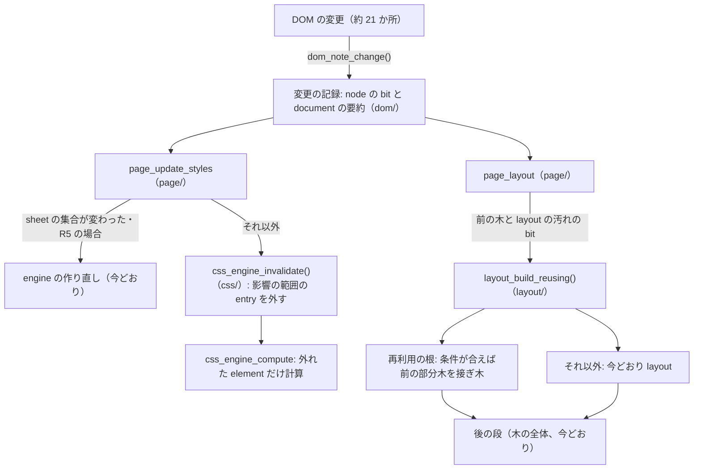

<!-- awesome-plan project=zedbsd record=ws346-design -->

# WS346 設計: libbrowser の style と layout の差分の再計算（layout cache）

版: 1（2026-11-03 Q1、p001）。範囲: 要求定義と外部設計（module の境界・interface・振る舞いの契約・試験・Phase の分割）。
内部設計（各関数の中の算法・データの細部）は各 Phase の実装の担当が、この文書の契約の中で決め、phase.md の結果の節に書く。

基点: main `8f181e0e1f`（2026-11-03）。対象の source: `userland/desktop/libbrowser/`（`dom/`・`css/`・`layout/`・`page/`・`bind/`）。

## 0. 読み方

- 実装の担当（Sonnet）は、この文書の §1〜§9 と自分の Phase の phase.md を読む。§10 以降は Q1 とユーザー向け。
- 「しなければならない」は契約。「してよい」は実装の担当の裁量。契約に足りない所は、止めて Q1 に報告する（自分で header の契約を広げない）。
- 新しいコードには [plan/coding-style.md](../coding-style.md) の全文を適用する。source の comment に WS・Phase の番号や plan/ への参照を書かない（AGENTS.md §10）。

## 1. 背景と目的

### 1.1 今の作り

1. DOM の変更（node の挿入・削除、text、属性、form の状態ほか約 21 か所）は `dom_document.generation` を 1 つ進めるだけで、**何が変わったかを記録しない**。
2. `page_update_styles`（`page/page.c`）は generation が進んでいれば `page_gather_styles` で **style の engine（`struct css_engine`）を作り直す**。
   engine が持つ element ごとの計算済みの style の cache（`css/cascade.c` の `style_table`）はそこで全部捨てられる。
3. `page_layout` は `layout_build`（`layout/box.c`）で **box の木を DOM の全体から作り直し、全部を layout する**。前の木（`page->previous_layout`）は
   container query の大きさのためだけに作り直しの間だけ残る。
4. script の幾何の問い（`offsetWidth`・`getBoundingClientRect` ほか）は `geometry_layout`（`page/geometry.c`）→ `page_needs_layout` が真なら `page_layout`。
   `getComputedStyle` は layout に依らない property なら `page_cascaded_style`（style だけ）、依る property なら layout。

### 1.2 測った事（2026-11-03、host、plain build `-O1`、amazon.co.jp の 1 回の読み込み）

| 計数（uprobe） | 回数 |
| --- | --- |
| `page_layout`（全体の layout） | 392 |
| `layout_build` | 522 |
| `css_engine_create`（engine の作り直し） | 508 |
| `css_engine_compute` / `cascade_compute` | 824,945 / 1,420,530 |
| `page_computed_style`（getComputedStyle） | 59,983 |
| `geometry_layout`（幾何の問い） | 64,012 |
| `view_update`（画面の描画） | 7 |

CPU（`perf record`、同じ頁）: style の cascade 約 22%（`cascade_simple_matches`・`cascade_selector_matches`・`cascade_compute`・`cascade_class_atoms` ほか）、
JS の VM 約 22%、GC と確保 約 10%、layout と text 約 11%、libc 約 16%（style の struct の copy と sort を含む）。

### 1.3 目的

DOM の変更の後に、**変わった所に関係する style と layout だけを計算し直す**。残りは前の結果を使う。
結果は、全部を作り直した時と**同じ**でなければならない（§3 R1）。

## 2. 用語

| 用語 | 意味 |
| --- | --- |
| 変更の記録 | DOM の変更ごとに、どの node に何が起きたかを node の bit と document の要約に残すこと（§5.1）。 |
| style の無効化 | engine の style の cache から、変更で結果が変わり得る element の entry を外すこと（§5.2）。 |
| 全体の作り直し | 今の動き。engine を作り直す（style の全体）・box の木を全部 layout する（layout の全体）。 |
| 再利用の根（root） | 前の layout の結果をそのまま使える候補の box。自分の formatting context を作り、外から影響を受けない box（§5.3.2）。 |
| 接ぎ木（graft） | 前の木の根の部分木を、新しい木の同じ element の box の下へ写すこと（§5.3.4）。 |
| 照合（verify） | 差分の結果と全体の作り直しの結果を両方作って比べる検査の mode（§5.5）。 |
| 後の段（post pass） | `layout_block` の後に木の全体へかける段: `layout_absolute`・`layout_position`・`layout_scroll_apply`・`box_apply_scale`・`layout_sticky_build`。 |

## 3. 要求

### 3.1 機能の要求

- **R1 同一性**: どの mode でも、layout の木の dump（`layout_dump`）・style の dump（`--dump=style` の出力）・描画の結果は、
  同じ DOM と同じ入力（viewport・scroll・font・image）に対する全体の作り直しと**同じ**でなければならない。違いが出る変更は不具合として扱う。
- **R2 切り替え**: 環境変数 `BROWSER_LAYOUT_CACHE` で mode を選べなければならない（§5.5）。`off` は今の動きと同じ（style も layout も全体の作り直し）。
- **R3 照合**: `verify` の mode は差分と全体の両方を作って比べ、違いを stderr に 1 行ずつ報告し、**全体の方の結果を使う**（頁の動きは `off` と同じ）。
- **R4 計数**: style の計算・cache の当たり・engine の作り直し・layout・再利用の当たりと外れの回数を数え、`BROWSER_LAYOUT_CACHE_STATS=1` の時に頁を閉じる時に stderr へ 1 行で出す（§5.5.3）。
- **R5 安全側**: 判断できない変更（分類の無い変更、:has() のある sheet、container query の再計算の段、web font の到着など）は、
  その範囲を全体の作り直しにしなければならない。速さより正しさを先にする。

### 3.2 非機能の要求

- **N1 速さ**: §8 の bench と amazon.co.jp で目標を満たす（p008 で判定）。
- **N2 memory**: 前の layout の木を 1 つだけ多く持ってよい（今も作り直しの間は 2 つある）。style の cache は document の element 数に比例してよい
  （[master-design-policy.md §10](../master-design-policy.md) の memory の前提）。削除された element の entry は残し続けない（§5.2.4）。
- **N3 thread**: layout は style の thread（`page_lend`）で動く。cache と変更の記録は、その page の thread と style の thread が同時に触らない
  （今の `page_lend` の排他の中でだけ読む・書く）。新しい lock を足さない。
- **N4 HAL・toolchain**: 変えない。公開の API（`userland/desktop/include/browser/browser.h`）を変えない。
- **N5 platform**: zedBSD・Linux・FreeBSD・Windows の shell で同じに動く（OS に依る code を足さない）。

### 3.3 範囲の外

- hover・focus・active の状態の変化による再 style（今も document の generation を進めない。今の扱いを変えない）。
- 描画（display list）の差分の再作成。`page_layout` の後の paint は今どおり全体。
- 画面の部分の再描画、compositor との連携。
- container query の再計算の段（`page_layout_work` の `PAGE_CONTAINER_PASSES`）の差分化。その段に入った build は再利用しない（今どおり）。
- JS の engine の速さ（inline cache・JIT）。別の WS にする。

## 4. 全体の構成



依存は一方向: `dom` ← `css` ← `layout` ← `page` ← `bind`。`dom` は `css`・`layout` を知らない。`layout` は `page` を知らない。

## 5. 外部設計

### 5.1 DOM の変更の記録（`dom/`）

#### 5.1.1 置き場所

- 新しい file `dom/change.c`。宣言は `dom/dom.h` に足す（新しい header は作らない）。
- node ごとの bit は `struct dom_node` の今使われていない `uint32_t reserved` を **`uint32_t change`** に改名して使う
  （大きさを変えない。`reserved` を使う code が無いことは 2026-11-03 に `grep` で確かめた）。
- document の要約は `struct dom_document` に足す（§5.1.4）。

#### 5.1.2 変更の種類

```c
enum dom_change_kind {
	DOM_CHANGE_CHILDREN,	/* node（親）の子の列が変わった。child は入った・出た子（NULL 可） */
	DOM_CHANGE_TEXT,	/* node（Text・CDATA・Comment）の文字が変わった */
	DOM_CHANGE_ATTRIBUTE,	/* node（element）の属性 name が変わった（加わる・変わる・消える） */
	DOM_CHANGE_STATE,	/* node（element）の form の状態・popover の開閉など、属性でない状態が変わった */
	DOM_CHANGE_SCROLL,	/* node（element）の scroll の位置が変わった */
	DOM_CHANGE_RESOURCE,	/* node（element）が見せる image などの資源が届いた・変わった */
	DOM_CHANGE_SHADOW,	/* node（host）に shadow root が付いた */
	DOM_CHANGE_DOCUMENT	/* document の全体に効く変更（adopted sheet、CSSOM の規則の変更、:target の移動など） */
};
```

#### 5.1.3 関数

```c
/*
 * Records a change of a document's tree: the node's bits and the document's
 * summary, then the document's generation grows as it does today.
 * child is the node inserted or removed for DOM_CHANGE_CHILDREN (NULL
 * otherwise); attribute is the attribute's local name for
 * DOM_CHANGE_ATTRIBUTE (NULL otherwise).  A node not in a document's tree
 * only grows the generation.
 */
void dom_note_change(struct dom_node *node, enum dom_change_kind kind, struct dom_node *child,
    const struct vm_string *attribute);

/* Whether the change needs a new style engine (the set of style sheets may have changed). */
int dom_change_needs_sheets(const struct dom_document *document);

/* Visits the nodes whose style bits are set, in tree order, and clears the style bits. */
int dom_changes_take_style(struct dom_document *document, dom_change_visit visit, void *context);

/* Clears the layout bits of the document's nodes (after a layout that read them). */
void dom_changes_clear_layout(struct dom_document *document);
```

- 名前は案。実装の担当は `dom_` の接頭辞と上の意味を保つ範囲で変えてよい（変えたら phase.md に書く）。
- `dom_change_visit` は `int (*)(void *context, struct dom_node *node, unsigned bits)`。0 以外を返すと走査をやめ、その値を返す。

#### 5.1.4 bit と要約（契約）

node の `change` の bit（`dom/dom.h` に `#define`）:

| bit | 意味 | 立てる時 |
| --- | --- | --- |
| `DOM_CHANGED_STYLE` | この element の style を計算し直す | 下の表 |
| `DOM_CHANGED_STYLE_SUBTREE` | この element と子孫の全部の style を計算し直す | 下の表 |
| `DOM_CHANGED_STYLE_SIBLINGS` | この element の後の兄弟（とその子孫）の style を計算し直す | 下の表 |
| `DOM_CHANGED_STYLE_BELOW` | 子孫のどれかに style の bit がある（走査の道しるべ） | style の bit を立てた node の全祖先 |
| `DOM_CHANGED_LAYOUT` | この node の box を layout し直す | 全ての種類（STYLE を含む） |
| `DOM_CHANGED_LAYOUT_BELOW` | 子孫のどれかに layout の bit がある | layout の bit を立てた node の全祖先 |

document の要約（`struct dom_document` に足す field）:

- `uint32_t change_sheets`: 0 以外なら sheet の集合が変わったかもしれない（engine を作り直す）。
- `uint32_t change_full_style`: 0 以外なら style を全体で作り直す（R5）。
- `uint32_t change_full_layout`: 0 以外なら layout を全体で作り直す（再利用しない）。
- `uint32_t change_count`: 前に取り出してからの変更の数（計数と上限のため）。上限（実装の担当が決める、例 10,000）を超えたら
  `change_full_style` と `change_full_layout` を立て、それ以上 bit を立てなくてよい。

種類ごとの bit（**最低限これを立てる**。多く立てるのは常に正しい）:

| 種類 | 立てる bit |
| --- | --- |
| CHILDREN（挿入） | **親に `STYLE_SUBTREE`**（:empty・:nth-child・:first-child・:last-child・兄弟の結合子のため、親と子の全部）。入った子の部分木に `STYLE_SUBTREE`。親と入った子に `LAYOUT`。 |
| CHILDREN（削除） | 親に `STYLE_SUBTREE` と `LAYOUT`。出た子の部分木の bit は消す（もう document に無い）。 |
| TEXT | 親の element に `STYLE`（:empty）と `LAYOUT`。 |
| ATTRIBUTE | element に `STYLE_SUBTREE`・`STYLE_SIBLINGS`・`LAYOUT`。どれを本当に計算し直すかは css が §5.2.2 で絞る。`style` 属性も同じ。 |
| STATE | element に `STYLE_SUBTREE`・`STYLE_SIBLINGS`・`LAYOUT`。 |
| SCROLL | element に `LAYOUT` だけ（style は変わらない）。 |
| RESOURCE | element に `LAYOUT` だけ。 |
| SHADOW | host に `STYLE_SUBTREE`・`LAYOUT`。 |
| DOCUMENT | `change_full_style`・`change_full_layout`。 |

sheet の集合の変化（`change_sheets` を立てる）: 次のどれか。

- 挿入・削除された部分木に `style` か `link` の element がある（HTML の名前空間。SVG の `style` も含める）。
- `style` の element の中の text の変更、`style`・`link` の element の属性の変更（`media`・`disabled`・`rel`・`href`・`type`・`title`・`nonce` ほか全部）。
- DOCUMENT の種類のうち adopted sheet と CSSOM の規則の変更（`bind/style-sheet.c` の `bind_style_sheet_changed`）。

#### 5.1.5 呼ぶ所（今 generation を進めている所を置き換える）

| 今の場所 | 種類 |
| --- | --- |
| `dom/node.c` `dom_insert_before` | CHILDREN（child = 入った node） |
| `dom/node.c` `dom_remove` | CHILDREN（child = 出た node。削除の**前**の木で親を決める） |
| `dom/node.c` `dom_text_append`・`dom_text_set`・`dom_text_truncate`・`dom_text_replace` | TEXT |
| `dom/node.c` `dom_shadow_attach` | SHADOW |
| `dom/node.c` `node_attribute_changed` | ATTRIBUTE（quiet の場合 = data-* で sheet が名指さない物は、今どおり `quiet_generation` も進め、**bit を立てない**） |
| `dom/shadow.c` `dom_adopted_set` | DOCUMENT（sheet） |
| `dom/select.c` `dom_option_set_selected`・`dom/control.c` `dom_input_set_value`・`dom/radio.c` `dom_input_set_checked`・`bind/html-input.c` `input_indeterminate_set`・`bind/select.c` `select_index_set`・`bind/prelude.c` `prelude_set_popover` | STATE |
| `bind/environment.c` `bind_scroll_to_fragment` | DOCUMENT（:target） |
| `bind/style-sheet.c` `bind_style_sheet_changed` | DOCUMENT（sheet） |
| `bind/geometry.c` `geometry_element_scroll` | SCROLL |
| `page/images.c`（image が届いて `images_generation` を進める所）・`page/media.c` の同じ所 | RESOURCE（element が分かる時）。分からない時（背景の image の URL）は `change_full_layout` |

- generation の値の進み方は今と同じでなければならない（`page_needs_layout` ほか generation を見る code を変えないため）。
- 上の表に無い場所で generation を進める code を見つけたら、DOCUMENT として扱い、phase.md に書く。

### 5.2 style の無効化（`css/`・`page/`）

#### 5.2.1 selector の特徴の表（`css/`）

engine は sheet を加える時（`css_engine_add_*`）に、全 selector から次を集めて持たなければならない。

- 名指された属性の名前（今の `css_engine_names_attribute` の表）、class の名前、id の名前。
- 兄弟の結合子（`+`・`~`）を使う selector があるか。そのうち、属性・class・id・状態の擬似 class を含む compound が結合子の左にある物があるか。
- 構造の擬似 class（`:nth-*`・`:first-*`・`:last-*`・`:only-*`・`:empty`）があるか。
- `:has()` があるか。
- 状態の擬似 class（`:checked`・`:disabled`・`:enabled`・`:indeterminate`・`:placeholder-shown`・`:valid`・`:invalid`・`:popover-open`・`:default`・`:required`・`:optional`・`:read-only`・`:read-write`・`:target` ほか engine が知る物）のどれがあるか。
- `attr()` を使う宣言があるか、`:dir()`・`:lang()` があるか（属性の継承に依る）。

#### 5.2.2 変更の影響の範囲（`css/`）

```c
/* What a change can restyle (the bits of css_change_scope's result). */
#define CSS_RESTYLE_NONE	0x0U
#define CSS_RESTYLE_SUBTREE	0x1U	/* the element and its descendants */
#define CSS_RESTYLE_SIBLINGS	0x2U	/* the element's following siblings and their descendants */
#define CSS_RESTYLE_ALL		0x4U	/* every element of the document */

/* Tells what an attribute's or a state's change of an element can restyle under the engine's sheets. */
unsigned css_engine_change_scope(const struct css_engine *engine, const struct dom_element *element,
    int kind, const struct vm_string *attribute);
```

契約（安全側。**疑わしい時は広い方**）:

- engine の sheet に `:has()` が 1 つでもあれば、ATTRIBUTE・STATE・CHILDREN・TEXT の全てに `CSS_RESTYLE_ALL`。
- ATTRIBUTE: 属性が `class`・`id`・`style` でなく、どの selector も名指さず、`attr()`・`:dir()`・`:lang()`（`dir`・`lang` 属性の時）にも当たらない → `CSS_RESTYLE_NONE`。
  それ以外は `CSS_RESTYLE_SUBTREE`。加えて、兄弟の結合子の左に同じ特徴（その属性・class・id）が出る selector があれば `CSS_RESTYLE_SIBLINGS`。
  - `class` の変更は、変わる前と後の class の語の対称差のどれかを selector が名指す時だけ広げてよい（語を比べられない実装は名指しの有無で判断してよい）。
  - `style` 属性は常に `CSS_RESTYLE_SUBTREE`（継承のため）。
- STATE: engine が状態の擬似 class を 1 つも持たなければ `CSS_RESTYLE_NONE`。持てば `CSS_RESTYLE_SUBTREE`、兄弟の結合子の左に状態の擬似 class があれば `| CSS_RESTYLE_SIBLINGS`。
- CHILDREN・TEXT は css に問わず、§5.1.4 の bit のまま（親の `STYLE_SUBTREE`）。構造の擬似 class も兄弟の結合子も無い時は、親の `STYLE`（:empty のため）と入った子の部分木だけにしてよい。

#### 5.2.3 engine の無効化（`css/`）

```c
/* Forgets the kept styles of an element (with CSS_RESTYLE_SUBTREE, of its descendants too; with CSS_RESTYLE_SIBLINGS, of its following siblings' subtrees; with CSS_RESTYLE_ALL, every kept style). */
void css_engine_invalidate(struct css_engine *engine, struct dom_element *element, unsigned scope);
```

- 外した entry の element は、次の `css_engine_compute` で計算し直される。外していない entry は今どおり返される。
- `css_engine_compute` の契約は今と同じ（「engine が前に計算した style を返す」）。**変えるのは engine の寿命だけ**: DOM が変わっても
  sheet の集合が同じなら engine を保ち、`css_engine_invalidate` で外す。
- pseudo-element の style（`css_engine_compute_pseudo`）が cache を持つなら、その element の無効化で一緒に外す。

#### 5.2.4 page の統合（`page/page.c`）

`page_update_styles` の新しい振る舞い（mode が `on` の時。`off` は今どおり）:

1. 今の「最新なら何もしない」の判定は同じ。
2. `dom_change_needs_sheets` が真、`change_full_style` が立つ、visited の generation・sheet の到着（`sheets_generation`）が変わった、engine が無い → 今どおり `page_gather_styles`（作り直し）、そして変更の記録の style の bit を全部消す。
3. それ以外 → `dom_changes_take_style` で bit のある node を tree の順に回り、bit と `css_engine_change_scope` から scope を決めて `css_engine_invalidate` を呼ぶ。
   最後に `page->styled_generation` などを今の作り直しの後と同じ値にする。
4. 削除された部分木の element の entry は、削除の記録の時に page の hook で `css_engine_invalidate(…, CSS_RESTYLE_SUBTREE)` を呼んで外す
   （address が新しい element に使い回されても古い style を返さないため。入った部分木は常に計算し直すので二重に守られる）。

### 5.3 layout の再利用（`layout/`・`page/`）

#### 5.3.1 入口

```c
/*
 * Lays a document out as layout_build does, reusing the boxes of previous
 * (the page's last complete tree, built for the same document; NULL: none)
 * whose elements did not change since it was built (their DOM_CHANGED_LAYOUT
 * and DOM_CHANGED_LAYOUT_BELOW bits are clear, and their styles are the same).
 * The result is the tree layout_build would build.
 */
int layout_build_reusing(struct layout_tree *tree, const struct layout_tree *previous,
    struct css_engine *css, struct text_system *text, struct dom_document *document,
    layout_image_lookup image_lookup, layout_url_lookup url_lookup, void *image_context,
    int width, int height, layout_unit scroll_x, layout_unit scroll_y,
    const struct layout_transition *transition);
```

- `layout_build` は残し、`layout_build_reusing(tree, NULL, …)` と同じ意味にする（他の呼び出し元 = frame・transition・scratch の木 = を変えない）。
- `previous` の木は読むだけ（const）。`previous` の arena の中を指す pointer を新しい木に残してはならない（前の木は直後に解放される）。

#### 5.3.2 再利用の根の条件（契約）

element の box R が「再利用の根」であるのは、次の**全部**を満たす時だけ:

1. R は block レベルの box か atomic な inline（inline-block・inline-flex・inline-grid・replaced でない物）で、**自分の block formatting context を作る**
   （display が flow-root・inline-block・flex・grid・table の外側、overflow が visible 以外、contain が layout・size・paint・strict・content、float、
   absolute・fixed、flex・grid の item のどれか）。外の float は中に入らず、margin は境を越えて相殺しない。
2. R の部分木の out-of-flow の box（absolute・fixed）は、全部 R の中に containing block を持つ（`layout_contains_absolute`・`layout_contains_fixed` の意味）。
3. R の部分木に、次の機能を使う box が無い: anchor positioning（`anchor()`・`position-anchor`・`position-area`・`position-try`）、container query に依る style
   （`css_engine_computed_contained`）、multicol の中（fragmentation）、view transition の木、sticky、subgrid、`counter()`（この engine が持つなら）、
   vertical の writing-mode の領域の根（`layout_logical`）、`::first-line`・`::first-letter` を持つ block の中の最初の行に関わる物。
   （どれも外の状態に依る。範囲の外として安全側に外す。p008 の後で個別に足してよい。）
4. R の element と部分木の全 node に `DOM_CHANGED_LAYOUT`・`DOM_CHANGED_LAYOUT_BELOW` が無い。document の `change_full_layout` が 0。
5. 前の木に同じ element の box が 1 つだけあり（continuation・fragment が無い）、その box も上の 1〜3 を満たしていた。
6. R の新しい style と前の box の style が**同じ**（`css_style` の field ごとの比較。pointer の field は pointer が同じ時だけ同じとみなしてよい = 安全側）。
7. 前の build と今の build で、font の generation・image の generation（R の部分木に関わる物）・viewport の大きさ・base zoom・color scheme・
   `tree->measuring` の状態・`logical_mode` が同じ。
8. 前の box が、R の layout を**今と同じ入力**で終えていた: containing width、containing height とその definite、R に flex・grid の親が与えた
   大きさ（`height_indefinite`・grid area の大きさ・stretch の大きさ）、R が measuring の中で測られたか。入力の組は実装の担当が `layout_block` の
   入口で集める（下の 5.3.3）。

#### 5.3.3 前の木に残す物

- 再利用の根の候補の box は、自分の layout が終わった時点の**入力の組**（5.3.2 の 8）を box に記録しなければならない。
- 前の木から「R の layout が終わった時点の幾何」（R の内側の全 box の、親の content box に対する相対の x・y、lines と fragments、out-of-flow の
  static position）を**取り出せ**なければならない。後の段（`layout_absolute` ほか）が x・y を絶対の値に書き換えるので、書き換える前の相対の値を
  別の field に残す（例: `layout_absolute` が加える前に `rel_x`・`rel_y` に写す）。方法は実装の担当が決める。
- 後の段が書く field（`placed_pass`・`try_base`・`used_inset*`・`sticky_dx/dy`・`static_scrolled`・`anchor*`・`area_*`・scroll の移動・scale）の一覧を
  実装の担当が `layout.h` の `struct layout_box` の comment に書き、接ぎ木の時にその field を新しい build の初期値に戻す。

#### 5.3.4 接ぎ木（graft）

- 新しい build が R の `layout_block`（または R を lay out する入口）に来て、5.3.2 を満たし、入力の組が前の box の物と同じ時:
  1. 新しく作った R の子の box を捨て（arena の中なので解放は不要）、前の木の R の部分木を**深く写す**（box・lines・fragments・decorations・
     grid の配列・`first_line_style`・`physical_style`・`try_base` ほか、arena の中を指す全 pointer を新しい arena に写し直す。`node` は同じ DOM の node を指す）。
  2. R 自身の大きさ（width・height・margin・border・padding・collapsed の margin・baseline・`max_content`・`min_content` とその条件）を前の box から取る。
  3. 写した部分木の x・y を 5.3.3 の相対の値に戻し、後の段の field を初期値に戻す。
  4. R の `layout_block` の残りを飛ばして戻る。
- 後の段は今どおり木の全体に一度かける（写した部分木も含めて）。
- 写す量は R の部分木の大きさに比例する。入れ子の根は外側の根で一度に写れば内側を別に写さない（外側が当たれば内側は見ない）。

#### 5.3.5 intrinsic の大きさの持ち越し

- 5.3.2 の 1〜7 を満たす box は、前の box の `max_content`・`min_content`（とその条件の field）を新しい box に写してよい（`*_known` を含めて）。
  これは 5.3.4 が外れた時（入力の組が違う時）にも効く。

#### 5.3.6 page の統合（`page/page.c`）

- `page_layout_work` は mode が `on`・`verify` の時、`page->previous_layout`（今もある）を `layout_build_reusing` に渡す。
  container query の段に入った 2 回目以降の build は `previous` に NULL を渡す。
- layout が成功したら `dom_changes_clear_layout`。失敗したら bit を残す（次の layout が全体を見直す）。
- 前の木を解放する時機は今どおり（新しい木が出来た後）。

### 5.4 変更の無い所（契約）

- `page_needs_layout`・generation の意味・`browser.h`・`bind/` の公開の振る舞い・`layout_build` の意味は変えない。
- `off` の mode では、どの path も今と同じ関数を同じ順に呼ばなければならない（追加の bit の記録は許す）。

### 5.5 mode・照合・計数

#### 5.5.1 mode

`BROWSER_LAYOUT_CACHE` を process の初めに 1 回読む（`page/` の 1 か所、例 `page_cache_mode()`）。

| 値 | 振る舞い |
| --- | --- |
| `off` | 今どおり（全体の作り直し）。 |
| `on` | §5.2・§5.3 の差分の計算。 |
| `verify` | `on` の計算をした後、同じ入力で全体の作り直しも行い、比べて違いを報告し、全体の方を使う。 |
| 無い・他の値 | 既定（p008 の終わりまでは `off`。p008 でユーザーが決める、§12）。 |

#### 5.5.2 照合（verify）

- style: `css_engine_compute` が cache の entry を返す度に、同じ element の style を cache を使わずに計算し（engine の内部の関数）、field ごとに比べる。
  違えば `layout-cache: style mismatch <tag>#<id>.<class> field=<名前>` を stderr に出し、計算した方を返す。
- layout: `layout_build_reusing` の後に scratch の木へ `layout_build`（全体）を作り、両方の `layout_dump` を比べる。違えば
  `layout-cache: layout mismatch line=<最初に違う行の番号>` と両方のその行を stderr に出し、全体の木を page の木にする（差分の木は解放）。
- 照合の違いの数は計数（5.5.3）に入れる。照合の mode は遅くてよい。

#### 5.5.3 計数

page ごとに次を数え、`BROWSER_LAYOUT_CACHE_STATS=1` の時、page を解放する時に 1 行で stderr へ出す:

```
layout-cache: mode=on engines=<engine を作った数> styles=<計算> style_hits=<cache の当たり> invalidated=<外した entry>
  layouts=<layout_build> roots=<根の候補> grafts=<接ぎ木> graft_boxes=<写した box> intrinsic=<持ち越し> mismatches=<照合の違い>
```

（実際の出力は 1 行。field の名前と順はこの通り。試験がこれを読む。）

## 6. 正しさの検査

### 6.1 単体の試験（host、各 Phase）

- 変更の記録: 種類ごとに bit と要約が §5.1.4 の通りか（`plan/ws346/tests/host-change.c`）。
- selector の特徴と範囲: 規則の組と変更の組の表で `css_engine_change_scope` の値（`plan/ws346/tests/host-restyle-scope.c`）。期待の値は手で決める。
- 無効化: 小さな頁で、変更 → `getComputedStyle` の値が `off` と同じか（JS の頁、`plan/ws346/tests/pages/`）。
- 再利用: 根の条件の各項目について、当たる頁・外れる頁（計数の `grafts` で確かめる）と、`verify` で違いが 0 か。

### 6.2 照合の全体の試験（p005・p007・p008）

`BROWSER_LAYOUT_CACHE=verify` で次を流し、`mismatches=0` と、`off` の時と同じ PASS の数であること:

- `run-wpt-reftests.py`（既定の 100 件）、`run-interop2025-scripted-reftests.py`、`run-dom-tests.py`、`run-js-tests.py`、`run-acid-tests.py`（Acid2・Acid3）。
- `plan/ws334/tests/stage1.sh`（段 1 の回帰）。
- live の頁（Q1 が流す。取得は最小の回数）: amazon.co.jp、yahoo.co.jp、google.com、store.google.com。

### 6.3 わざと壊す

実装の担当は試験が通った後、git の外で実装を数通り壊し（例: 兄弟の範囲を外す、bit の伝播を止める、入力の組の 1 項目を比べない）、
`verify` と単体の試験が FAIL することを確かめて戻す。

## 7. 失敗の扱い

- 確保の失敗: 記録・cache・接ぎ木のどこで失敗しても、その操作を全体の作り直しに倒して続ける（`change_full_*` を立てる、cache を捨てる）。頁を壊さない。
- 照合の違い: 頁は全体の結果で動く。stderr の報告だけ。

## 8. 速さの目標と測り方（p003 で道具、p008 で判定）

- bench `plan/ws346/tests/bench/restyle.html`（第三者の内容を使わない、`--run`、3 回の中央値、`plan/ws074/tests/bench/bug411.sh` の形）:
  1. 2,000 個の element の頁で、1 つの element の class を変えて `offsetWidth` を読む × 200 回。
  2. 同じで、`style.width` を変える × 200 回（layout は根の外へ広がらない形）。
  3. list の末尾に `li` を足して `getBoundingClientRect` × 200 回。
  4. `getComputedStyle(…).color` を DOM の変更の後に読む × 1,000 回。
- 目標（host、plain build、`off` に対して）: 1・2・4 は 10 倍以上速い、3 は 3 倍以上。照合の違い 0。
- amazon.co.jp（Q1、live、1 回）: `engines` が 50 以下（sheet が変わる回数）、`styles` が `off` の 1/5 以下、読み込みの全体の時間が `off` の 1/2 以下。

## 9. Phase の分割

各 Phase は Sonnet（phase-runner-low）の 1 回の起動で済む大きさ。worktree は Q1 が main から作る（`/home/awe/zedBSD-worktrees/s-ws346-pNNN`）。

| Phase | 中身 | 主な file | 受け入れの要点 |
| --- | --- | --- | --- |
| p002 | 変更の記録（§5.1）・mode と計数の土台（§5.5.1・§5.5.3）。振る舞いは変えない | `dom/change.c`・`dom/dom.h`・§5.1.5 の呼ぶ所・`page/`（mode と計数） | host-change、`off` で既存の試験が全部同じ |
| p003 | 照合の道具（§5.5.2 の layout の照合の骨組み、style の照合は p005）と bench（§8） | `page/page.c`・`plan/ws346/tests/bench/` | `verify` で（差分がまだ無いので）違い 0、bench が動く |
| p004 | selector の特徴の表と `css_engine_change_scope`・`css_engine_invalidate`（§5.2.1〜5.2.3） | `css/cascade.c`・`css/css.h` | host-restyle-scope、既存の css の試験 |
| p005 | style の無効化の統合（§5.2.4）、style の照合 | `page/page.c`・`page/geometry.c` | §6.2 を `verify` で違い 0、bench 4 が 10 倍 |
| p006 | 幾何の保存（§5.3.3）・根の候補の判定と計数（`roots`）・intrinsic の持ち越し（§5.3.5） | `layout/box.c`・`layout/block.c`・`layout/layout.h` | §6.2 を `verify` で違い 0（持ち越しの照合）、`roots` の計数 |
| p007 | 接ぎ木（§5.3.4）・`layout_build_reusing`・page の統合（§5.3.6） | `layout/`・`page/page.c` | §6.2 を `verify` で違い 0、bench 1〜3 の目標 |
| p008 | 統合の試験・live の頁・速さの判定・既定の mode の案 | 試験と記録 | §8 の目標、ユーザーの判断（§12） |
| p009 | 規約の全文の見直し（AGENTS §2） | 変えた全 file | coding-style の checklist |

p004 は p003 と並べて起動してよい（触る file が重ならない）。

## 10. 危険と対策

| 危険 | 対策 |
| --- | --- |
| 無効化の漏れ（古い style が残る） | 安全側の契約（§5.2.2）、`verify` の style の照合、わざと壊す試験 |
| 接ぎ木の field の写し漏れ・古い pointer | 前の木の arena を指す pointer の禁止（§5.3.1）、ASan の build で §6.2、`verify` の layout の照合 |
| 計算済みの style が GC で回収された string を指す | engine が保たれる時間が長くなる。p005 で style の中の string の寿命（atom か sheet が持つか）を調べ、回収され得る物は計算し直しの対象にするか根を張る。ASan と GC を強いる試験で確かめる |
| 外の状態に依る layout（anchor・counter・container・sticky ほか）の見落とし | 根の条件で安全側に外す（§5.3.2 の 3）。見つけたら条件に足す |
| `verify` が遅すぎて試験が時間切れ | 試験の時間の上限を mode ごとに延ばす。live の頁は Q1 が 1 回 |

## 11. 関係する記録

- [BUG-411](../bugs/BUG-411.md)（JS の engine と layout の遅さ。layout の結果の cache は Q1 が別の項目にする、としていた物がこの WS）。
- [WS074](../ws074/ws.md) p263（amazon.co.jp の UAT。描画まで時間がかかる問題の元）。
- [WS345](../ws345/ws.md)（ブラウザの thread の分け方。layout は style の thread、§3.2 N3）。

## 12. ユーザーの決定（2026-11-03 06:40）

1. **既定の mode**: p008 で目標を満たし照合の違いが 0 なら、既定を `on` にしてよい（`off` は環境変数で残す）。それまでの既定は `off`。
2. **live の頁での照合**: amazon・yahoo・google・store.google を照合の mode で全部で約 20 回読んでよい（p005・p007・p008 で、各 1〜2 回）。
3. **範囲の外の機能**（§5.3.2 の 3: anchor・container query・sticky ほか）の再利用は、この WS では行わず毎回計算する。再利用は別の WS にする。

## 13. 実装の進め方の決定（2026-11-03 06:39）

2026-11-03 ユーザーから、モデルを Sonnet 5.5 にしたので、定義した Phase をこのメインのエージェントで実装し、サブエージェントは使わない、という趣旨の指示を受けた。
p002 から順に Q1（main の checkout）で実装する。worktree は作らない。
